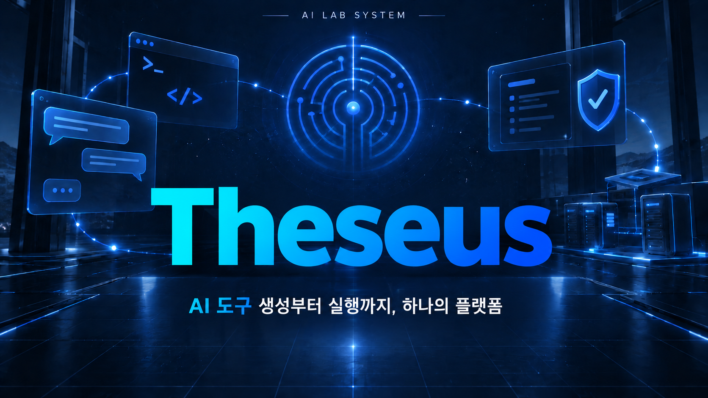
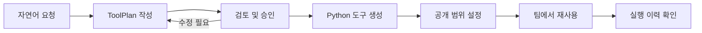
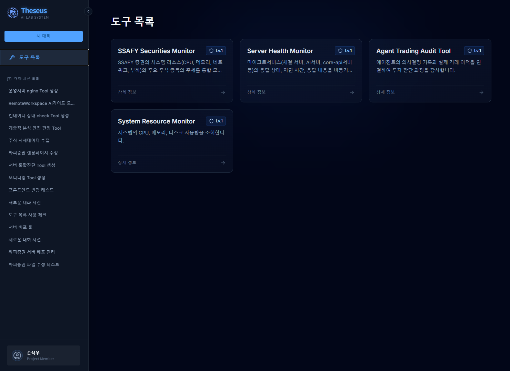
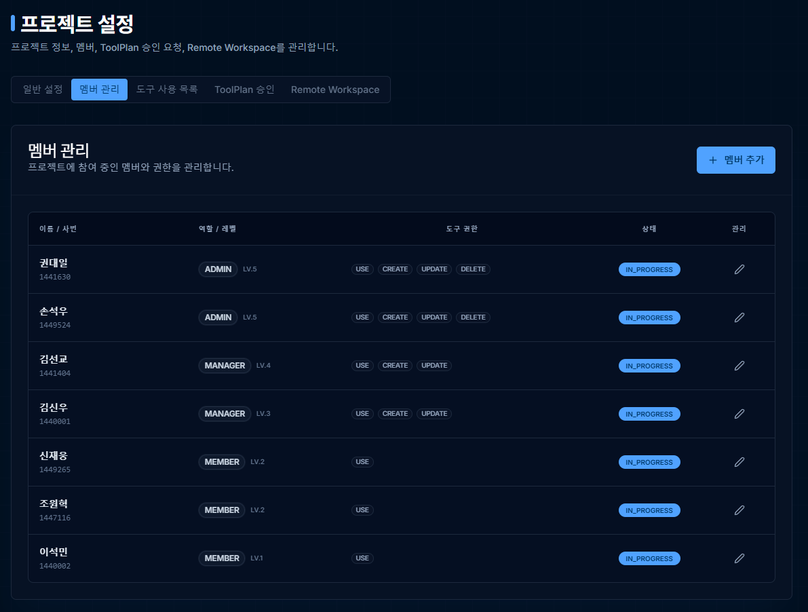
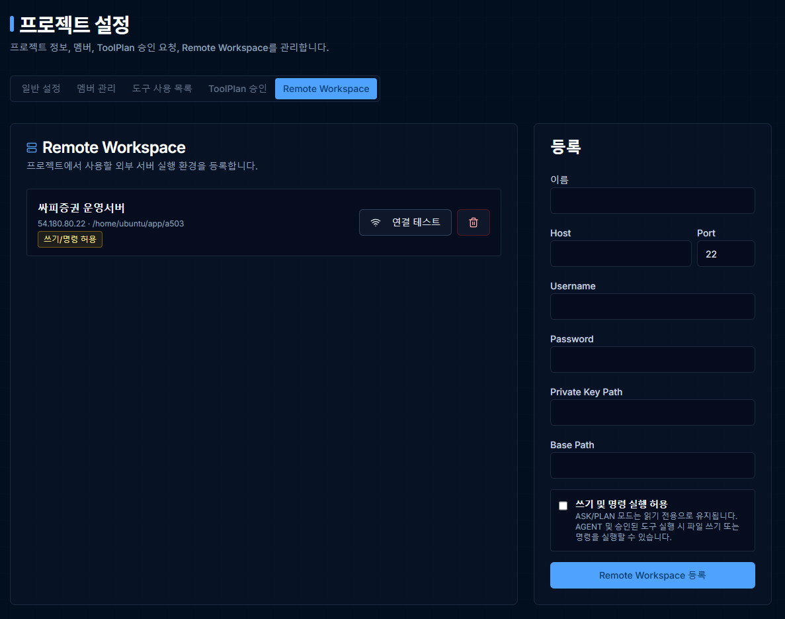
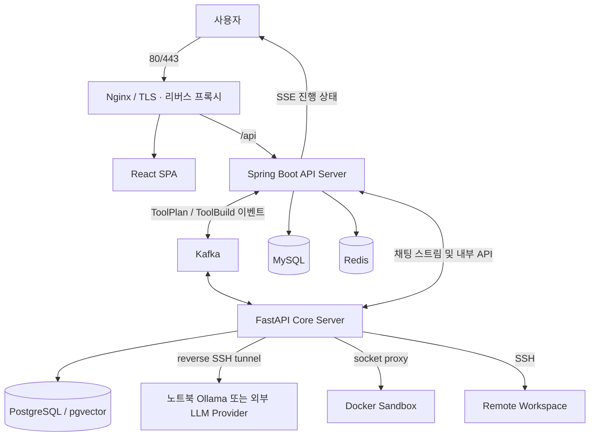

<a id="top"></a>

# 🔵 Theseus (테세우스)

<p align="center">
  
</p>

<h3 align="center">AI 도구 생성부터 실행까지, 하나의 플랫폼</h3>

<p align="center">
  자연어로 업무 도구를 만들고, 승인과 권한 관리 아래 팀이 함께 재사용하는 AI 에이전트 플랫폼<br />
  <strong>사람이 바뀌어도, 일하는 방식은 이어집니다.</strong>
</p>

<p align="center">
  <a href="#features">주요 기능</a> ·
  <a href="#getting-started">시작하기</a> ·
  <a href="./docs/operations/self-hosting.md">셀프호스팅 가이드</a> ·
  <a href="./docs/vscode-extension.md">VS Code 익스텐션</a> ·
  <a href="#contributing">기여하기</a>
</p>

---

## 📋 목차

- [프로젝트 개요](#overview)
- [서비스 사용 흐름](#workflow)
- [주요 기능](#features)
- [시스템 아키텍처](#architecture): [팀 프로젝트 당시](#team-setup) · [개인 서버](#self-hosted-setup)
- [기술 스택](#tech-stack)
- [핵심 기술 상세](#technical-details)
- [시작하기](#getting-started): [로컬 개발](#local-dev) · [배포](#deploy) · [VS Code 익스텐션](#vscode-porting)
- [ERD 및 산출물](#documents)
- [저장소 구조](#repository-structure)
- [변경 이력 / 리팩토링](#changelog)
- [고도화 결과](#roadmap-results)
- [팀](#team)
- [프로젝트 성과](#achievements)
- [추가 정보](#additional-info)
- [기여](#contributing)
- [라이선스](#license)

---

<a id="overview"></a>

## 🎯 프로젝트 개요

**Theseus**는 개인이 AI와 대화하며 정리한 업무 노하우를 **팀이 다시 사용할 수 있는 도구**로 만드는 플랫폼입니다. 자연어 요청을 **ToolPlan**으로 구체화하고, 관리자의 승인을 거쳐 Python 도구를 생성합니다. 프로젝트 구성원은 권한에 맞게 도구를 사용하고, 관리자는 실행 이력과 결과를 확인합니다.

### 프로젝트 배경

AI로 업무를 처리해도, 그 과정이 개인의 대화창에만 남으면 팀이 같은 방법을 다시 활용하기 어렵습니다.

| 업무 현장의 문제 | Theseus의 접근 |
| --- | --- |
| 좋은 프롬프트와 업무 노하우가 개인에게만 남음 | 작업 방법을 실행 가능한 도구로 저장하고 프로젝트에서 공유 |
| 담당자가 바뀌면 같은 업무를 처음부터 파악해야 함 | 기존 도구와 사용 이력을 참고해 업무를 이어갈 수 있도록 지원 |
| 같은 요청을 매번 새롭게 설명해야 함 | 등록한 도구를 반복 호출해 작업 절차를 재사용 |
| AI의 내부 시스템 접근과 실행을 관리하기 어려움 | 계획 승인, 도구 권한, 원격 실행 설정, 사용 이력으로 실행 범위 관리 |

> **AI 활용을 개인의 역량에서 조직의 자산으로.**
> 프롬프트는 사람마다 달라질 수 있지만, 검증된 Tool은 일관된 업무 결과를 만듭니다.

### 서비스 목표

| 목표 | 내용 |
| --- | --- |
| **노하우의 자산화** | AI를 잘 쓰는 개인의 프롬프트와 업무 방식이 사라지지 않도록 반복 업무를 Tool로 저장하고, 조직 구성원이 함께 재사용합니다. |
| **결과의 일관성** | 사람마다 다른 프롬프트 대신 검증된 Tool로 반복 업무를 수행해 결과 편차를 줄입니다. |
| **승인과 권한 기반의 안전한 실행** | AI가 서버·코드·문서·내부 시스템에 접근하는 환경에서 ToolPlan 승인, 프로젝트 멤버 권한, 실행 이력으로 조직 차원의 안전장치를 둡니다. |
| **업무 연속성** | 신입이나 새 담당자도 승인된 Tool로 같은 기준의 업무를 수행해 인수인계 비용을 줄입니다. |

### 프로젝트 정보

| 항목 | 내용 |
| --- | --- |
| 서비스명 | Theseus |
| 서비스 분야 | 팀 단위 AI 도구 생성 및 업무 자동화 |
| 주요 플랫폼 | Web Application · VS Code Extension |
| 개발 기간 | 2026.03.30 ~ 2026.06.01 |
| 개발 인원 | 5명 |
| 기관 | 삼성 청년 SW·AI 아카데미 14기 |
| 핵심 키워드 | ToolPlan, AI Tool, 승인 기반 실행, 권한 관리, Tool RAG, Docker Sandbox, Kafka, Remote Workspace |

---

<a id="workflow"></a>

## 🧭 서비스 사용 흐름

**ToolPlan은 도구를 만들기 전에 검토하는 작업 계획이고, Tool은 생성이 완료된 실행 가능한 도구입니다.** 계획 승인과 도구 공개를 구분해 관리합니다.



운영 서버의 CPU·메모리·디스크 상태를 확인하는 작업을 예로 들면 다음과 같습니다.

1. **요청**: AI 채팅에서 확인할 서버와 리소스를 설명합니다.
2. **계획**: AI가 작업 내용과 입력·출력을 ToolPlan으로 정리합니다.
3. **승인**: 관리자가 계획을 검토하고 도구 생성을 승인합니다.
4. **등록**: 생성한 도구의 코드와 접근 범위를 확인합니다.
5. **재사용**: 구성원이 허용된 도구를 실행하고 결과를 확인합니다.

---

<a id="features"></a>

## ✨ 주요 기능

### 한눈에 보기

| 기능 | 설명 |
| --- | --- |
| 로그인 / 인증 | JWT 기반 사용자 인증, refresh 토큰 회전, API 접근 제어 |
| 프로젝트·멤버 관리 | 팀 단위 프로젝트, 멤버 역할·접근 레벨·작업별 도구 권한 |
| 채팅 세션 | 프로젝트별 AI 요청과 대화 이력, ASK / PLAN / AGENT 모드 |
| AI 스트리밍 응답 | AI 응답과 ToolPlan 생성 과정을 SSE로 실시간 표시 |
| ToolPlan 생성·승인 | 자연어 요청을 실행 가능한 계획으로 구조화하고, 관리자가 승인 또는 반려 |
| Tool 생성·등록·실행 | 승인된 계획으로 Python 도구를 생성·검증하고 팀에서 재사용 |
| Tool RAG | 요청과 관련된 도구만 골라 LLM에 노출하는 동적 도구 검색 |
| 도구 사용 목록 | 도구별 사용자, 사용일, 성공·실패 상태 조회 |
| Remote Workspace | SSH 기반 외부 서버·프로젝트 디렉터리 연결 |
| Kafka 이벤트 처리 | API Server와 Core Server 간 비동기 작업 처리 |
| Docker Sandbox | 생성 코드를 격리된 컨테이너에서 검증 |
| 로컬 LLM 지원 | Ollama·vLLM 등 자체 호스팅 모델과 내부망 배포를 고려한 구조 |

### 1. AI 대화와 ToolPlan 생성

프로젝트별 대화에서 필요한 업무를 설명하고, 도구로 만들 작업의 목적과 실행 계획을 구체화합니다.

- **프로젝트별 대화 이력**: 요청과 피드백을 채팅 세션에 보관합니다.
- **ASK / PLAN / AGENT**: 질문, 계획 수립, 작업 실행 목적에 맞게 모드를 선택합니다.
- **진행 상태 표시**: AI 응답과 도구 생성 과정의 상태를 스트리밍으로 확인합니다.

<p align="center">
  
</p>

### 2. 계획 승인과 Python 도구 생성

AI가 제안한 ToolPlan을 검토하고, 승인한 계획을 바탕으로 재사용 가능한 Python 도구를 생성합니다.

- **승인 대기열**: 요청자, 요청일, 검토 상태를 확인합니다.
- **계획 검토**: 작업 내용을 검토한 뒤 승인하거나 반려합니다.
- **생성 결과 확인**: 도구 상세 화면에서 코드, 상태, 접근 레벨을 확인합니다.

<p align="center">
  
</p>

<details>
<summary>생성한 도구의 Python 코드 확인</summary>

<p align="center">
  
</p>

</details>

### 3. 팀의 도구 공유와 재사용

생성한 도구를 프로젝트에 등록하고, 구성원이 접근 권한에 맞게 다시 사용합니다.

- **도구 목록**: 도구 이름과 설명을 보고 필요한 기능을 찾습니다.
- **프로젝트 단위 관리**: 팀의 업무 목적에 맞춰 도구와 대화를 관리합니다.
- **반복 작업 재사용**: 리소스 조회, 서버 상태 확인처럼 반복되는 작업을 등록한 도구로 수행합니다.

<p align="center">
  
</p>

### 4. 프로젝트 권한과 실행 이력 관리

구성원별 도구 권한을 설정하고, 도구를 사용한 결과를 추적합니다.

- **역할과 접근 레벨**: 프로젝트 멤버의 역할과 도구 접근 범위를 설정합니다.
- **작업별 권한**: 도구 사용·생성·수정·삭제 권한을 관리합니다.
- **사용 결과 확인**: 도구별 사용자, 사용일, 성공·실패 결과를 조회합니다. (실행 이력 기록 연동은 아직 미구현입니다. [알려진 제한](#known-limitations) 참고)

<p align="center">
  
</p>

<details>
<summary>도구 사용 이력 화면</summary>

<p align="center">
  
</p>

</details>

### 5. Remote Workspace

외부 서버를 SSH로 연결해 파일, 로그, 시스템 리소스를 확인하고 허용한 범위에서 작업을 실행합니다.

- **실행 환경 등록**: 연결할 서버와 작업 기준 디렉터리를 프로젝트에 등록합니다.
- **연결 테스트**: 저장한 설정으로 원격 서버에 접속할 수 있는지 확인합니다.
- **실행 범위 설정**: 읽기 작업과 파일 수정·명령 실행의 허용 범위를 구분합니다.

<p align="center">
  
</p>

### 6. VS Code Extension

VS Code의 Theseus 사이드바에서 프로젝트 코드를 살펴보고, AI와 대화하며 계획 수립과 코드 편집을 진행할 수 있습니다. 공통 에이전트 엔진을 로컬 데몬으로 실행하며, 소스 Python 또는 패키징된 Runner를 연결합니다.

- **에디터 연동**: 선택 코드 설명, 문제 설명·수정, Inline Edit를 제공합니다.
- **작업 공간 선택**: 분석할 프로젝트와 Worktree를 선택합니다.
- **로컬 실행**: Standalone 모드에서는 웹 서비스용 API·DB·Kafka를 함께 구동할 필요가 없습니다.
- **배포 방식**: VSIX와 엔진 소스를 함께 전달하거나, VSIX와 Runner 실행 파일을 테스트 패키지로 전달합니다.

설치와 배포 절차는 [VS Code 익스텐션 안내](./docs/vscode-extension.md)를 참고하세요.

### 주요 화면

| 화면 | 설명 |
| --- | --- |
| 랜딩 페이지 | 서비스 소개, 주요 가치, 시작 진입점 |
| AI 채팅 및 ToolPlan 생성 | 자연어 요청을 바탕으로 ToolPlan 생성 과정을 스트리밍 |
| ToolPlan 승인 관리 | 관리자가 AI가 만든 계획을 검토하고 승인 또는 반려 |
| 도구 목록·상세 | 등록된 도구의 설명, 코드, 상태, 접근 레벨 |
| 멤버·권한 관리 | 프로젝트 멤버의 역할, 접근 레벨, 작업별 권한 |
| 도구 사용 목록 | 도구 호출 이력, 사용자, 성공·실패 상태 |
| Remote Workspace 관리 | 외부 서버 연결 정보와 실행 허용 범위 |

---

<a id="architecture"></a>

## 🏗️ 시스템 아키텍처

Theseus는 사용자 화면, 서비스 API, AI 실행 서버를 분리합니다. API Server는 사용자·프로젝트·권한·승인 정보를 관리하고, Core Server는 AI 응답과 도구 생성·실행을 담당합니다. 이 구조는 팀 프로젝트 당시와 지금의 개인 서버에서 같고, **어디에 어떻게 띄우는지만 다릅니다.**

| 구성 요소 | 주요 책임 |
| --- | --- |
| Nginx | TLS, 정적 화면과 `/api` 라우팅, SSE 무버퍼링, 내부 경로 차단, 로그인 요청 제한 |
| Frontend | 프로젝트, 채팅, 도구, 관리자 설정 화면 |
| API Server | 인증, 프로젝트 멤버, 권한 판단, 승인, 도구 메타데이터와 이력 |
| Core Server | 에이전트 실행, ToolPlan 작성, 도구 생성·검증, 원격 작업 |
| Kafka | API Server와 Core Server 간 도구 생성 요청·진행 이벤트 전달 |
| Redis | refresh 토큰과 작업 진행 상태 저장, SSE 재연결 시 상태 조회 |
| MySQL | 사용자에게 제공하는 서비스 기준 데이터와 최종 상태 저장 |
| PostgreSQL / pgvector | Core 실행 데이터와 지식 검색용 데이터 저장 |
| Docker Sandbox | BUILD 단계에서 생성 코드를 네트워크가 차단된 컨테이너로 검증 |
| Remote Workspace | SSH로 연결하는 외부 프로젝트 및 서버 환경 |

네트워크, 포트, 데이터 저장 책임과 요청 흐름은 [시스템 아키텍처 문서](./docs/architecture/system-architecture.md)를 참고하세요.

<a id="team-setup"></a>

### 팀 프로젝트 당시 구성 (SSAFY, 2026.03~06)

프로젝트 기간에는 SSAFY에서 제공한 관리형 인프라 위에서 영역(Zone)별로 나눠 운영했습니다.

| Zone | 구성 요소 | 설명 |
| --- | --- | --- |
| Theseus Service Zone | React, Vite, Nginx, API Server, SSE Stream | 사용자 화면, API 요청 처리, 실시간 상태 스트리밍 |
| AI Core Zone | Kafka, Core Server, Docker Sandbox, Access/Secret Control | ToolPlan 생성, Tool 실행, 비동기 이벤트 처리, 실행 격리 |
| SSAFY SuperApp Infra | RDS MySQL, RDS PostgreSQL, ElastiCache Redis | 서비스 데이터, AI Core 데이터, 상태 캐싱 |
| External Project Zone | Remote Workspace(시연용 외부 프로젝트 서버) | 외부 운영 서버의 로그·설정·배포 상태 점검 |
| CI/CD | GitLab Webhook → Jenkins → Docker Compose 재배포 → Health Check | 관련 파일은 [`docs/archive/ssafy/`](./docs/archive/ssafy/)에 보관 |
| LLM | SSAFY 제공 LLM API, GPU 서버의 로컬 LLM(vLLM) | 팀 공용 GPU 서버에서 서빙 |

<a id="self-hosted-setup"></a>

### 개인 서버 구성 (셀프호스팅, 2026.11~)

프로젝트 종료 후 같은 서비스를 **개인 서버 한 대(2 vCPU / 3.8GB RAM)의 docker compose**로 옮겼습니다. 관리형 DB·캐시와 GPU 서버 없이 모든 구성 요소를 한 대에 올리고, 외부에는 Nginx의 80/443만 엽니다. LLM은 서버에 두지 않고 개발 노트북의 Ollama를 reverse SSH tunnel로 연결합니다.



| 항목 | 팀 프로젝트 당시 | 개인 서버 |
| --- | --- | --- |
| 서버 | SSAFY 제공 EC2 + 관리형 서비스 | 서버 한 대(Ubuntu 24.04, 2 vCPU, 3.8GB RAM) |
| DB·캐시 | RDS MySQL·PostgreSQL, ElastiCache Redis | 같은 compose 안의 MySQL·PostgreSQL·Redis 컨테이너 |
| LLM | SSAFY LLM API, GPU 서버 vLLM | 노트북 Ollama(GPU) + reverse SSH tunnel |
| CI | Jenkins | GitHub Actions(테스트, compose 검증, gitleaks) |
| CD | GitLab Webhook → Jenkins 빌드 → Docker Compose 재배포 → Health Check | `dev` push → GitHub Actions 빌드 → GHCR → 서버는 pull만(실패 시 자동 롤백) |

<details>
<summary>개인 서버에 올리기 위한 경량화 내용</summary>

<br />

팀 프로젝트 때는 여러 서버와 관리형 서비스에 나뉘어 있던 스택을 RAM 3.8GB 서버 한 대에 넣기 위해 다음을 조정했습니다.

| 영역 | 조정 내용 |
| --- | --- |
| 메모리 상한 | 상시 서비스 10개에 `mem_limit`을 걸어 합계 3424MiB(약 3.34GiB)로 맞추고, 순간 초과분은 4GB 스왑이 받도록 구성 |
| API(JVM) | 고정 힙 `-Xmx384m`, SerialGC(2 vCPU에 유리), metaspace 160m, OOM 시 즉시 종료 → 640m |
| Kafka | KRaft 단일 노드(ZooKeeper 없음), 힙 256m, 네트워크·IO 스레드 2개 → 448m |
| MySQL | buffer pool 128M, performance_schema OFF → 384m |
| PostgreSQL | shared_buffers 64MB, max_connections 40 → 160m |
| Redis | maxmemory 48mb(volatile-lru) → 64m |
| Core | 임베딩 모델 로드 순간에도 OOM kill 대신 스왑으로 버티도록 `memswap_limit` 3g |
| 빌드·배포 | 서버에서 빌드하지 않음. GitHub Actions 러너가 이미지를 빌드해 GHCR에 올리고, 서버는 바뀐 레이어만 pull. 서버에 Jenkins를 두지 않아 JVM 하나(약 0.5~1GB)를 아낌 |
| LLM | 서버에 GPU·모델을 두지 않고 노트북 Ollama를 터널로 연결. 터널 쪽에는 `/v1/models`, `/v1/chat/completions`만 통과시키는 nginx 필터를 둠 |
| 운영 도구 | Kafka UI는 필요할 때만 켜는 `ops` 프로필로 분리 |
| Sandbox | BUILD 검증 컨테이너마다 128m, 실행이 끝나면 바로 삭제 |

**실측(E2E 전체 흐름):** 기동 직후 약 1.3GiB, PLAN·BUILD 중 동시 최대 약 2.2GiB였고 OOM kill과 재시작은 없었습니다. 서비스별 수치와 근거는 [셀프호스팅 가이드의 메모리 예산](./docs/operations/self-hosting.md#12-메모리-예산)에 있습니다.

</details>

---

<a id="tech-stack"></a>

## 🛠️ 기술 스택

| 영역 | 사용 기술 |
| --- | --- |
| **Frontend** | TypeScript, React 19, Vite, Tailwind CSS v4, Zustand, Axios, React Hook Form, Zod, Vitest |
| **Backend** | Java 21, Spring Boot 3.5, Spring Security, Spring Data JPA, Flyway, JWT, Swagger / OpenAPI, Testcontainers |
| **AI Core** | Python 3.11, FastAPI, Theseus Engine, ONNX Runtime(multilingual-e5-small int8, Tool RAG), OpenAI 호환 LLM 연동(Ollama, vLLM, OpenAI, Anthropic, Gemini, DeepSeek) |
| **Data** | MySQL 8.4, PostgreSQL 16, pgvector, Redis 7.4 |
| **Messaging / Streaming** | Kafka(KRaft), SSE |
| **Remote / Sandbox** | SSH, Paramiko, Docker, docker-socket-proxy |
| **Infra / CI·CD (개인 서버)** | Docker Compose, Nginx, Let's Encrypt(certbot), GitHub Actions, GHCR, Dependabot, gitleaks |
| **개발 당시 Infra** | Jenkins, GitLab Webhook, AWS EC2, RDS(MySQL·PostgreSQL), ElastiCache, S3 |
| **협업** | GitLab, Jira, Notion, Mattermost |

의존성 버전은 [Frontend 패키지](./frontend/package.json), [API Server 빌드 설정](./backend/theseus-api-server/build.gradle), [Core Server 의존성](./backend/theseus-core-server/requirements.txt)을 기준으로 확인할 수 있습니다.

---

<a id="technical-details"></a>

## 🔍 핵심 기술 상세

### 1. ToolPlan 생성·승인·빌드 분리

자연어 요청을 검토 가능한 계획과 생성 완료된 도구로 나누어 관리합니다.

1. **계획 생성**: Core Server가 요청을 분석하고 ToolPlan 후보를 작성합니다.
2. **피드백 반영**: 수정 요청을 반영한 새 계획 버전을 저장합니다.
3. **승인**: 관리자가 검토한 계획을 기준으로 도구 생성을 허가합니다.
4. **빌드**: Core Server가 코드와 실행 메타데이터를 생성하고 검증합니다.
5. **공개 범위 설정**: 프로젝트 관리자가 생성 결과를 확인하고 구성원에게 허용할 접근 범위를 설정합니다.

`tool_plans`는 계획 버전, `tool_plan_runs`는 생성·재생성·빌드 작업, `tools`는 빌드 완료된 도구를 관리합니다. 생성 진행 상태와 최종 산출물을 분리해 승인 이력과 실패한 작업을 추적합니다.

관련 문서: [Tool API](./docs/api/tool-api.md), [데이터 모델](./docs/planning/erd.md)

### 2. Theseus Agent Engine과 실행 모드

`theseus_engine`은 LLM 응답 스트리밍, 도구 호출, 권한 검사, 실행 이벤트 처리를 담당하는 공통 런타임입니다.

| 모드 | 용도 | 원격 작업의 기본 범위 |
| --- | --- | --- |
| **ASK** | 질문과 상황 파악 | 파일·로그·리소스 조회 |
| **PLAN** | 조사 결과를 바탕으로 작업 계획 수립 | 읽기 도구를 활용한 조사 |
| **AGENT** | 도구를 사용해 작업 수행 | 기본은 읽기, 설정에 따라 쓰기·명령 실행 허용 |

모드와 프로젝트 권한에 따라 사용할 수 있는 도구를 결정하고, 도구 실행 전 권한을 검사합니다. 서버와 로컬 에디터 런타임이 같은 엔진과 프롬프트 구성 로직을 공유합니다.

VS Code Extension 및 로컬 실행 방식은 [Core Server 문서](./backend/theseus-core-server/README.md)에서 별도로 안내합니다.

### 3. Kafka 비동기 처리와 SSE 상태 전달

도구 계획 작성과 코드 생성은 요청 시간이 길어질 수 있으므로, API Server와 Core Server가 Kafka 이벤트로 작업을 주고받습니다.

- **요청 접수**: API Server가 작업을 등록하고 요청 이벤트를 발행합니다.
- **작업 처리**: Core Server가 계획 생성 또는 빌드를 수행하고 진행·완료·실패 이벤트를 발행합니다.
- **실시간 표시**: API Server가 작업 상태를 반영하고 SSE로 화면에 전달합니다.
- **재접속 처리**: Redis에 저장한 최신 상태를 조회해 진행 상황을 다시 보여줍니다.

중간 진행 상태는 Redis와 SSE로 전달하고, 사용자에게 제공할 최종 상태는 서비스 데이터베이스에 저장합니다.

### 4. 권한 제어와 실행 환경 격리

프로젝트 역할, 접근 레벨, 작업별 도구 권한을 조합해 실행 범위를 관리합니다.

- **API Server**는 사용자와 프로젝트 정책을 확인합니다.
- **Core Engine**은 도구 호출 전에 권한과 노출 정책을 검사합니다.
- **Docker Sandbox**는 BUILD 단계에서 생성 코드를 네트워크 차단·비root·읽기 전용 컨테이너로 검증합니다. 승인된 도구는 Core 서버 안에서 실행됩니다.
- **사용 이력**은 실행 결과를 확인하고 작업을 추적하는 데 활용합니다(기록 연동은 [알려진 제한](#known-limitations) 참고).

Core는 Docker 소켓을 직접 마운트하지 않고, containers/images API만 여는 socket proxy를 거쳐 sandbox 컨테이너를 만듭니다. 구체적인 설정 항목은 [Core Server 문서](./backend/theseus-core-server/README.md), [로컬 인프라 안내](./infra/README.md), [셀프호스팅 가이드의 보안 메모](./docs/operations/self-hosting.md#14-보안-메모와-알려진-제한)를 참고하세요.

### 5. Remote Workspace 연결과 실행 정책

Core Server가 API Server에서 연결 설정을 조회한 뒤 Paramiko 기반 SSH로 원격 서버에 접속합니다.

- **연결 정보 전달**: 클라이언트와 작업 이벤트에는 `remoteWorkspaceId`를 전달합니다.
- **설정 조회**: Core Server가 내부 API로 필요한 접속 정보를 조회합니다.
- **읽기 작업**: 파일 검색, 로그 조회, CPU·메모리·디스크 확인 도구를 제공합니다.
- **쓰기 및 명령 실행**: 일반 설정에서는 `allowWriteExecution` 허용 여부를 확인합니다.

운영자용 파일 쓰기 override와 명령 실행의 조건은 다르므로, 상세 정책은 [Core Server의 Remote Workspace 설명](./backend/theseus-core-server/README.md)을 기준으로 설정합니다.

---

<a id="getting-started"></a>

## 🚀 시작하기

| 목적 | 방법 |
| --- | --- |
| 기능 개발·디버깅 | [로컬 개발](#local-dev): 인프라는 Docker, API·Core·Frontend는 각각 로컬 프로세스 |
| 서버에 운영 배포 | [배포](#deploy): 서버 한 대 + docker compose, [셀프호스팅 가이드](./docs/operations/self-hosting.md) |
| 에디터에서 에이전트 사용 | [VS Code 익스텐션](#vscode-porting): API·DB·Kafka 없이 로컬 데몬으로 실행 |

<a id="local-dev"></a>

### 로컬 개발

셸 명령은 Bash 기준이며, 각 서버는 별도 터미널에서 실행합니다.

#### 1. 준비 환경과 저장소 받기

| 항목 | 기준 |
| --- | --- |
| Java | 21 |
| Python | 3.11 |
| Node.js | 24(`frontend/.nvmrc`), `engines`는 `>=20.19` |
| Docker | Linux 컨테이너를 실행할 수 있는 Docker Engine / Docker Desktop과 Compose |
| LLM | 노트북 Ollama(`ollama/<모델>`) 또는 외부 Provider API 키 |

```bash
git clone https://github.com/karneva/Theseus.git
cd Theseus
```

#### 2. 로컬 인프라

```bash
cp infra/docker/local/.env.local.example infra/docker/local/.env.local
```

`.env.local`의 빈 값(`MYSQL_ROOT_PASSWORD`, `MYSQL_PASSWORD`, `SPRING_DATASOURCE_PASSWORD`, `POSTGRES_PASSWORD`, `SPRING_DATA_REDIS_PASSWORD`, `JWT_SECRET`, `INTERNAL_API_KEY`, `INITIAL_ADMIN_*`)을 로컬 전용 값으로 채웁니다.
`SPRING_DATASOURCE_PASSWORD`는 `MYSQL_PASSWORD`와 같아야 하고, `JWT_SECRET`은 32바이트 이상(예: `openssl rand -base64 48`)이어야 합니다. 이 파일은 git에 올라가지 않습니다.

```bash
docker compose -f infra/docker/local/docker-compose.infra.yml up -d
docker compose -f infra/docker/local/docker-compose.infra.yml ps
```

MySQL(13306), PostgreSQL + pgvector(15432), Redis(16379), Kafka(19092), Kafka UI(18080)가 모두 `127.0.0.1`에만 열리고, kafka-init이 업무 토픽 4개와 DLT 2개를 만듭니다.

#### 3. API Server

```bash
cd backend/theseus-api-server
./gradlew bootRun
```

기본 프로필 `local`이 `infra/docker/local/.env.local`을 읽습니다. 첫 기동 때 Flyway가 스키마를 만들고, SUPER_ADMIN이 없으면 `INITIAL_ADMIN_*` 값으로 최초 관리자를 생성합니다. Windows PowerShell에서는 `.\gradlew.bat bootRun`을 사용합니다.

#### 4. Core Server

저장소 루트에서 sandbox 이미지를 준비합니다.

```bash
docker build -t theseus-sandbox:py311-tools \
  -f backend/theseus-core-server/Dockerfile.sandbox \
  backend/theseus-core-server
```

```bash
cd backend/theseus-core-server
python -m venv .venv
source .venv/bin/activate          # PowerShell: .\.venv\Scripts\Activate.ps1
pip install -r requirements.txt
cp .env.example .env
```

`.env`에서 다음 값을 로컬 인프라에 맞춥니다. 나머지는 템플릿 기본값을 그대로 써도 됩니다.

| 설정 | 로컬 값 |
| --- | --- |
| `THESEUS_MODEL` | `ollama/<모델>` 또는 `openai/...`, `anthropic/...` 등 provider 접두사 모델 |
| Provider API 키 | 외부 Provider를 쓸 때 해당 키만 입력 |
| `CORE_POSTGRES_USER` / `CORE_POSTGRES_PASSWORD` | `.env.local`의 `POSTGRES_USER`(`theseus`) / `POSTGRES_PASSWORD` |
| `INTERNAL_API_KEY` | `.env.local`의 `INTERNAL_API_KEY`와 같은 값 |
| `SPRING_BOOT_INTERNAL_URL` | `http://localhost:8080`(기본값) |
| `CORE_KAFKA_BOOTSTRAP_SERVERS` | `localhost:19092`(기본값) |

```bash
python -m uvicorn src.main:app --host 127.0.0.1 --port 8086 --workers 1 --env-file .env
```

`--env-file`은 `.env`를 프로세스 환경 변수로도 올립니다. 엔진 설정(`OLLAMA_BASE_URL`, `THESEUS_LLM_TIMEOUT_SECONDS` 등)은 환경 변수에서 직접 읽으므로 이 옵션을 붙여 실행합니다.

#### 5. Frontend

```bash
cd frontend
npm ci
npm run dev
```

Vite 개발 서버가 `/api` 요청을 API Server(`http://localhost:8080`)로 프록시하므로, 브라우저 기준으로는 운영과 같은 same-origin 요청입니다. API 주소를 바꿀 때만 `frontend/.env.local`에 `VITE_DEV_API_PROXY_TARGET`을 지정합니다. `VITE_API_BASE_URL`은 API를 다른 origin에 둘 때만 씁니다.

| 서비스 | 기본 로컬 주소 |
| --- | --- |
| Frontend | [localhost:5173](http://localhost:5173), 실제 주소는 Vite 실행 로그에서 확인 |
| API Server | [localhost:8080](http://localhost:8080) |
| API 문서(local 프로필) | [Swagger UI](http://localhost:8080/swagger-ui.html) |
| Core Server | [localhost:8086](http://localhost:8086) |
| Kafka UI | [localhost:18080](http://localhost:18080) |

`INITIAL_ADMIN_*`으로 만든 관리자 계정(사번 또는 이메일)으로 로그인합니다. 다른 사용자는 Super Admin이 발급합니다. 계정 정책은 [인증 API 문서](./docs/api/auth-api.md)를 참고하세요.

API·Core까지 컨테이너로 띄워 통합 확인하려면 `docker-compose.infra.yml`, `docker-compose.api.yml`, `docker-compose.core.yml`을 함께 `up`합니다. 자세한 내용은 [로컬 인프라 안내](./infra/README.md)를 참고하세요.

#### 6. 테스트

| 영역 | 명령 | 현재 결과 |
| --- | --- | --- |
| API Server | `cd backend/theseus-api-server && ./gradlew test`(Testcontainers, Docker 필요) | 197개 통과 |
| Core Server | `cd backend/theseus-core-server && python -m pytest -q`(DB·Kafka·Docker 불필요) | 193개 중 192개 통과·1개 건너뜀(테스트 전용 `THESEUS_TEST_TOKENIZER_JSON`이 없을 때). Tool RAG ONNX 모델이 없으면 8개를 더 건너뜀 |
| Frontend | `cd frontend && npm run lint && npm test -- --run && npm run build` | 38개 통과 |

<a id="deploy"></a>

### 배포(셀프호스팅)

운영 배포는 **서버 한 대(Ubuntu 24.04, 2 vCPU, 3.8GB RAM + 스왑 4GB)에 docker compose로 전체 스택**을 올리는 구성입니다. 서버는 이미지를 빌드하지 않고, LLM은 노트북의 Ollama를 reverse SSH tunnel로 연결합니다.

**자동 배포(CD)**: `dev`에 push하고 CI가 통과하면 [Deploy 워크플로](./.github/workflows/deploy.yml)가 이미지를 빌드해 GHCR에 올리고, 배포 전용 SSH 키로 서버의 [`ci-deploy.sh`](./scripts/ci-deploy.sh)에 커밋 SHA만 넘깁니다. 서버는 그 커밋이 `dev`에 있는지 확인하고 설정과 이미지를 직접 받아 `deploy.sh`로 갱신하며, healthy가 되지 않으면 직전 버전으로 롤백합니다. 이전 커밋을 수동 실행하면 롤백으로 쓸 수 있습니다. 1회 설정은 [셀프호스팅 가이드 10.1](./docs/operations/self-hosting.md#101-자동-배포github-actions)에 있습니다.

**수동 배포**는 노트북에서 빌드해 SSH로 옮깁니다.

```bash
# 노트북
bash scripts/build-images.sh <태그>
bash scripts/ship-images.sh --with-config <서버별칭> <태그>
docker compose -f infra/docker/llm-gateway/docker-compose.yml up -d   # 노트북 Ollama + 경로 필터
bash scripts/llm-tunnel.sh --local-port 11435 <서버별칭>

# 서버(최초 1회: sudo scripts/server-bootstrap.sh, env 작성, scripts/gen-secrets.sh --fill)
/opt/theseus/app/scripts/deploy.sh
/opt/theseus/app/scripts/issue-cert.sh
```

서버 준비, 비밀값, TLS, LLM 터널(Ollama 컨텍스트 16k 필요), 검증 체크리스트, 백업·복구, 메모리 예산, 문제 해결은 [셀프호스팅 가이드](./docs/operations/self-hosting.md)에 있습니다.

### 환경 변수

| 실행 환경 | 템플릿 |
| --- | --- |
| 로컬 개발 | [`infra/docker/local/.env.local.example`](./infra/docker/local/.env.local.example) → `infra/docker/local/.env.local` |
| Core 단독 실행 | [`backend/theseus-core-server/.env.example`](./backend/theseus-core-server/.env.example) → `.env` |
| Frontend | [`frontend/.env.example`](./frontend/.env.example) |
| 셀프호스팅 | [`infra/docker/selfhost/.env.example`](./infra/docker/selfhost/.env.example) → 서버 `/opt/theseus/theseus.env`(권한 600) |

| 주요 변수 | 용도 |
| --- | --- |
| `JWT_SECRET` | API JWT 서명 키(32바이트 이상) |
| `INTERNAL_API_KEY` | API ↔ Core 서버 간 공유 키(두 서비스가 같은 값) |
| `THESEUS_MODEL` | Core 모델(provider 접두사, 예: `ollama/<모델>`). 운영에서는 필수 |
| `OLLAMA_BASE_URL` | Ollama endpoint(셀프호스팅 기본 `http://host.docker.internal:11434/v1`) |
| `LLM_MAX_OUTPUT_TOKENS` | 출력 토큰 상한. 작은 로컬 모델이면 낮춥니다 |
| `INITIAL_ADMIN_*` | 최초 SUPER_ADMIN 생성 |
| `ALLOWED_ORIGINS` | API CORS. same-origin(nginx, Vite 프록시)이면 비웁니다 |

전체 목록(필수 여부, 기본값)은 [환경 변수 문서](./docs/operations/environment-variables.md)를 참고하세요. 실제 값이 든 env 파일은 커밋하지 않습니다.

### CI

[GitHub Actions](./.github/workflows/ci.yml)가 PR과 `dev`/`main` push마다 다음을 검사합니다. `dev` push에서 모두 통과하면 [자동 배포](#deploy)로 이어집니다.

| Job | 내용 |
| --- | --- |
| API | JDK 21, `./gradlew test`(Testcontainers) |
| Core | Python 3.11(torch 없음), `import src.main` 스모크, `pytest` |
| Frontend | Node(`.nvmrc`), `npm ci`, lint, `npm test -- --run`, build |
| Infra | selfhost compose, local compose(3개 파일 함께) `config` 검증 |
| Secret scan | gitleaks |
| Deploy | `dev` push 한정. 이미지 빌드·GHCR push → 서버 배포 → 외부 `/healthz` 확인 |

의존성 갱신은 [Dependabot](./.github/dependabot.yml)이 매주 PR로 올립니다.

<a id="vscode-porting"></a>

### VS Code 익스텐션

VS Code `^1.90.0`, Python 3.11, Node.js/npm을 준비한 뒤 저장소 루트에서 PowerShell로 실행합니다.

```powershell
Push-Location backend/theseus-core-server/vscode-extension
npm.cmd ci
npm.cmd run package:vsix
Pop-Location
.\scripts\vscode-extension\Install-Theseus-Extension.cmd -Ide vscode
```

설치 후 `backend/theseus-core-server/.env`에 모델과 Provider 키를 설정하고, VS Code에서 작업 폴더를 열어 `Theseus: Start Agent`를 실행합니다. 설정, 다른 PC 배포(소스 패키지, Runner 테스트 패키지), 문제 해결, 제거 절차는 [VS Code 익스텐션 안내](./docs/vscode-extension.md)를 참고하세요.

---

<a id="documents"></a>

## 🗂️ ERD 및 산출물

### 데이터 모델

| 데이터 영역 | 주요 테이블 | 역할 |
| --- | --- | --- |
| 사용자와 프로젝트 | `users`, `projects`, `project_members` | 계정과 프로젝트 참여·권한 관리 |
| 대화 | `chat_sessions`, `chat_messages` | 프로젝트별 대화와 최종 메시지 저장 |
| 도구 계획 | `tool_plan_groups`, `tool_plans` | 계획 묶음과 버전 관리 |
| 생성과 승인 | `tool_plan_runs`, `tool_approvals` | 생성 작업 상태와 승인 이력 관리 |
| 실행 가능한 도구 | `tools` | 빌드 완료한 도구 정보 관리 |
| 원격 작업 환경 | `remote_workspaces` | Remote Workspace 연결 설정 |
| 사용 이력과 모델 사용량 | `tool_usage_logs`, `billing_usages` | 도구 사용 이력, Core가 보고한 사용량 기록 |

스키마는 Flyway 마이그레이션([`V1__init.sql`](./backend/theseus-api-server/src/main/resources/db/migration/V1__init.sql))이 기준입니다. 상세 컬럼과 상태 정의는 [ERD 문서](./docs/planning/erd.md)를 참고하세요.

### 프로젝트 문서

| 문서 | 내용 |
| --- | --- |
| [셀프호스팅 가이드](./docs/operations/self-hosting.md) | 단일 서버 배포, TLS, LLM 터널, 검증, 백업·복구, 메모리 예산, 문제 해결 |
| [환경 변수](./docs/operations/environment-variables.md) | 서비스별 환경 변수의 필수 여부, 기본값, 용도 |
| [VS Code 익스텐션 안내](./docs/vscode-extension.md) | VSIX 빌드, 로컬 설치, LLM 설정, 소스·Runner 배포 및 오류 해결 |
| [시스템 아키텍처](./docs/architecture/system-architecture.md) | 서비스 구성, 네트워크, 데이터 저장 책임, 요청 흐름 |
| [Tool RAG](./docs/architecture/tool-rag.md) | 도구 검색 v1 문제 측정, v2 설계, 평가 프로토콜, 결과, 한계 |
| [API 개요](./docs/api/api-overview.md) | API 구성과 주요 기능 흐름 |
| [인증 API](./docs/api/auth-api.md) | 계정, 로그인, 토큰 정책 |
| [Tool API](./docs/api/tool-api.md) | ToolPlan 생성, 피드백, 승인, 도구 생성 |
| [Core Server 문서](./backend/theseus-core-server/README.md) | 엔진, 실행 모드, Remote Workspace, VS Code Extension |
| [배포 문서](./docs/operations/deployment.md) | 배포 흐름 요약과 CI |
| [트러블슈팅](./docs/operations/troubleshooting.md) | 실행 및 연동 문제 확인 |
| [웹 포팅 매뉴얼](./exec/PORTING_MANUAL.md) | SSAFY 제출용 포팅 매뉴얼(기록) |

---

<a id="repository-structure"></a>

## 📁 저장소 구조

```text
Theseus/
├── frontend/                       # React 사용자 화면
├── backend/
│   ├── theseus-api-server/          # Spring Boot 서비스 API
│   └── theseus-core-server/         # FastAPI 및 AI 실행 환경
│       ├── src/                    # 서버 연동과 비동기 작업
│       ├── theseus_engine/         # 공통 에이전트 런타임
│       ├── tests/                  # Core 테스트
│       └── vscode-extension/       # VS Code 클라이언트
├── infra/docker/
│   ├── local/                      # 로컬 개발 compose와 .env.local.example
│   └── selfhost/                   # 단일 서버 compose, nginx 이미지, .env.example
├── scripts/                        # 빌드·전송·배포·백업·인증서·LLM 터널 스크립트
│   └── vscode-extension/           # VS Code 익스텐션 설치·패키징 wrapper
├── docs/                           # 설계·API·운영 문서와 서비스 이미지
├── exec/                           # 포팅 매뉴얼 등 제출 산출물
└── .github/                        # GitHub Actions CI, Dependabot, PR·이슈 템플릿
```

---

<a id="changelog"></a>

## 🔧 변경 이력 / 리팩토링

SSAFY 프로젝트 종료 후 저장소를 정리해 **서버 한 대에서 직접 운영할 수 있는 상태**로 만들었습니다(Phase 1, 2026.11). SSAFY 개발 당시의 Jenkins·GitLab·Jira 관련 파일은 [`docs/archive/ssafy/`](./docs/archive/ssafy/)에 보관했습니다.

| 영역 | 주요 변경 |
| --- | --- |
| 보안 강화 | `web_fetch`·`deep_research`의 SSRF 차단(사설망·메타데이터 대역, 리다이렉트 재검사), 내부 API를 `INTERNAL_API_KEY` 고정 시간 비교로 통일, nginx에서 `/api/internal`·Swagger·Actuator 차단, 로그인 rate limit, prod CORS off·`*` 거부, refresh 쿠키 Secure, 비활성 사용자 토큰 차단, JSON 401/403 응답, sandbox 컨테이너 하드닝(네트워크 차단, uid 65534, cap_drop, read-only)과 docker socket proxy, 토큰을 브라우저 저장소에 두지 않음 |
| 설정 외부화 | API는 `application.yaml` + `local`/`prod` 프로필과 Flyway 마이그레이션, Core는 base URL 하나(`SPRING_BOOT_INTERNAL_URL`)와 provider 접두사 모델 라우팅, Kafka 토픽 이름을 `KAFKA_TOPIC_*`로 공유, 실행 환경별 env 템플릿 정리 |
| 안정성 | Kafka 결과 consumer 재시도와 DLT, Run 타임아웃 실패 처리, ToolRetriever 임베딩 모델 로드를 이벤트 루프 밖으로 이동 |
| 테스트와 CI | API 197개(Testcontainers), Core 131개, Frontend 38개(Vitest) 모두 통과(정리 전: API 159개 중 32개 실패, Core import 실패, Frontend `npm ci` 실패). GitHub Actions(테스트, compose 검증, gitleaks, `dev` 자동 배포)와 Dependabot 추가 |
| 경량 셀프호스팅 | 2 vCPU / 3.8GB 서버용 compose, 노트북 빌드·SSH 전송 배포 스크립트, Let's Encrypt 자동 갱신, 백업 스크립트, 노트북 Ollama reverse tunnel. 경량화 내용은 [개인 서버 구성](#self-hosted-setup) 참고 |
| 정리 | 미사용 모듈·의존성·데모 도구 삭제, VS Code 확장 wrapper를 `scripts/vscode-extension/`으로 이동, 커밋된 빌드 산출물 제거, 문서 갱신 |

<a id="known-limitations"></a>

### 알려진 제한

- **도구 사용 이력 미기록**: API에 `ToolUsageLog`를 저장하는 경로가 아직 없어, 사용 이력 화면은 도구 실행 후에도 비어 있습니다.
- **sandbox 범위**: sandbox는 BUILD 검증에만 쓰이고, 승인된 도구는 Core 프로세스 안에서 실행됩니다. 신뢰할 수 없는 사용자에게 도구 생성을 열기 전에는 실행 격리가 필요합니다.
- **토큰 사용량**: 도구가 붙은 채팅 스트림(ASK/AGENT)은 사용량이 0으로 기록됩니다.

자세한 내용은 [셀프호스팅 가이드의 보안 메모와 알려진 제한](./docs/operations/self-hosting.md#14-보안-메모와-알려진-제한)을 참고하세요.

---

<a id="roadmap-results"></a>

## 🧪 고도화 결과

> [!NOTE]
> 프로젝트 종료 후 진행한 고도화의 측정 결과입니다. Tool RAG는 완료했고, 로컬 LLM 파인튜닝·양자화는 진행 중입니다.

### Tool RAG 고도화

에이전트가 매 턴 모든 도구 스키마를 보내면 그것만으로 5천 토큰이 넘고, 운영 대상인 4B 로컬 모델(16k 컨텍스트)은 도구가 많을수록 고르는 정확도도 떨어집니다. Tool RAG(김선교 설계)를 평가셋으로 다시 재고 v2로 고도화했습니다.

- **평가**: 동결 평가셋 236개 질의(한국어 69%, "맞는 도구 없음" 35개 포함)를 dev/test 50:50으로 고정하고, 기법 선택과 튜닝은 dev에서만 했습니다. 최종 수치는 따로 만든 **홀드아웃** 140개 질의로 냅니다. 평가셋·용어집·few-shot을 본 적 없는 작성자가 도구 카탈로그만 보고 썼고, 다른 주석자가 독립으로 라벨링했으며(135개 일치), 개발 전에 해시를 고정한 뒤 최종 구성과 비교 대상을 한 번만 평가했습니다.
- **v1에서 측정한 문제**: 한국어 R@3 0.533(영어 0.754), 유사도 임계값이 한 번도 걸리지 않아 "도구 없음" 판정 불가, 키워드 리랭크 효과 미미(MRR +0.024), 서버는 검색 없이 보이는 도구 전부 전송, 사후 훅이 가시성·RBAC를 무시하고 bash 등을 주입(보안 버그), torch 때문에 이미지 2.46 GB·모델 로드 +950 MB
- **v2**: dense(e5-small) + BM25(한글 bigram) 융합 점수, 영어 도구 설명에 붙인 한국어 용어집, 스키마 크기를 반영한 비용 인지 슬롯 선택, "도구 없음" 판정(상위 3개 + tool_search로 soft fallback, 다른 작성자의 질의로 전이되지 않아 기본은 꺼짐), ONNX int8 임베딩(torch 제거). 서버 조립·tool_search·사후 훅 주입을 모두 보이는 도구 안으로 제한했습니다.

| 홀드아웃 (core, 순위 n=67) | v1 | v2 |
| --- | ---: | ---: |
| R@3 (한국어 / 영어) | 0.493 (0.549 / 0.404) | **0.806** (0.841 / 0.750) |
| MRR | 0.497 | **0.752** |
| 실제 전달 집합의 정답 재현율 | 0.708 | **0.899** |
| 턴당 도구 스키마 토큰 평균 / p95 | 1968 / 2417 | **1771 / 1999** |

- 홀드아웃 paired bootstrap 95% CI: R@3 **+0.313** [+0.201, +0.433](24승 1패), 정답 재현율 +0.190 [+0.118, +0.268], 토큰 −197 [−256, −139]. 토큰에는 일부만 보내는 모든 턴에 고정으로 넣는 tool_search 스키마(176 토큰)가 들어 있습니다. 평가셋 test(n=70)에서는 R@3 0.636 → 0.895(+0.260 [+0.152, +0.364])였지만, test는 두 번 평가했고 튜닝 입력에 섞였을 수 있어 보조 지표로만 봅니다.
- **서버 토큰**: 실제 서버 기본 구성(Remote Workspace 도구 포함, 엔진 RAG 도구 2개 숨김)에서 검색 없이 보이는 도구 42개를 보내던 서버(5367 토큰/턴) 대비 v2는 1769 토큰/턴(**약 −67%**, 홀드아웃)입니다. 정답 재현율은 0.935 → 0.842로 내려가는 트레이드오프이고, 빠진 도구는 매 턴 들어 있는 tool_search로 찾습니다. 같은 조건의 홀드아웃 R@3는 v1 검색기 0.399, 개선 전 v2 0.684, v2 **0.818**입니다(개선 전 대비 +0.134 [+0.075, +0.203]).
- **자원**: Core 이미지 2.46 GB → **1.07 GB**, 컨테이너(2 vCPU·1.5 GB)에서 검색 1회 뒤 프로세스 RSS 약 1.08 GB → **약 0.42 GB**, 첫 검색(모델 로드 포함) 약 19 s → **약 1.9 s**, 웜 검색 p50 18.9 ms → **5.9 ms**(홀드아웃)
- **한계**: 홀드아웃도 LLM이 쓴 질의라 실제 사용자 질의보다 깨끗할 수 있고, 라벨 일치도 같은 편향일 수 있습니다. 순위 지표 n=67이라 신뢰구간이 넓고, 영어 R@3(0.750)가 한국어(0.841)보다 낮습니다. 홀드아웃 R@3(0.806)는 평가셋 test(0.895)보다 낮은데, v1도 같이 내려가(0.636 → 0.493) 홀드아웃이 더 어려운 것으로 보입니다. "도구 없음" 판정은 다른 작성자가 쓴 보정용 질의 세트와의 전이에서 미리 정한 기준(양방향 F1 ≥ 0.5, 오판 ≤ 5%)을 넘지 못해 기본으로 꺼 두었습니다(`THESEUS_TOOL_RAG_NONE_MODE=soft`로 켬). 홀드아웃에서는 옛 판정 규칙이 F1 0.606으로 괜찮았지만, 결정 뒤에 본 사후 관찰이고 none 질의가 19개뿐이라 기본값은 바꾸지 않았습니다.

측정 조건, 설계 근거, 버린 기법, 재현 명령, 3단계 임베딩 파인튜닝을 붙이는 방법은 [Tool RAG 문서](./docs/architecture/tool-rag.md)에 있습니다.

### 로컬 LLM 파인튜닝·양자화

<!-- TODO: 기반 모델, 학습 데이터, 파인튜닝·양자화 방식, Ollama 배포 형식, 품질·속도·메모리 비교 -->

_작성 예정_

---

<a id="team"></a>

## 👥 팀

| 이름 | 역할 | 주요 담당 업무 |
| :---: | --- | --- |
| 손석우 | 팀장 / Infra / BE | 시스템 아키텍처와 인프라 구성, Docker Compose 배포 환경, Jenkins/GitLab CI/CD, Nginx Reverse Proxy, Kafka·Redis·RDS·Remote Workspace 연동 |
| 조원혁 | Full Stack | 프로젝트·채팅 화면, ToolPlan 생성·승인 UI, Remote Workspace 관리 화면, 랜딩 페이지, 프론트엔드 API 연동 |
| 김대연 | Full Stack | API Server 기능 구현, 프로젝트·Tool API, 관리자 설정과 Tool 관리, 프론트엔드·백엔드 연동, 발표 자료와 시연 영상 |
| 권대일 | AI | Theseus Agent Engine(QueryEngine, Context Compressor, 자체 TUI), LLM 기반 ToolPlan 생성과 structured output, Tool 실행 오케스트레이션, Top-K 동적 도구 검색·ToolSearchTool 구현, Custom Tool Registry, ToolBuild 샌드박스 안정화, VS Code Extension |
| 김선교 | AI / BE | AI Core Server(FastAPI) 구축, Docker Sandbox 구현, Core 측 Kafka 비동기 처리, Tool RAG 설계 + v2 고도화, RAG·Vector DB 인프라, 과금 Outbox. 프로젝트 종료 후 오픈소스화 리팩토링·셀프호스팅·고도화 |

<details>
<summary>김선교 담당 작업 상세</summary>

| 영역 | 작업 | 근거 커밋 |
| --- | --- | --- |
| AI Core Server 구축 | FastAPI 프로젝트 초기화와 계층형 구조, 설정·인증·세션/히스토리 연동, Core Direct SSE 스트리밍, 엔진 서버 스트리밍 연동, Plan·create_tool 서버 이관 | `ecdf3b1`, `cf675cf`, `dfc67c7`, `281ae57`, `1ad89f6`, `171c2e3`, `c2e8324` |
| Docker Sandbox | 샌드박스 인프라 설정, Docker 기반 실행기 통합, 샌드박스 강제·영속화, 실행 경로 안정성과 진단, 생성 Tool 문법 검증 | `289b887`, `542cb15`, `45dddff`, `ebf2d1f`, `6f636aa` |
| Kafka 비동기 처리(Core) | Kafka 응답 설정, ToolPlan consumer, ToolBuild consumer·publisher·processor, Tool 빌드 고정·취약점 강화 | `fa137b3`, `80ba357`, `09f845a`, `869722d` |
| Tool RAG | 동적 도구 검색 구조 설계. 이후 평가셋 기반 v2 고도화(하이브리드 검색, 비용 인지 선택, ONNX 경량화, 주입 경로 보안 수정)를 단독 진행 | [고도화 결과](#roadmap-results), [Tool RAG 문서](./docs/architecture/tool-rag.md) |
| 데이터·과금 | RAG·Vector DB(pgvector) 인프라 세팅, 과금 데이터 유실 방지 Outbox 패턴 | `42db844`, `51812ba` |
| 오픈소스화·셀프호스팅 (2026.07~) | 민감정보·하드코딩 제거, 보안 강화, 설정 외부화, 테스트 정상화, 단일 서버 배포 구성 | [변경 이력](#changelog) |

</details>

---

<a id="achievements"></a>

## 🏆 프로젝트 성과

- 개인의 프롬프트 노하우를 조직이 재사용할 수 있는 Tool로 전환하는 구조 설계
- ToolPlan 승인 과정으로 AI Tool의 무분별한 생성·실행 방지
- 프로젝트 멤버별 권한과 레벨 기반 도구 실행 통제
- Kafka 기반 비동기 구조로 API Server와 AI Core Server의 결합도 완화
- Redis 기반 실행 상태 캐싱으로 SSE 재연결 시 최신 상태 복구
- Docker Sandbox로 생성 코드를 격리된 환경에서 검증한 뒤 활성화
- SSH 기반 Remote Workspace로 외부 서버 운영 업무 자동화 가능성 확보
- 프로젝트 기간에는 Jenkins·Docker Compose·Nginx 기반 배포 자동화, 이후 서버 한 대 셀프호스팅으로 재구성

---

<a id="additional-info"></a>

## 📌 추가 정보
- 15기 실습코치 김선교 - @kimsk3568_gmail

---

<a id="contributing"></a>

## 🤝 기여

기능 개선, 버그 수정, 문서 보완에 참여할 수 있습니다. 브랜치·커밋·PR 규칙과 로컬 검증 명령은 [CONTRIBUTING.md](./CONTRIBUTING.md)를 따릅니다.

- 기본 브랜치는 `dev`이고, 작업 브랜치는 `<type>/<kebab-요약>`(예: `docs/self-hosting-guide`)으로 만듭니다.
- 커밋은 Conventional Commits 형식에 한국어 요약을 씁니다(예: `fix(api): ...`).
- PR은 [GitHub 저장소](https://github.com/karneva/Theseus)의 `dev`로 보내고, CI가 모두 통과해야 병합합니다.
- 환경변수 파일, API 키, 비밀번호, SSH 개인키와 실행 중 생성한 로그는 커밋하지 않습니다.

보안 취약점은 공개 이슈로 올리지 말고 [SECURITY.md](./SECURITY.md)의 비공개 제보 절차를 따라 주세요.

---

<a id="license"></a>

## 📄 라이선스

현재 저장소에는 별도의 라이선스 문서가 등록되어 있지 않습니다. 배포 라이선스는 라이선스 문서 등록 후 안내합니다.

---

## 마무리

Theseus는 단순히 AI Agent를 실행하는 서비스가 아닙니다.
조직이 AI를 안전하게 도입하고, 반복 업무를 표준화하며, 담당자가 바뀌어도 업무 방식이 유지되도록 돕는 플랫폼입니다.

> **프롬프트는 사람마다 달라질 수 있지만, 검증된 Tool은 일관된 업무 결과를 만듭니다.**
> **Theseus는 AI 사용 경험을 조직의 업무 자산으로 바꿉니다.**

---

<p align="center">
  <a href="#top">⬆ 맨 위로</a>
</p>
