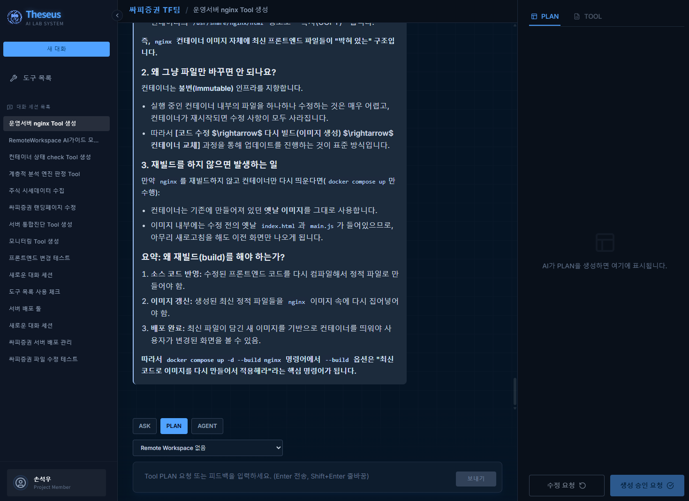
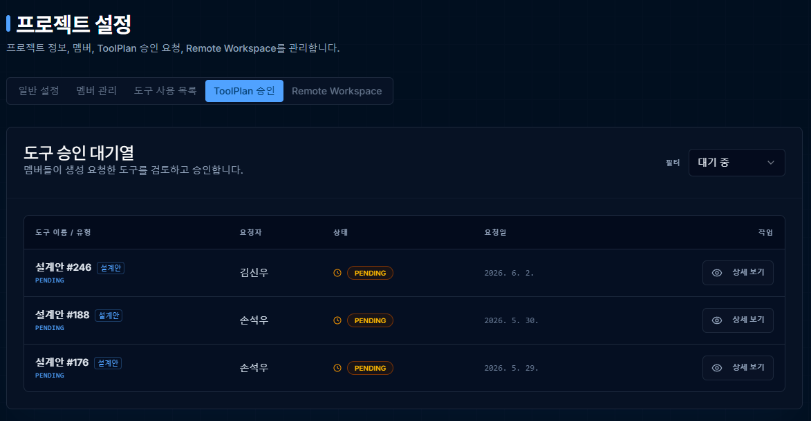
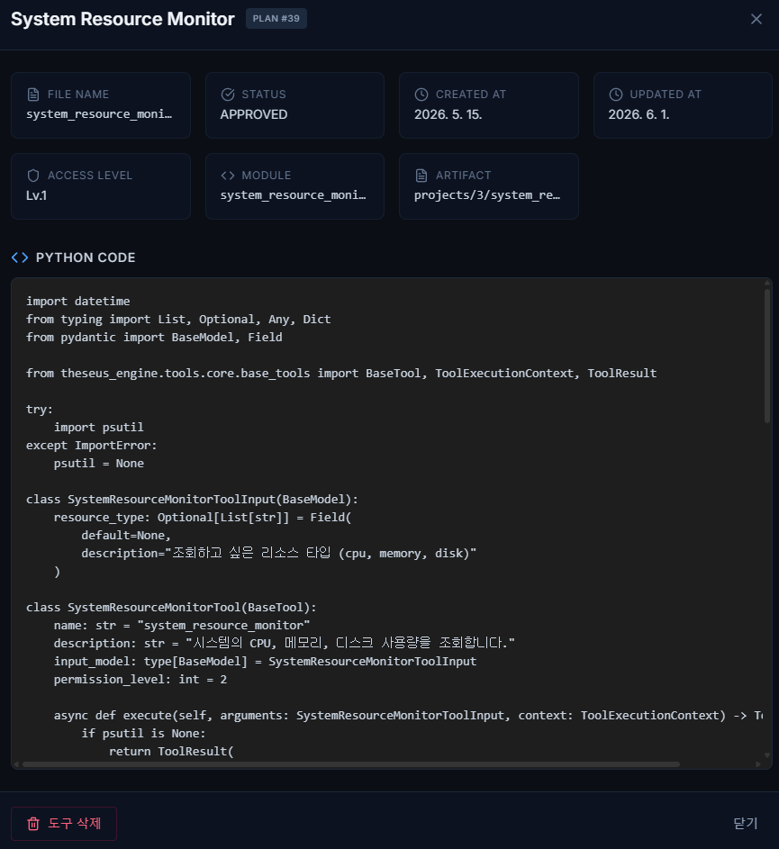
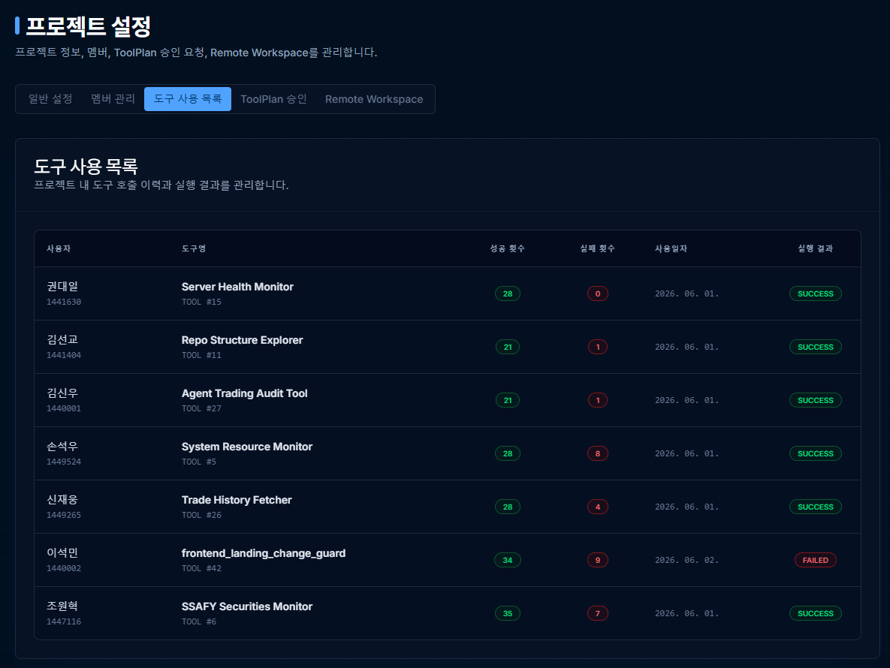
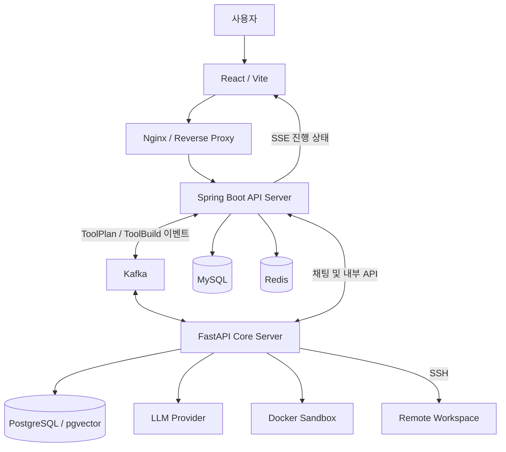

<a id="top"></a>

# 🔵 Theseus (테세우스)

<p align="center">
  
</p>

<h3 align="center">AI 도구 생성부터 실행까지, 하나의 플랫폼</h3>

<p align="center">
  자연어로 업무 도구를 만들고, 승인과 권한 관리 아래 팀이 함께 재사용하는 AI 에이전트 플랫폼<br />
  <strong>사람이 바뀌어도, 일하는 방식은 이어집니다.</strong>
</p>

<p align="center">
  <a href="#features">주요 기능</a> ·
  <a href="#getting-started">시작하기</a> ·
  <a href="./exec/PORTING_MANUAL.md">웹 포팅 매뉴얼</a> ·
  <a href="#vscode-porting">익스텐션 포팅 매뉴얼</a> ·
  <a href="#contributing">기여하기</a>
</p>

---

## 📋 목차

- [프로젝트 개요](#overview)
- [서비스 사용 흐름](#workflow)
- [주요 기능](#features)
- [시스템 아키텍처](#architecture)
- [기술 스택](#tech-stack)
- [핵심 기술 상세](#technical-details)
- [시작하기](#getting-started)
- [VS Code 익스텐션 포팅 매뉴얼](#vscode-porting)
- [ERD 및 산출물](#documents)
- [저장소 구조](#repository-structure)
- [팀](#team)
- [추가 정보](#additional-info)
- [기여](#contributing)
- [라이선스](#license)

---

<a id="overview"></a>

## 🎯 프로젝트 개요

**Theseus**는 개인이 AI와 대화하며 정리한 업무 노하우를 **팀이 다시 사용할 수 있는 도구**로 만드는 플랫폼입니다. 자연어 요청을 **ToolPlan**으로 구체화하고, 관리자의 승인을 거쳐 Python 도구를 생성합니다. 프로젝트 구성원은 권한에 맞게 도구를 사용하고, 관리자는 실행 이력과 결과를 확인합니다.

### 프로젝트 배경

AI로 업무를 처리해도, 그 과정이 개인의 대화창에만 남으면 팀이 같은 방법을 다시 활용하기 어렵습니다.

| 업무 현장의 문제 | Theseus의 접근 |
| --- | --- |
| 좋은 프롬프트와 업무 노하우가 개인에게만 남음 | 작업 방법을 실행 가능한 도구로 저장하고 프로젝트에서 공유 |
| 담당자가 바뀌면 같은 업무를 처음부터 파악해야 함 | 기존 도구와 사용 이력을 참고해 업무를 이어갈 수 있도록 지원 |
| 같은 요청을 매번 새롭게 설명해야 함 | 등록한 도구를 반복 호출해 작업 절차를 재사용 |
| AI의 내부 시스템 접근과 실행을 관리하기 어려움 | 계획 승인, 도구 권한, 원격 실행 설정, 사용 이력으로 실행 범위 관리 |

### 프로젝트 정보

| 항목 | 내용 |
| --- | --- |
| 서비스명 | Theseus |
| 서비스 분야 | 팀 단위 AI 도구 생성 및 업무 자동화 |
| 주요 플랫폼 | Web Application · VS Code Extension |
| 개발 기간 | 2026.03.30 ~ 2026.06.01 |
| 개발 인원 | 5명 |
| 기관 | 삼성 청년 SW·AI 아카데미 14기 |

---

<a id="workflow"></a>

## 🧭 서비스 사용 흐름

**ToolPlan은 도구를 만들기 전에 검토하는 작업 계획이고, Tool은 생성이 완료된 실행 가능한 도구입니다.** 계획 승인과 도구 공개를 구분해 관리합니다.


운영 서버의 CPU·메모리·디스크 상태를 확인하는 작업을 예로 들면 다음과 같습니다.

1. **요청**: AI 채팅에서 확인할 서버와 리소스를 설명합니다.
2. **계획**: AI가 작업 내용과 입력·출력을 ToolPlan으로 정리합니다.
3. **승인**: 관리자가 계획을 검토하고 도구 생성을 승인합니다.
4. **등록**: 생성한 도구의 코드와 접근 범위를 확인합니다.
5. **재사용**: 구성원이 허용된 도구를 실행하고 결과를 확인합니다.

---

<a id="features"></a>

## ✨ 주요 기능

### 1. AI 대화와 ToolPlan 생성

프로젝트별 대화에서 필요한 업무를 설명하고, 도구로 만들 작업의 목적과 실행 계획을 구체화합니다.

- **프로젝트별 대화 이력**: 요청과 피드백을 채팅 세션에 보관합니다.
- **ASK / PLAN / AGENT**: 질문, 계획 수립, 작업 실행 목적에 맞게 모드를 선택합니다.
- **진행 상태 표시**: AI 응답과 도구 생성 과정의 상태를 스트리밍으로 확인합니다.

<p align="center">
  
</p>

### 2. 계획 승인과 Python 도구 생성

AI가 제안한 ToolPlan을 검토하고, 승인한 계획을 바탕으로 재사용 가능한 Python 도구를 생성합니다.

- **승인 대기열**: 요청자, 요청일, 검토 상태를 확인합니다.
- **계획 검토**: 작업 내용을 검토한 뒤 승인하거나 반려합니다.
- **생성 결과 확인**: 도구 상세 화면에서 코드, 상태, 접근 레벨을 확인합니다.

<p align="center">
  
</p>

<details>
<summary>생성한 도구의 Python 코드 확인</summary>

<p align="center">
  
</p>

</details>

### 3. 팀의 도구 공유와 재사용

생성한 도구를 프로젝트에 등록하고, 구성원이 접근 권한에 맞게 다시 사용합니다.

- **도구 목록**: 도구 이름과 설명을 보고 필요한 기능을 찾습니다.
- **프로젝트 단위 관리**: 팀의 업무 목적에 맞춰 도구와 대화를 관리합니다.
- **반복 작업 재사용**: 리소스 조회, 서버 상태 확인처럼 반복되는 작업을 등록한 도구로 수행합니다.

<p align="center">
  
</p>

### 4. 프로젝트 권한과 실행 이력 관리

구성원별 도구 권한을 설정하고, 도구를 사용한 결과를 추적합니다.

- **역할과 접근 레벨**: 프로젝트 멤버의 역할과 도구 접근 범위를 설정합니다.
- **작업별 권한**: 도구 사용·생성·수정·삭제 권한을 관리합니다.
- **사용 결과 확인**: 도구별 사용자, 사용일, 성공·실패 결과를 조회합니다.

<p align="center">
  
</p>

<details>
<summary>도구 사용 이력 화면</summary>

<p align="center">
  
</p>

</details>

### 5. Remote Workspace

외부 서버를 SSH로 연결해 파일, 로그, 시스템 리소스를 확인하고 허용한 범위에서 작업을 실행합니다.

- **실행 환경 등록**: 연결할 서버와 작업 기준 디렉터리를 프로젝트에 등록합니다.
- **연결 테스트**: 저장한 설정으로 원격 서버에 접속할 수 있는지 확인합니다.
- **실행 범위 설정**: 읽기 작업과 파일 수정·명령 실행의 허용 범위를 구분합니다.

<p align="center">
  
</p>

### 6. VS Code Extension

VS Code의 Theseus 사이드바에서 프로젝트 코드를 살펴보고, AI와 대화하며 계획 수립과 코드 편집을 진행할 수 있습니다. 공통 에이전트 엔진을 로컬 데몬으로 실행하며, 소스 Python 또는 패키징된 Runner를 연결합니다.

- **에디터 연동**: 선택 코드 설명, 문제 설명·수정, Inline Edit를 제공합니다.
- **작업 공간 선택**: 분석할 프로젝트와 Worktree를 선택합니다.
- **로컬 실행**: Standalone 모드에서는 웹 서비스용 API·DB·Kafka를 함께 구동할 필요가 없습니다.
- **배포 방식**: VSIX와 엔진 소스를 함께 전달하거나, VSIX와 Runner 실행 파일을 테스트 패키지로 전달합니다.

설치와 배포 절차는 [VS Code 익스텐션 포팅 매뉴얼](#vscode-porting)을 참고하세요.

---

<a id="architecture"></a>

## 🏗️ 시스템 아키텍처

Theseus는 사용자 화면, 서비스 API, AI 실행 서버를 분리합니다. API Server는 사용자·프로젝트·권한·승인 정보를 관리하고, Core Server는 AI 응답과 도구 생성·실행을 담당합니다.



| 구성 요소 | 주요 책임 |
| --- | --- |
| Frontend | 프로젝트, 채팅, 도구, 관리자 설정 화면 |
| API Server | 인증, 프로젝트 멤버, 권한 판단, 승인, 도구 메타데이터와 이력 |
| Core Server | 에이전트 실행, ToolPlan 작성, 도구 생성·검증, 원격 작업 |
| Kafka | API Server와 Core Server 간 도구 생성 요청·진행 이벤트 전달 |
| Redis | 인증 관련 상태와 작업 진행 상태 캐싱, SSE 재연결 시 상태 조회 |
| MySQL | 사용자에게 제공하는 서비스 기준 데이터와 최종 상태 저장 |
| PostgreSQL / pgvector | Core 실행 데이터와 지식 검색용 데이터 저장 |
| Docker Sandbox | 생성 코드의 검증과 도구 실행 환경 격리 |
| Remote Workspace | SSH로 연결하는 외부 프로젝트 및 서버 환경 |

로컬 개발에서는 Compose로 데이터베이스와 메시지 브로커를 실행합니다. 운영 배포는 EC2의 애플리케이션 실행 계층과 SuperApp의 RDS·ElastiCache 등 관리형 데이터 계층을 구분합니다. 상세 배포 경계와 스토리지 구성은 [시스템 아키텍처 문서](./docs/architecture/system-architecture.md)를 참고하세요.

---

<a id="tech-stack"></a>

## 🛠️ 기술 스택

| 영역 | 사용 기술 |
| --- | --- |
| **Frontend** | TypeScript, React, Vite, Tailwind CSS, TanStack Query, Zustand, Axios |
| **Backend** | Java 21, Spring Boot, Spring Security, Spring Data JPA, JWT, Swagger / OpenAPI |
| **AI Core** | Python 3.11, FastAPI, Theseus Engine, LLM Provider 연동 |
| **Data** | MySQL, PostgreSQL, pgvector, Redis |
| **Messaging / Streaming** | Kafka, SSE |
| **Remote / Sandbox** | SSH, Paramiko, Docker |
| **Infra / CI/CD** | Docker Compose, Nginx, Jenkins, GitLab Webhook, EC2, RDS, ElastiCache |

의존성 버전은 [Frontend 패키지](./frontend/package.json), [API Server 빌드 설정](./backend/theseus-api-server/build.gradle), [Core Server 의존성](./backend/theseus-core-server/requirements.txt)을 기준으로 확인할 수 있습니다.

---

<a id="technical-details"></a>

## 🔍 핵심 기술 상세

### 1. ToolPlan 생성·승인·빌드 분리

자연어 요청을 검토 가능한 계획과 생성 완료된 도구로 나누어 관리합니다.

1. **계획 생성**: Core Server가 요청을 분석하고 ToolPlan 후보를 작성합니다.
2. **피드백 반영**: 수정 요청을 반영한 새 계획 버전을 저장합니다.
3. **승인**: 관리자가 검토한 계획을 기준으로 도구 생성을 허가합니다.
4. **빌드**: Core Server가 코드와 실행 메타데이터를 생성하고 검증합니다.
5. **공개 범위 설정**: 프로젝트 관리자가 생성 결과를 확인하고 구성원에게 허용할 접근 범위를 설정합니다.

`tool_plans`는 계획 버전, `tool_plan_runs`는 생성·재생성·빌드 작업, `tools`는 빌드 완료된 도구를 관리합니다. 생성 진행 상태와 최종 산출물을 분리해 승인 이력과 실패한 작업을 추적합니다.

관련 문서: [Tool API](./docs/api/tool-api.md), [데이터 모델](./docs/planning/erd.md)

### 2. Theseus Agent Engine과 실행 모드

`theseus_engine`은 LLM 응답 스트리밍, 도구 호출, 권한 검사, 실행 이벤트 처리를 담당하는 공통 런타임입니다.

| 모드 | 용도 | 원격 작업의 기본 범위 |
| --- | --- | --- |
| **ASK** | 질문과 상황 파악 | 파일·로그·리소스 조회 |
| **PLAN** | 조사 결과를 바탕으로 작업 계획 수립 | 읽기 도구를 활용한 조사 |
| **AGENT** | 도구를 사용해 작업 수행 | 기본은 읽기, 설정에 따라 쓰기·명령 실행 허용 |

모드와 프로젝트 권한에 따라 사용할 수 있는 도구를 결정하고, 도구 실행 전 권한을 검사합니다. 서버와 로컬 에디터 런타임이 같은 엔진과 프롬프트 구성 로직을 공유합니다.

VS Code Extension 및 로컬 실행 방식은 [Core Server 문서](./backend/theseus-core-server/README.md)에서 별도로 안내합니다.

### 3. Kafka 비동기 처리와 SSE 상태 전달

도구 계획 작성과 코드 생성은 요청 시간이 길어질 수 있으므로, API Server와 Core Server가 Kafka 이벤트로 작업을 주고받습니다.

- **요청 접수**: API Server가 작업을 등록하고 요청 이벤트를 발행합니다.
- **작업 처리**: Core Server가 계획 생성 또는 빌드를 수행하고 진행·완료·실패 이벤트를 발행합니다.
- **실시간 표시**: API Server가 작업 상태를 반영하고 SSE로 화면에 전달합니다.
- **재접속 처리**: Redis에 저장한 최신 상태를 조회해 진행 상황을 다시 보여줍니다.

중간 진행 상태는 Redis와 SSE로 전달하고, 사용자에게 제공할 최종 상태는 서비스 데이터베이스에 저장합니다.

### 4. 권한 제어와 실행 환경 격리

프로젝트 역할, 접근 레벨, 작업별 도구 권한을 조합해 실행 범위를 관리합니다.

- **API Server**는 사용자와 프로젝트 정책을 확인합니다.
- **Core Engine**은 도구 호출 전에 권한과 노출 정책을 검사합니다.
- **Docker Sandbox**는 별도 실행 환경에서 생성 코드를 검증하고 도구를 실행합니다.
- **사용 이력**은 실행 결과를 확인하고 작업을 추적하는 데 활용합니다.

Sandbox 이미지, Docker 소켓 접근, 공유 작업 경로는 실행 환경에 맞게 설정합니다. 구체적인 설정 항목은 [Core Server 문서](./backend/theseus-core-server/README.md)와 [로컬 인프라 안내](./infra/README.md)를 참고하세요.

### 5. Remote Workspace 연결과 실행 정책

Core Server가 API Server에서 연결 설정을 조회한 뒤 Paramiko 기반 SSH로 원격 서버에 접속합니다.

- **연결 정보 전달**: 클라이언트와 작업 이벤트에는 `remoteWorkspaceId`를 전달합니다.
- **설정 조회**: Core Server가 내부 API로 필요한 접속 정보를 조회합니다.
- **읽기 작업**: 파일 검색, 로그 조회, CPU·메모리·디스크 확인 도구를 제공합니다.
- **쓰기 및 명령 실행**: 일반 설정에서는 `allowWriteExecution` 허용 여부를 확인합니다.

운영자용 파일 쓰기 override와 명령 실행의 조건은 다르므로, 상세 정책은 [Core Server의 Remote Workspace 설명](./backend/theseus-core-server/README.md)을 기준으로 설정합니다.

---

<a id="getting-started"></a>

## 🚀 시작하기

<a id="vscode-porting"></a>

### VS Code 익스텐션으로 시작하기

VS Code `^1.90.0`, Python 3.11, Node.js/npm을 준비한 뒤 저장소 루트에서 다음 PowerShell 명령을 실행합니다. 이미 저장소를 받았다면 Clone 단계는 생략하세요.

```powershell
git clone https://lab.ssafy.com/ssafy-coach-15th/14th_theseus.git
Set-Location 14th_theseus
Push-Location backend/theseus-core-server/vscode-extension
npm.cmd ci
npm.cmd run package:vsix
Pop-Location
.\Install-Theseus-Extension.cmd -Ide vscode
```

설치 후 사용할 LLM의 API 키와 모델을 설정하고, VS Code에서 해당 폴더를 열어 `Theseus: Start Agent`를 실행합니다. 설치기는 기존 VSIX를 사용하므로 **패키징이 성공한 것을 확인한 뒤** 실행하세요. API 키 설정부터 배포와 오류 해결까지의 전체 절차는 아래 토글에서 확인할 수 있습니다.

<details>
<summary><strong>VS Code 익스텐션 포팅 매뉴얼 펼치기 · 설치, 설정, 배포, 오류 해결</strong></summary>

명령은 별도 표시가 없으면 **Windows PowerShell** 기준입니다.

#### 1. 구성과 설치 방식

```text
VS Code → Theseus Extension → 로컬 Daemon → Theseus Agent Engine → LLM Provider
                                  └─ 선택한 프로젝트의 코드·도구
```

익스텐션이 데몬을 직접 실행합니다. 로컬 데몬은 `127.0.0.1`의 빈 포트를 자동 선택하며, 작업 공간의 `.theseus/runner.json`에 연결 정보를 기록합니다. 웹 Core Server의 `8086` 포트와 별개이므로 익스텐션 사용을 위해 FastAPI 서버를 따로 시작할 필요가 없습니다.

| 방식 | 실행 환경 | 사용 목적 |
| --- | --- | --- |
| 소스 설치 / `source-python` | VSIX + Python 가상환경 + `theseus_engine` 소스 | 개발, 엔진 수정, 소스와 함께 배포 |
| 실행 파일 설치 / `bundled-runner` | VSIX + `theseus-runner.exe`와 동봉 파일 | Windows 테스트 배포 |
| 자동 선택 / `auto` | `runnerPath`가 있으면 실행 파일, 없으면 Python 소스 | 기본 런타임 선택 |

`theseus.serverUrl`을 빈 문자열로 두면 Standalone 모드입니다. 기본 로컬 실행에는 웹용 API Server, MySQL, Redis, Kafka의 동시 실행이 필요하지 않습니다. 외부 서버나 별도 도구가 필요한 기능은 해당 연결과 의존성을 추가로 준비합니다.

#### 2. 준비 환경

| 항목 | 준비 사항 |
| --- | --- |
| VS Code | 익스텐션 `package.json`의 호환 범위 `^1.90.0` |
| Python | 소스 설치 및 Runner 빌드 환경은 3.11 기준 |
| Node.js / npm | VSIX를 직접 빌드할 때 필요. `npm ci`로 잠금 파일의 의존성 설치 |
| Git | 저장소 Clone 및 소스 갱신 |
| PowerShell | Windows 설치·패키징 스크립트 실행 |
| VS Code CLI | `code` 명령 사용 가능 또는 설치 시 `-Code`로 경로 지정 |
| LLM 설정 | 선택한 모델과 해당 Provider API 키 |

VSIX와 Runner가 이미 포함된 테스트 패키지의 사용자는 VSIX 빌드용 Node.js나 엔진 실행용 Python을 별도로 설치하는 대신 동봉된 Runner를 사용합니다. 실행할 커스텀 도구에 필요한 외부 프로그램은 별도입니다.

```powershell
git --version
python --version
node --version
npm.cmd --version
code --version
```

#### 3. 저장소에서 빌드하고 설치하기

##### 3-1. 소스 받기

```powershell
git clone https://lab.ssafy.com/ssafy-coach-15th/14th_theseus.git
Set-Location 14th_theseus
```

이후 명령에서 **저장소 루트**는 `14th_theseus` 폴더입니다. 이미 Clone했다면 해당 폴더에서 시작합니다.

##### 3-2. VSIX 빌드

저장소 루트에서 실행합니다.

```powershell
Push-Location backend/theseus-core-server/vscode-extension
npm.cmd ci
npm.cmd run package:vsix
Pop-Location
```

`package:vsix`는 TypeScript 컴파일, 필수 패키지 입력 파일 확인, VSIX 패키징을 수행합니다. 각 명령이 성공했는지 확인한 뒤 다음 단계로 진행합니다.

- 출력 위치: `backend/theseus-core-server/vscode-extension/`
- 파일 이름: `theseus-vscode-<version>.vsix`
- 현재 Manifest 버전: `0.0.1`
- 익스텐션 ID: `theseus.theseus-vscode`

설치기는 VSIX를 자동 빌드하지 않습니다. VSIX가 여러 개라면 수정 시각이 가장 최근인 파일을 선택하므로, 특정 파일을 설치하려면 `-VsixPath`를 지정합니다.

##### 3-3. 설치기 실행

저장소 루트에서 실행합니다.

```powershell
.\Install-Theseus-Extension.cmd -Ide vscode
```

설치기는 Core 폴더의 `.venv` 생성, `requirements.txt` 설치, VS Code 설정 반영, VSIX 설치를 수행합니다. `uv`가 있으면 Python 3.11 가상환경 생성에 사용하고, 없으면 `python` 또는 `-Python`으로 지정한 실행 파일을 사용합니다.

기본 설정 파일은 작업 공간의 `.vscode/settings.json`입니다. 설치기가 `theseus.*` 항목을 다시 작성하므로 기존 Theseus 연결 설정은 설치 후 확인합니다.

Theseus 저장소가 아닌 다른 프로젝트에서 사용하려면 **이미 존재하는 프로젝트 폴더**를 지정합니다.

```powershell
.\Install-Theseus-Extension.cmd -Ide vscode -WorkspacePath "C:\DEV\my-project"
```

| 옵션 | 용도 |
| --- | --- |
| `-CorePath "경로"` | `theseus_engine`과 `requirements.txt`가 있는 Core 폴더 지정 |
| `-WorkspacePath "경로"` | 분석·작업 대상 프로젝트 폴더 지정 |
| `-Python "경로"` | 가상환경 생성에 사용할 Python 실행 파일 지정 |
| `-Code "경로"` | 자동 감지되지 않는 VS Code CLI 지정 |
| `-VsixPath "경로"` | 설치할 VSIX를 명시 |
| `-SkipRequirements` | 기존 가상환경의 의존성 재설치 생략 |
| `-SkipExtension` | VSIX 설치 생략 |
| `-SkipSettings` | IDE 설정 작성 생략 |
| `-InstallPlaywright` | 브라우저 도구용 의존성과 Chromium 추가 설치 |

예를 들어 VS Code CLI가 PATH에 없다면 다음처럼 지정합니다.

```powershell
.\Install-Theseus-Extension.cmd -Ide vscode -Code "$env:LOCALAPPDATA\Programs\Microsoft VS Code\bin\code.cmd"
```

VS Code가 다른 위치에 설치되어 있으면 실제 경로로 바꿉니다. 이미 다른 런타임을 사용하던 환경이라면 아래 설정에서 `runtimeMode`와 `runnerPath`도 확인합니다.

##### 3-4. 수동 설정 확인

VS Code에서 `Preferences: Open Workspace Settings (JSON)`을 열고 다음 항목을 확인합니다. 아래 예시는 저장소를 `C:/DEV/14th_theseus`에, 작업할 프로젝트를 `C:/DEV/my-project`에 둔 경우입니다.

```json
{
  "theseus.runtimeMode": "source-python",
  "theseus.corePath": "C:/DEV/14th_theseus/backend/theseus-core-server",
  "theseus.pythonPath": "C:/DEV/14th_theseus/backend/theseus-core-server/.venv/Scripts/python.exe",
  "theseus.workspacePath": "C:/DEV/my-project",
  "theseus.runnerPath": "",
  "theseus.serverUrl": "",
  "theseus.readyTimeoutSeconds": 60
}
```

| 설정 | 의미 |
| --- | --- |
| `corePath` | 엔진 설치 위치. 작업 대상 프로젝트와 달라도 됨 |
| `pythonPath` | 의존성이 설치된 가상환경의 Python 실행 파일 |
| `workspacePath` | 작업 대상. 비어 있으면 VS Code의 첫 번째 작업 공간 폴더 사용 |
| `runtimeMode` | `auto`, `source-python`, `bundled-runner` 중 선택 |
| `runnerPath` | `bundled-runner` 실행 파일 경로 |
| `serverUrl` | 외부 서버 연동 주소. 로컬 Standalone은 빈 문자열 |
| `readyTimeoutSeconds` | 준비 대기 시간. 기본 60초, 허용 범위 1~60초 |

경로 설정은 `${workspaceFolder}`, `${userHome}`, `${env:NAME}` 치환을 지원합니다. Theseus 저장소 자체가 작업 공간일 때에는 `corePath`를 `${workspaceFolder}/backend/theseus-core-server`로 쓸 수 있습니다.

##### 3-5. LLM 모델과 API 키 설정

소스 설치에서는 `backend/theseus-core-server/.env`에 사용할 모델과 해당 Provider 키를 설정합니다. 기존 파일이 있으면 필요한 값만 수정합니다.

```dotenv
THESEUS_MODEL=<사용 가능한 모델 ID>
GEMINI_API_KEY=<발급받은 키>
```

위 키 이름은 Gemini 사용 예시입니다. 엔진이 사용하는 Provider에 맞춰 아래 중 필요한 키를 설정합니다.

| Provider | 환경 변수 |
| --- | --- |
| Gemini | `GEMINI_API_KEY` 또는 `GOOGLE_API_KEY` |
| OpenAI | `OPENAI_API_KEY` |
| Anthropic | `ANTHROPIC_API_KEY` |
| DeepSeek | `DEEPSEEK_API_KEY` |

`THESEUS_MODEL`은 해당 Provider에서 실제 사용할 수 있고 엔진이 인식하는 모델 ID로 지정합니다. 코드에 기본 모델이 지정되어 있어도 계정의 접근 가능 여부는 별도이므로 배포 환경에 맞춰 설정합니다.

Runner 배포에서는 `theseus-runner.exe`와 같은 폴더의 `.env` 또는 작업 공간의 `.env`를 사용할 수 있습니다. 프로세스에 이미 설정된 환경 변수는 `.env`로 덮어쓰지 않습니다. 키 파일은 저장소나 배포 ZIP에 포함하지 말고 설치 환경에서 설정합니다.

설정 변경 후에는 `Theseus: Stop Agent` → `Theseus: Start Agent`로 재시작합니다. 시스템 환경 변수를 바꿨다면 VS Code도 완전히 종료한 뒤 다시 엽니다.

<a id="vscode-verification"></a>

#### 4. 최초 실행과 동작 확인

1. VS Code에서 작업 대상 폴더를 엽니다.
2. Activity Bar의 **Theseus**를 선택합니다.
3. 명령 팔레트에서 `Theseus: Start Agent`를 실행합니다.
4. `Theseus: Show Logs`로 엔진 시작 로그와 오류 여부를 확인합니다.
5. “현재 프로젝트의 디렉터리 구조를 설명해 줘”처럼 코드 조회 요청을 보냅니다.
6. 코드를 선택해 `Theseus: Explain Selection`을 실행하고 선택한 파일의 문맥이 전달되는지 확인합니다.
7. 편집 기능은 테스트용 파일에서 `Theseus: Inline Edit`를 실행한 뒤 변경 사항을 확인합니다.

Inline Edit 단축키는 Windows/Linux `Ctrl+I`, macOS `Cmd+I`이며 에디터에 포커스가 있을 때 적용됩니다.

| 확인 항목 | 기대 결과 |
| --- | --- |
| 익스텐션 설치 | Extensions에서 Theseus를 찾을 수 있음 |
| 런타임 시작 | 설정한 Python 또는 Runner가 실행되고 데몬이 준비됨 |
| 프로젝트 경로 | 현재 분석 대상이 지정한 `workspacePath`와 일치 |
| LLM 연결 | 선택한 Provider의 인증 오류 없이 응답 수신 |
| 에디터 연동 | 선택 코드 설명과 테스트 파일 편집 동작 확인 |
| 종료·재시작 | Stop 후 Start가 정상 동작 |

`.theseus/runner.json`에는 연결 인증 정보가 포함되므로 파일 내용을 공개 로그나 이슈에 붙이지 않습니다.

#### 5. 다른 PC로 배포하기

##### 5-1. 엔진 소스를 포함한 배포

VSIX 빌드 의존성 설치가 끝난 환경에서 저장소 루트의 다음 명령을 실행합니다.

```powershell
.\Package-Theseus-LocalExtension.cmd
```

래퍼는 VSIX 빌드를 요청한 뒤 필요한 엔진 소스와 설치 스크립트를 묶습니다.

```text
backend/theseus-core-server/dist/local-extension-package/
└── Theseus-LocalExtensionSourcePackage.zip
```

배포물에는 `theseus_engine`, `theseus_cli`, 의존성 목록, VSIX와 설치·제거 스크립트 등이 포함됩니다. 웹 Frontend/API Server, 개발 가상환경, 테스트와 실제 `.env`는 포함하지 않습니다.

받는 PC에서는 ZIP 전체를 고정된 위치에 압축 해제하고, 패키지 루트의 `Install-Theseus-Extension.cmd -Ide vscode`를 실행합니다. Python 3.11을 준비하고 API 키를 별도로 설정합니다. 이미 빌드된 VSIX를 설치하므로 수신자가 VSIX를 다시 빌드할 필요는 없습니다.

##### 5-2. Runner 실행 파일을 포함한 테스트 배포

빌드 PC에 Core 가상환경과 의존성이 준비되어 있어야 합니다. 3장의 소스 설치를 완료한 환경에서 진행하거나, IDE 설치 없이 아래처럼 빌드 환경만 준비할 수 있습니다.

```powershell
powershell -NoProfile -ExecutionPolicy Bypass -File .\backend\theseus-core-server\scripts\install-vscode-extension.ps1 -SkipExtension -SkipSettings
```

익스텐션 폴더에서 `npm.cmd ci`를 완료한 뒤 저장소 루트에서 실행합니다.

```powershell
.\Package-Theseus-TestPackage.cmd -BuildRunner -InstallPyInstaller
```

VSIX와 PyInstaller 기반 Runner를 빌드하고 다음 ZIP을 생성합니다. 이미 Runner를 빌드했다면 `-BuildRunner`를 생략할 수 있지만, 이 경우 기존 실행 파일이 있어야 합니다.

```text
backend/theseus-core-server/dist/test-package/Theseus-TestPackage.zip

Theseus-TestPackage/
├── README.md
├── Install-Theseus-TestPackage.cmd
├── scripts/
│   └── install-test-package.ps1
├── theseus-vscode-0.0.1.vsix
└── theseus-runner/
    ├── theseus-runner.exe
    └── _internal/
```

버전에 따라 VSIX 이름은 달라집니다. 기본 Runner 빌드는 디렉터리 단위 배포이므로 `.exe`만 복사하지 말고 `_internal`을 포함한 전체 패키지를 전달합니다. 이 `.exe` 배포 절차는 Windows 대상입니다.

받는 PC에서는 ZIP을 압축 해제한 뒤 **압축 해제된 패키지 루트에서** 실행합니다.

```powershell
.\Install-Theseus-TestPackage.cmd -Ide vscode -WorkspacePath "C:\DEV\my-project"
```

설치기는 VSIX 설치, `runtimeMode=bundled-runner`, `runnerPath`, `workspacePath` 설정 후 IDE를 엽니다. API 키와 모델 설정을 마친 뒤 4장의 절차로 검증합니다. 패키지 폴더를 옮기거나 삭제하면 설정된 실행 파일 경로가 끊어지므로 계속 사용할 위치에 보관합니다.

##### 5-3. 소스 설치용 Bash 스크립트

소스 방식은 [Bash 설치기](./backend/theseus-core-server/scripts/install-vscode-extension.sh)도 제공합니다. Python 환경과 VSIX를 준비한 후 Core 폴더에서 실행합니다.

```bash
bash scripts/install-vscode-extension.sh --ide vscode --workspace-path /path/to/project
```

Bash 옵션은 `--workspace-path`, `--code`처럼 표기합니다. Windows PowerShell의 `-WorkspacePath`와 혼용하지 않습니다. 이 경로는 소스 Python 실행 방식이며 Windows Runner 실행 파일을 다른 OS에서 실행하는 절차가 아닙니다.

#### 6. 업데이트와 설치 위치 변경

- **익스텐션 코드 변경**: `npm.cmd ci`와 `npm.cmd run package:vsix`를 다시 수행하고 새 VSIX를 설치합니다.
- **소스 엔진 변경**: Core 소스를 갱신하고 의존성이 바뀌었다면 설치기로 재설치한 뒤 Agent를 재시작합니다.
- **Runner 엔진 변경**: `-BuildRunner`를 포함해 테스트 패키지를 다시 만듭니다. VSIX 교체만으로 기존 Runner의 엔진 코드가 갱신되지는 않습니다.
- **다른 프로젝트 사용**: 설치 시 `-WorkspacePath`를 지정하거나 `Theseus: Select Workspace (Worktree)`를 사용합니다.
- **폴더 이동**: `corePath`, `pythonPath`, `runnerPath`, `workspacePath`를 새 위치에 맞춰 수정하거나 설치기를 다시 실행합니다.
- **런타임 변경**: 소스 방식은 `source-python`으로 설정하고 `runnerPath`를 비웁니다. 실행 파일 방식은 `bundled-runner`와 유효한 `runnerPath`를 설정합니다.

업데이트 후 VS Code의 `Developer: Reload Window`를 실행하고 4장의 확인 절차를 반복합니다.

#### 7. 문제 해결

| 증상 | 확인 및 해결 |
| --- | --- |
| `VSIX package was not found` | 3-2 빌드 성공 여부와 출력 파일 확인. 필요하면 `-VsixPath` 지정 |
| `Missing VSIX package inputs` | 익스텐션 폴더에서 컴파일하고 오류에 나온 `out/`, `media/`, `resources/` 파일 확인 |
| `code` 명령을 찾지 못함 | VS Code CLI 경로를 `-Code`로 지정 |
| `Cannot find theseus_engine/` | `corePath`가 엔진 패키지 자체가 아닌 그 상위 Core 폴더인지 확인 |
| `ModuleNotFoundError` | `pythonPath`가 의존성을 설치한 `.venv`의 Python인지 확인 |
| `bundled-runner`인데 실행 파일을 못 찾음 | `runnerPath`의 파일 존재 여부와 압축 해제 위치 확인 |
| Agent 준비 시간 초과 | `Theseus: Show Logs`에서 기동 오류 확인. 대기 설정 최대값은 60초 |
| LLM 인증 또는 모델 오류 | 선택 모델과 Provider 키가 일치하는지, 계정에 모델 접근 권한이 있는지 확인 후 재시작 |
| 잘못된 프로젝트를 분석함 | `workspacePath` 및 Worktree 선택 확인. 다중 폴더에서는 첫 폴더가 기본값 |
| 브라우저 도구 실행 실패 | 소스 설치기 `-InstallPlaywright`로 의존성과 Chromium 설치 |
| 설치 후 이전 화면이 보임 | 새 VSIX 설치 여부 확인 후 `Developer: Reload Window` 실행 |

수동으로 소스 데몬의 시작 오류를 확인하려면 **Core 폴더에서** 다음을 실행합니다. IDE에서 실행 중인 Agent는 먼저 중지합니다.

```powershell
.\.venv\Scripts\python.exe -m theseus_engine.daemon --workspace "C:\DEV\my-project" --host 127.0.0.1 --port 0
```

이 명령은 진단을 위한 별도 실행이며, 정상 사용 시에는 익스텐션의 `Start Agent`가 데몬을 시작합니다. 확인을 마치면 `Ctrl+C`로 종료합니다.

#### 8. 제거

익스텐션만 제거하려면 VS Code Extensions 화면에서 Theseus를 제거하거나 다음 명령을 실행합니다.

```powershell
code --uninstall-extension theseus.theseus-vscode
```

저장소의 `Uninstall-Theseus-VSCode.cmd`는 확장 데이터와 설정까지 정리합니다. 기본 옵션은 작업 공간의 `.vscode` 폴더 전체와 Core `.venv`도 삭제하므로, 해당 파일을 보존하려면 다음 옵션을 사용합니다. 먼저 제거 대상을 미리 확인합니다.

```powershell
.\Uninstall-Theseus-VSCode.cmd -WorkspacePath "C:\DEV\my-project" -KeepVenv -KeepWorkspaceVscode -DryRun -NoPause
```

출력된 대상이 의도한 환경인지 확인한 뒤 같은 명령에서 `-DryRun`을 제거하면 실제 정리가 진행됩니다. `-KeepWorkspaceVscode`를 지정해도 `settings.json`의 `theseus.*` 설정은 제거 대상입니다.

#### 9. 구현 기준 문서와 파일

- [익스텐션 Manifest](./backend/theseus-core-server/vscode-extension/package.json): 호환 버전, 명령, 설정, 빌드 스크립트
- [Core README](./backend/theseus-core-server/README.md): 엔진과 익스텐션 실행 안내
- [Windows 설치기](./backend/theseus-core-server/scripts/install-vscode-extension.ps1): 가상환경, VSIX 및 IDE 설정
- [소스 배포 패키저](./backend/theseus-core-server/scripts/package-local-extension-source.ps1)
- [Runner 빌더](./backend/theseus-core-server/scripts/build-runner-binary.ps1)
- [테스트 배포 패키저](./backend/theseus-core-server/scripts/package-test-distribution.ps1)
- [테스트 패키지 설치 안내](./backend/theseus-core-server/scripts/test-package-README.md)

이 문서는 저장소 구현과 명령·경로를 대조한 설치 안내입니다. 배포 환경별 실행 성공 여부는 실제 대상 PC에서 4장의 절차로 확인합니다.

</details>

### 웹 서비스로 시작하기

아래는 **인프라는 Docker로, API·Core·Frontend는 각각 로컬 프로세스로 실행하는 개발 구성**입니다. 셸 명령은 Bash 기준이며, 각 서버는 별도 터미널에서 실행합니다.

### 1. 준비 환경과 저장소 받기

| 항목 | 기준 |
| --- | --- |
| Java | 21 |
| Python | 3.11 |
| Node.js | 저장소의 Frontend Dockerfile 기준 24 |
| Docker | Linux 컨테이너를 실행할 수 있는 Docker Engine / Docker Desktop과 Compose |
| 외부 설정 | 사용할 LLM Provider의 API 키, DB·서버 내부 인증 설정 |

```bash
git clone https://lab.ssafy.com/ssafy-coach-15th/14th_theseus.git
cd 14th_theseus
```

### 2. 로컬 인프라 설정

Compose가 읽는 `infra/docker/local/.env.local` 파일을 생성합니다. 이 파일은 저장소에 포함되지 않으므로 최초 실행 전에 작성해야 합니다.

```dotenv
# infra/docker/local/.env.local
MYSQL_ROOT_PASSWORD=<로컬 MySQL 비밀번호>
MYSQL_DATABASE=theseus
POSTGRES_USER=root
POSTGRES_PASSWORD=<로컬 PostgreSQL 비밀번호>
POSTGRES_DB=theseus_core

SPRING_DATASOURCE_URL=jdbc:mysql://localhost:13306/theseus
SPRING_DATASOURCE_USERNAME=root
SPRING_DATASOURCE_PASSWORD=<위 MySQL 비밀번호와 동일한 값>
SPRING_KAFKA_BOOTSTRAP_SERVERS=localhost:19092
SPRING_DATA_REDIS_HOST=localhost
SPRING_DATA_REDIS_PORT=16379
THESEUS_CORE_BASE_URL=http://localhost:8086
JWT_SECRET=<JWT 서명 키>
INTERNAL_API_KEY=<서버 간 공유 인증 키>
```

자리표시자를 실제 개발 환경 값으로 바꾼 뒤 저장소 루트에서 실행합니다.

```bash
docker compose -f infra/docker/local/docker-compose.infra.yml up -d
docker compose -f infra/docker/local/docker-compose.infra.yml ps
```

### 3. API Server 실행

```bash
cd backend/theseus-api-server
./gradlew bootRun
```

API Server의 `local` 프로필은 `infra/docker/local/.env.local`을 읽습니다. Windows PowerShell에서는 `./gradlew` 대신 `.\gradlew.bat`을 사용합니다.

### 4. Core Server 설정과 실행

저장소 루트에서 Sandbox 이미지를 준비합니다.

```bash
docker build -t theseus-sandbox:py311-tools \
  -f backend/theseus-core-server/Dockerfile.sandbox \
  backend/theseus-core-server
```

Core 디렉터리에서 Python 가상환경과 설정 파일을 준비합니다. 기존 `.env`가 있으면 복사 대신 해당 파일을 확인합니다.

```bash
cd backend/theseus-core-server
python -m venv .venv
source .venv/bin/activate
pip install -r requirements.txt
cp .env.example .env
```

Windows PowerShell에서는 `source` 대신 `.\.venv\Scripts\Activate.ps1`, `cp` 대신 `Copy-Item`을 사용할 수 있습니다.

`.env`에서 사용할 모델과 Provider 키를 입력하고, 아래 항목을 로컬 구성에 맞게 설정합니다.

| 설정 | 로컬 구성 |
| --- | --- |
| `THESEUS_MODEL` | 사용할 모델 식별자 |
| Provider API 키 | `.env.example`에서 사용하는 Provider의 키만 입력 |
| `AUTH_MODE` | `spring` |
| `CORE_POSTGRES_HOST`, `CORE_POSTGRES_PORT` | `localhost`, `15432` |
| `CORE_POSTGRES_DB`, `CORE_POSTGRES_USER` | `theseus_core`, `root` |
| `CORE_POSTGRES_PASSWORD` | 인프라 파일의 `POSTGRES_PASSWORD`와 동일한 값 |
| `CORE_KAFKA_BOOTSTRAP_SERVERS` | `localhost:19092` |
| `CORE_KAFKA_CONSUMER_ENABLED` | `true` |
| `CORE_TOOL_PLAN_CONSUMER_ENABLED` | 현재 API의 ToolPlan / ToolBuild 경로 사용 시 `true` |
| `SPRING_BOOT_INTERNAL_URL` | `http://localhost:8080` |
| `SPRING_BOOT_INTERNAL_API_KEY` | API Server의 `INTERNAL_API_KEY`와 동일한 값 |
| `SPRING_BOOT_*_URL` | `.env.example`의 인증·권한·이력 등 내부 API 주소를 로컬 API Server에 맞게 설정 |
| `SANDBOX_IMAGE` | `theseus-sandbox:py311-tools` |

```bash
python -m uvicorn src.main:app --host 127.0.0.1 --port 8086 --workers 1
```

### 5. Frontend 실행

새 터미널에서 저장소의 `frontend` 디렉터리로 이동합니다.

```bash
cd frontend
npm ci
npm run dev
```

API 주소를 변경하려면 `frontend/.env.local`에 다음 값을 설정합니다.

```dotenv
VITE_API_BASE_URL=http://localhost:8080
```

| 서비스 | 기본 로컬 주소 |
| --- | --- |
| Frontend | [localhost:5173](http://localhost:5173), 실제 주소는 Vite 실행 로그에서 확인 |
| API Server | [localhost:8080](http://localhost:8080) |
| API 문서 | [Swagger UI](http://localhost:8080/swagger-ui.html) |
| Core Server | [localhost:8086](http://localhost:8086) |
| Kafka UI | [localhost:18080](http://localhost:18080) |

서비스 이용에는 Super Admin이 발급한 사용자 계정과 프로젝트 권한이 필요합니다. 계정 정책은 [인증 API 문서](./docs/api/auth-api.md)에서 확인할 수 있습니다.

전체 Docker 통합 실행, Docker 소켓 권한과 공유 디렉터리 설정은 [로컬 인프라 안내](./infra/README.md), 운영 배포는 [포팅 매뉴얼](./exec/PORTING_MANUAL.md)을 참고하세요. 위 호스트 실행용 DB·Kafka 주소와 컨테이너 내부 주소는 서로 다릅니다.

---

<a id="documents"></a>

## 🗂️ ERD 및 산출물

### 데이터 모델

| 데이터 영역 | 주요 테이블 | 역할 |
| --- | --- | --- |
| 사용자와 프로젝트 | `users`, `projects`, `project_members` | 계정과 프로젝트 참여·권한 관리 |
| 대화 | `chat_sessions`, `chat_messages` | 프로젝트별 대화와 최종 메시지 저장 |
| 도구 계획 | `tool_plan_groups`, `tool_plans` | 계획 묶음과 버전 관리 |
| 생성과 승인 | `tool_plan_runs`, `tool_approvals` | 생성 작업 상태와 승인 이력 관리 |
| 실행 가능한 도구 | `tools` | 빌드 완료한 도구 정보 관리 |
| 모델 사용량 | `billing_usages` | Core가 보고한 사용량 기록 |

상세 컬럼과 상태 정의는 [ERD 문서](./docs/planning/erd.md)를 참고하세요.

### 프로젝트 문서

| 문서 | 내용 |
| --- | --- |
| [웹 포팅 매뉴얼](./exec/PORTING_MANUAL.md) | 웹 서비스 개발 환경, 빌드, 실행 및 운영 배포 |
| [VS Code 익스텐션 포팅 매뉴얼](#vscode-porting) | VSIX 빌드, 로컬 설치, LLM 설정, 소스·Runner 배포 및 오류 해결 |
| [시스템 아키텍처](./docs/architecture/system-architecture.md) | 서비스 구성과 인프라 경계 |
| [API 개요](./docs/api/api-overview.md) | API 구성과 주요 기능 흐름 |
| [인증 API](./docs/api/auth-api.md) | 계정, 로그인, 토큰 정책 |
| [Tool API](./docs/api/tool-api.md) | ToolPlan 생성, 피드백, 승인, 도구 생성 |
| [Core Server 문서](./backend/theseus-core-server/README.md) | 엔진, 실행 모드, Remote Workspace, VS Code Extension |
| [배포 문서](./docs/operations/deployment.md) | 배포 구성과 운영 절차 |
| [트러블슈팅](./docs/operations/troubleshooting.md) | 실행 및 연동 문제 확인 |

---

<a id="repository-structure"></a>

## 📁 저장소 구조

```text
14th_theseus/
├── frontend/                       # React 사용자 화면
├── backend/
│   ├── theseus-api-server/          # Spring Boot 서비스 API
│   └── theseus-core-server/         # FastAPI 및 AI 실행 환경
│       ├── src/                    # 서버 연동과 비동기 작업
│       ├── theseus_engine/         # 공통 에이전트 런타임
│       ├── tests/                  # Core 테스트
│       └── vscode-extension/       # VS Code 클라이언트
├── infra/                          # 로컬·운영 Docker 및 Nginx 설정
├── docs/                           # 설계·API·운영 문서와 서비스 이미지
├── exec/                           # 포팅 매뉴얼 등 제출 산출물
├── tools/                          # 개발·운영 보조 도구
└── Jenkinsfile                     # CI/CD 파이프라인
```

---

<a id="team"></a>

## 👥 팀

| 이름 | 역할 |
| --- | --- | --- |
| 손석우 | 팀장/Infra 아키텍처 및 CI/CD |
| 권대일 | LLM 모델 최적화 |
| 김대연 | Full Stack |
| 김선교 | AI/BE |
| 조원혁 | FE |

---

<a id="additional-info"></a>

## 📌 추가 정보
- 15기 실습코치 김선교 - @kimsk3568_gmail

---

<a id="contributing"></a>

## 🤝 기여

기능 개선, 버그 수정, 문서 보완에 참여할 수 있습니다. 수정한 내용과 확인 방법을 함께 남겨주세요.

### 1. 저장소 Fork 및 준비

1. [Theseus 저장소](https://lab.ssafy.com/ssafy-coach-15th/14th_theseus)에서 **Fork**를 선택합니다.
2. 개인 GitLab 네임스페이스에 Fork하고, 해당 저장소를 로컬에 복제합니다.
3. 원본 저장소를 `upstream`으로 등록합니다.

```bash
git clone https://lab.ssafy.com/<개인-GitLab-ID>/14th_theseus.git
cd 14th_theseus
git remote add upstream https://lab.ssafy.com/ssafy-coach-15th/14th_theseus.git
git fetch upstream
```

`<개인-GitLab-ID>`는 자신의 네임스페이스로 바꿉니다. Fork 경로를 변경했다면 GitLab에서 제공하는 Clone URL을 사용합니다.

### 2. 작업 브랜치 생성

원본 저장소에서 변경을 반영할 대상 브랜치를 확인한 뒤, 해당 브랜치의 최신 상태에서 작업 브랜치를 만듭니다. 다음은 `master`를 대상으로 하는 문서 기여 예시입니다.

```bash
git switch -c docs/readme-improvement upstream/master
```

Jira와 연계하는 작업은 기존 [브랜치 및 MR 컨벤션](./docs/conventions/branch-strategy.md)의 형식을 따릅니다.

```text
브랜치: label/JIRA번호/기능요약
커밋 및 MR 제목: JIRA번호 [label]: 작업 내용
```

작업 유형은 `feat`, `fix`, `docs`, `refactor`, `test`, `chore`로 구분합니다.

### 3. 변경 내용 확인과 Commit

변경한 영역에 맞는 검증을 수행합니다. 문서만 수정했다면 이미지·문서 링크와 예제 명령을 확인합니다.

| 변경 영역 | 검증 예시 |
| --- | --- |
| Frontend | `frontend`에서 `npm run lint`, `npm run build` |
| API Server | `backend/theseus-api-server`에서 `./gradlew test` |
| Core Server | 관련 테스트 실행, 상세 명령은 [Core 검증 안내](./backend/theseus-core-server/README.md) 참고 |
| VS Code Extension | 익스텐션 폴더에서 `npm run compile`, `npm run verify:package-inputs` 실행 후 실제 IDE 동작 확인. [익스텐션 포팅 매뉴얼의 최초 실행과 동작 확인](#vscode-porting) 참고 |
| 연동 기능 | API·이벤트·화면 사이의 요청과 응답, 실패 상황 확인 |

변경한 파일을 확인하고 필요한 파일만 Commit합니다. 아래는 README 수정 예시이며, 기능 작업에서는 실제 변경 파일과 커밋 메시지로 바꿉니다.

```bash
git status
git diff
git add README.md
git commit -m "[docs]: README 설명 보완"
git push -u origin docs/readme-improvement
```

환경변수 파일, API 키, 비밀번호, SSH 개인키와 실행 중 생성한 로그는 Commit에 포함하지 않습니다.

### 4. Merge Request 작성

Fork한 저장소에서 원본 저장소로 **Merge Request**를 생성합니다.

- **Source**: 개인 Fork의 작업 브랜치
- **Target**: 원본 Theseus 저장소의 변경 반영 대상 브랜치
- **제목**: 작업 유형과 변경 내용을 명확하게 작성하고, Jira 연계 작업은 티켓 번호 포함
- **본문**: 아래 항목을 작성

```markdown
## 변경 목적

## 주요 변경 사항

## 검증 방법 및 결과

## 관련 화면 또는 참고 자료
```

리뷰 의견을 반영할 때는 같은 작업 브랜치에 추가 Commit을 Push합니다. 코드 작성 기준은 [코드 컨벤션](./docs/conventions/code-review-convention.md)을 참고하세요.

---

<a id="license"></a>

## 📄 라이선스

현재 저장소에는 별도의 라이선스 문서가 등록되어 있지 않습니다. 배포 라이선스는 라이선스 문서 등록 후 안내합니다.

---

<p align="center">
  <a href="#top">⬆ 맨 위로</a>
</p>
