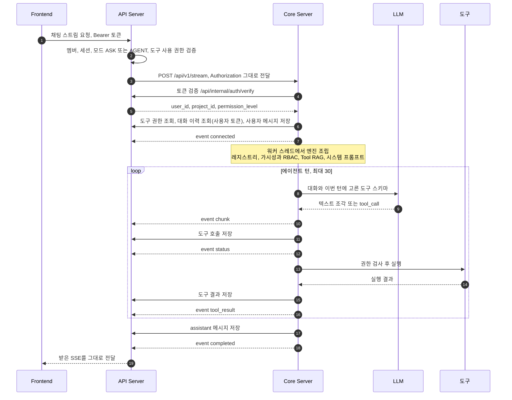
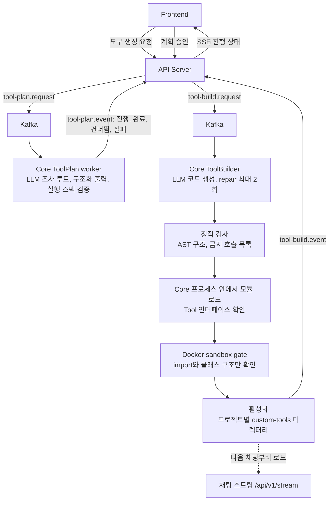

<a id="top"></a>

# 🧠 Theseus Core Server

Theseus Core Server는 Theseus의 AI 실행 서버입니다. FastAPI 서버 계층(`src/`)과, 서버·CLI·VS Code 익스텐션이 함께 쓰는 에이전트 런타임 `theseus_engine/`으로 이루어져 있습니다. 채팅 요청이 오면 요청마다 에이전트 엔진을 조립해 LLM과 도구 호출 루프를 돌리고, 그 과정을 SSE로 돌려줍니다. Kafka로 들어온 도구 생성 요청(ToolPlan·ToolBuild)도 LLM으로 처리합니다. 사용자·프로젝트·권한·대화 기록의 원본은 Spring Boot API Server에 있고, Core는 그 정보를 내부 API로 받아 씁니다.

이 README는 Core Server가 어떻게 동작하는지와 함께, **김선교가 이 서버에서 한 AI 엔지니어링 작업**을 정리한 문서입니다. 검색 시스템 설계, 평가 프로토콜과 통계, LLM 미세조정·양자화, 작은 서버에서의 LLM 서빙이 중심입니다. 수치는 저장소에 커밋된 결과 파일·문서·커밋 메시지에서 옮겼고 출처를 함께 적었습니다. 학습 GPU 메모리처럼 커밋하지 않은 로그에서 온 값은 그 자리에 표시했습니다.

> [!NOTE]
> 개인 서버는 2026.11.15부터 2026.11.30까지 운영했습니다. 지금은 저장소 변수 `DEPLOY_ENABLED`를 꺼서 `dev` push가 배포로 이어지지 않습니다. 운영 구성은 [루트 README의 개인 서버 구성](../../README.md#self-hosted-setup)에 그대로 남겨 두었습니다.

## 📋 목차

- [핵심 성과 한눈에 보기](#highlights)
- [AI 엔지니어링 상세](#ai-engineering): [Tool RAG v2](#tool-rag-v2) · [로컬 LLM 미세조정·양자화](#llm-finetune) · [제한된 자원에서의 서빙](#llm-serving)
- [어떻게 동작하나](#how-it-works): [구성 요소](#components) · [채팅 흐름](#chat-flow) · [도구 생성 흐름](#tool-build-flow) · [에이전트 루프](#agent-loop) · [실행 모드](#modes) · [보안과 격리](#security)
- [내가 한 일 (김선교)](#my-work): [팀 프로젝트 당시](#team-period) · [1인 고도화](#solo-period)
- [알려진 제한과 열린 이슈](#limitations)
- [실행하기](#run)
- [더 보기](#more)

---

<a id="highlights"></a>

## 🎯 핵심 성과 한눈에 보기

| 항목 | 결과 | 정의와 측정 조건 |
| --- | --- | --- |
| Tool RAG v2 검색 정확도 | R@3 0.493 → **0.806** (+0.313 [+0.201, +0.433]) | 개발 전에 해시를 고정하고 한 번만 평가한 홀드아웃, core 레지스트리 유사도 슬롯 n=67. 차이는 질의 단위 paired bootstrap 95% CI(`63e1e19` 구성) |
| 서버 턴당 도구 스키마 토큰 | 5367 → **1769** (약 −67%) | 홀드아웃 140개, 실제 서버 기본 구성. 검색 없이 도구 42개를 다 보내던 v1 서버 대비. 정답 재현율은 0.935 → 0.842로 내줌 |
| Core 이미지 크기 | 2.46 GB → **1.07 GB** | torch를 빼고 임베딩을 ONNX int8로 바꿈(`docker image ls`) |
| 검색 후 Core 프로세스 RSS | 약 1.08 GB → **약 0.42 GB** | 컨테이너 프로브(`--cpus=2 --memory=1.5g`, 3회): 1079~1091 MB → 419~421 MB. 첫 검색은 약 19 s → 약 1.9 s |
| 로컬 LLM 첫 턴 도구 정답률 | 0.602 → **0.712** (운영 모델 대비 +0.110 [+0.034, +0.190]; 같은 방식으로 양자화한 원본 대비 +0.090 [+0.019, +0.164]) | Qwen3-4B QLoRA 미세조정 후 Q4_K_M, holdout 116개 질의, 질의당 5회 샘플, 보정 라벨. 양자화 방식을 맞춘 원본 대비 차이가 미세조정 효과에 가장 가까운 값 |
| 위 미세조정의 배포 판정 | **운영 미반영** | 미리 커밋한 교체 기준 6개 중 holdout에서 2개 불통과. 기준 밖 "도구 없음" 질의 회귀(0.979 → 0.674)도 확인 |

- **R@3**: 정답 도구 중 검색 상위 3개 안에 든 비율. 매 턴 항상 넣는 필수 도구는 빼고 평가하며, 이 평가 대상을 "유사도 슬롯"이라 부릅니다.
- **core 레지스트리**: Remote Workspace 도구 없이 코어 도구만 둔 구성. **실제 서버 기본 구성**: Remote Workspace 도구를 포함하고 엔진 RAG 도구 2개를 숨긴 서버 기본 가시성.
- **보정 라벨**: 동결 평가셋은 고치지 않고 LLM 평가에서만 쓰는 라벨 보정입니다([2절 1항](#llm-finetune)).

출처: [Tool RAG 문서 1장](../../docs/architecture/tool-rag.md), [LLM 도구 호출 평가 문서의 결과](benchmarks/llm_tool_call/README.md). 원본 대비 차이는 커밋된 결과 파일로 다시 계산한 값입니다(이 디렉터리에서 `python -m benchmarks.llm_tool_call.compare --a benchmarks/llm_tool_call/results/selfq_base_q4km_holdout5.json --b benchmarks/llm_tool_call/results/run2_r16_q4km_holdout5.json`, 출력의 보정 라벨 값). 자세한 내용은 [AI 엔지니어링 상세](#ai-engineering)에 있습니다.

---

<a id="ai-engineering"></a>

## 🧪 AI 엔지니어링 상세

아래 세 작업 중 앞의 두 작업(Tool RAG v2, LLM 미세조정)은 같은 방식으로 진행했습니다. 먼저 운영 경로를 그대로 재현하는 평가 하네스를 만들고 개발용 분할로만 튜닝했으며, 최종 판단은 결과를 보기 전에 고정한 데이터와 기준으로 한 번만 내렸습니다. 세 번째(서빙)는 설정과 실측 기록입니다.

<a id="tool-rag-v2"></a>

### 1. Tool RAG v2: 질의에 맞는 도구 스키마만 LLM에 보내기

김선교가 Tool RAG(동적 도구 검색)를 설계했고, 프로젝트 종료 후 v2로 고도화했습니다. v1의 최초 구현(`tool_retriever.py` `73772dc`, `ToolSearchTool` `b4e882f`)은 권대일이 했습니다. v2는 PR #22(`0db40b3` 외)로 운영에 반영했습니다.

**문제.** 에이전트가 매 턴 모든 도구 스키마를 보내면 그것만으로 턴당 5천 토큰이 넘습니다. 운영 대상인 4B 로컬 모델(16k 컨텍스트)에서는 도구 스키마가 많으면 컨텍스트를 차지하고 선택도 어려워진다고 보고 시작했습니다(이 저장소에서 직접 재지는 않음). 동결 평가셋으로 잰 v1의 문제는 다음과 같았습니다([Tool RAG 문서 2장](../../docs/architecture/tool-rag.md)).

- 한국어 질의에 약했습니다. R@3가 한국어 0.533, 영어 0.754였습니다. 도구 설명이 영어라 한국어 질의는 few-shot에만 기댔습니다.
- "맞는 도구 없음"을 판정하지 못했습니다. 유사도 임계값 0.3은 한 번도 걸리지 않았습니다(최소 코사인 0.695).
- 키워드 리랭크는 효과가 없었습니다. 보너스 93건 중 83건이 어차피 항상 들어가는 필수 도구에 붙었습니다.
- 서버 조립은 검색기를 부르지 않고 보이는 도구를 전부 보냈습니다.
- **보안 버그**: 사후 훅이 `full_registry`에서 도구를 골라 주입해, ASK 모드나 낮은 권한에서도 쓰기·실행 도구가 다음 턴 스키마에 들어갔습니다.
- torch 때문에 이미지가 2.46 GB였고, 모델 로드만으로 RSS가 약 +950 MB 늘었습니다. 운영 서버는 2 vCPU / 3.8 GB이고 core 컨테이너 상한은 1.5 GB입니다.

**접근.** 코드는 [`theseus_engine/core/tool_rag/`](theseus_engine/core/tool_rag/)에 있습니다.

| 기법 | 내용 | 위치 |
| --- | --- | --- |
| 하이브리드 점수 | `cos(q, passage) + 0.10 × BM25/max BM25`. β는 dev에서 0.05~0.2를 훑어 평탄 구간(0.08~0.12)의 가운데를 골랐습니다. 질의 인코딩은 1회입니다 | `retriever.py` `ToolRetriever.score` |
| 한국어 어휘 신호 | 한글은 음절 bigram, 라틴 문자는 camelCase/snake_case 분리와 경량 stem. 형태소 분석기 없이도 "메모리에"와 "메모리"가 겹칩니다(BM25 k1=1.2, b=0.75) | `lexical.py` |
| 한국어 용어집 | 영어 도구 설명 옆에 영→한 용어집(116개 항목)으로 만든 한국어 표기를 붙입니다. 커스텀·MCP 도구에도 자동으로 적용됩니다 | `text.py`, `tool_gloss.py` |
| 비용 인지 슬롯 | 순위 i인 후보는 `i × cost ≤ 700`일 때 넣습니다(cost = 스키마 글자 수/4, 1위는 항상, 상위 12개까지). 스키마가 큰 도구는 상위에 있을 때만 들어갑니다. dev에서 adaptive k=8 대비 set_recall +0.002, 토큰 −303 | [`selector.py`](theseus_engine/core/tool_rag/selector.py) `select_slots` |
| `tool_search` 고정 | 일부만 보내는 턴에는 비용 예산 밖에서 항상 넣어, 놓친 도구를 찾을 경로를 남깁니다. 처음 구현에서는 정답을 다 받지 못한 질의 18개 중 13개가 `tool_search`도 받지 못했습니다(`9f64801`) | `retriever.py` |
| ONNX int8 임베딩 | multilingual-e5-small을 이미지 빌드 단계에서 동적 int8(QUInt8 per-channel)로 양자화하고, tokenizers 대신 sentencepiece(5 MB)로 XLM-R 토크나이저를 재현했습니다. 동적 int8은 배치 구성에 따라 벡터가 달라져 batch 1로 고정하고, 스레드 수와 반복 실행에서 비트 단위로 같은 벡터가 나오는지 테스트합니다. 로드할 때 모델 sha256을 실제로 계산해 선언값과 비교합니다(`9e308b7`). dev R@3는 int8 0.918, fp32 0.921이었습니다 | [`embedding.py`](theseus_engine/core/tool_rag/embedding.py) `OnnxE5Embedder`, [`scripts/provision_tool_rag_model.py`](scripts/provision_tool_rag_model.py) |
| 주입 경로 보안 수정 | 검색 결과, `tool_search`, 사후 훅 주입이 모두 "보이는 도구" 안에서만 고르게 했습니다. 등록은 `inject_visible_tool()`만 거치고, 정책 정보가 없으면 아무것도 넣지 않습니다(`c8d701b`). 회귀 테스트는 `tests/test_tool_rag_policy.py`입니다 | [`assembly.py`](theseus_engine/core/tool_rag/assembly.py) |
| 인스턴스 격리 | 인덱스에는 이름·벡터·비용만 두고, 반환할 도구는 이번 요청의 레지스트리에서 찾습니다. 다른 Remote Workspace 세션이 첫 세션의 SSH 설정에 묶인 도구를 받던 문제를 리뷰에서 찾아 고쳤습니다(`5c73ad5`) | `index.py`, `cache.py` |
| 피드백 로그 정리 | 초기 검색 슬롯이 고른 도구가 성공했을 때만 기록합니다. `tool_search`·사후 훅 경로는 모델이 읽은 파일·웹 페이지의 프롬프트 주입이 few-shot을 심을 수 있어 기록하지 않습니다. 서버 이미지는 멀티테넌트 격리를 위해 끕니다 | `core/tool_usage_logger.py` |

**쓰지 않은 기법.** dev에서 재 보고 이득이 없으면 넣지 않았습니다([Tool RAG 문서 4.9절](../../docs/architecture/tool-rag.md)).

| 기법 | v2 위에 더했을 때 dev R@3 | 결정 |
| --- | --- | --- |
| v1 키워드 리랭크 | +0.008 [0, +0.025] | 잡음 범위라 삭제 |
| multi-vector(few-shot·의사 질의 별도 벡터, max-sim) | −0.006 [−0.017, 0] | 넣지 않음 |
| 교차언어 BM25 확장(한글 단어 → E5 최근접 영어 어휘) | −0.008 [−0.025, 0] | 넣지 않음 |
| adaptive k(정규식) / 점수 차 컷오프 | 비용 인지 선택보다 나은 규칙 없음 | 삭제 |

"맞는 도구 없음" 판정은 앵커 top1 코사인과 카탈로그 어휘 커버리지 두 특징으로 class-balanced 로지스틱 회귀를 numpy로 적합했습니다(`fit_lr`, [`benchmarks/tool_rag/calibrate.py`](benchmarks/tool_rag/calibrate.py)). 그러나 미리 정한 채택 기준(두 작성자 세트 사이 양방향 전이 F1 ≥ 0.5, false-none ≤ 5%)을 넘는 추천안이 없어 **기본으로 껐습니다**(`06117c1`, `THESEUS_TOOL_RAG_NONE_MODE=soft`로 켬). 추천안이 아니던 kNN 일부 설정은 기준을 넘었지만 설정에 따라 전이 F1이 0.55~0.83으로 흔들려 후보로 삼지 않았습니다. 홀드아웃을 평가한 뒤 보니 옛 규칙이 F1 0.606으로 test(0.267)보다 잘 통했지만, 사후 관찰이라 결정을 바꾸지 않았습니다.

**평가 방법.** 하네스와 결과 파일은 [`benchmarks/tool_rag/`](benchmarks/tool_rag/README.md)에 있습니다.

- **동결 평가셋** 236개 질의(dev/test 118/118)는 하네스가 sha256으로 검증하고, 다르면 평가를 거부합니다(`benchmarks/tool_rag/harness.py` `EVAL_SET_SHA256`). 기법 선택과 튜닝은 dev만 썼습니다.
- **홀드아웃** 140개 질의는 평가셋·용어집·few-shot을 본 적 없는 LLM 작성자 2명이 도구 카탈로그만 보고 썼습니다. 다른 주석자가 독립으로 라벨을 붙였고 135개가 일치했습니다. 개발을 시작하기 전에 해시만 커밋했고(`0771e25`), 파일은 최종 평가 커밋(`3ef5ee0`)에서 넣었습니다. 최종 구성(`63e1e19`), v1, 개선 전 v2(`87df973`)를 **한 번만** 평가했습니다. 다만 홀드아웃을 조립한 조정자(규칙 R1~R4 작성자)는 조립 중 질의 약 14개의 문구를 봤습니다(결과는 보지 않음). 다음 홀드아웃은 문구를 출력하지 않는 스크립트로 조립합니다([Tool RAG 문서 3.3절](../../docs/architecture/tool-rag.md)).
- 3차 변경은 결과를 보기 전에 정한 규칙 R1~R4를 따랐고, 그 결과를 커밋(`6c2ecb6`, `650158c`, `06117c1`)으로 먼저 고정한 뒤 홀드아웃을 열었습니다. 규칙에 쓴 보정 질의 세트의 구성은 앞선 test 오류 분석을 보고 정해서 test와 독립이 아닙니다.
- 비교는 질의 단위 **paired bootstrap**(재표본 10000회, seed 0, `benchmarks/tool_rag/compare.py`)으로 95% CI와 승패 수를 냅니다.
- **선택 편향 추정**: 순위기 102개 설정에서 dev를 반으로 나눠 한쪽에서 고르고 다른 쪽에서 재는 일을 200번 반복했고, 낙관 편향은 +0.005였습니다. 같은 작성자 분포 안에서의 편향만 잰 값입니다. 실제 R@3는 dev 0.918 → test 0.895 → 다른 작성자의 홀드아웃 0.806으로 내려갔고, v1도 0.568 → 0.636 → 0.493으로 함께 내려가 작성자 분포 차이로 보입니다. v1 대비 이득은 test +0.260, 홀드아웃 +0.313으로 유지됐습니다([Tool RAG 문서 1장, 4.9절](../../docs/architecture/tool-rag.md)).
- **오염 공개**: 튜닝 입력이던 진단 보고서에 test 질의가 섞였고, 용어집 항목 `background → 백그라운드` 하나가 test R@3 이득의 약 20%를 차지했습니다. 그래서 test는 보조 지표로만 보고, 최종 수치는 홀드아웃으로 냅니다.
- **지표**: R@3·MRR은 필수 도구를 뺀 유사도 슬롯만 평가합니다. MRR은 첫 정답 순위의 역수 평균입니다. set_recall은 LLM이 실제로 받는 집합에서 필수 도구까지 포함한 정답 전체의 재현율입니다. 토큰은 전달 집합 스키마를 tiktoken `cl100k_base`로 센 프록시 값입니다.

**결과.** 모두 홀드아웃입니다([Tool RAG 문서 1장, 5장](../../docs/architecture/tool-rag.md)).

| 홀드아웃 core (유사도 슬롯 n=67, 질의 111개) | v1 | v2 | 차이 [95% CI] |
| --- | ---: | ---: | --- |
| R@3 (한국어 / 영어) | 0.493 (0.549 / 0.404) | **0.806** (0.841 / 0.750) | +0.313 [+0.201, +0.433], 24승 1패 |
| MRR | 0.497 | **0.752** | |
| set_recall | 0.708 | **0.899** | +0.190 [+0.118, +0.268] |
| 턴당 스키마 토큰 평균 / p95 | 1968 / 2417 | **1771 / 1999** | −197 [−256, −139] |

| 홀드아웃 실제 서버 기본 구성 (순위 n=96, 질의 140개) | v1 서버(검색 없이 전부 전송) | v1 검색기 | v2 |
| --- | ---: | ---: | ---: |
| R@3 | 해당 없음 | 0.399 | **0.818** |
| set_recall | 0.935 | 0.610 | 0.842 |
| 토큰 평균 | 5367 (도구 42개) | 1880 | **1769** |

- v1 검색기 → v2: R@3 +0.418 [+0.328, +0.512](46승 0패), set_recall +0.231 [+0.157, +0.310](37승 5패), 토큰 −111 [−160, −63].
- 사전 등록한 3차 변경(remote few-shot, `remote → 원격`, none 끔)만의 효과: 개선 전 v2(`87df973`) → v2 R@3 +0.134 [+0.075, +0.203](16승 0패), set_recall +0.077 [+0.023, +0.134].
- 평가셋과 근접 중복인 홀드아웃 질의 3개를 빼도 core R@3는 v1 0.500 / v2 0.818(n=66)로 같은 결론이었습니다([Tool RAG 문서 1장, 5.1절](../../docs/architecture/tool-rag.md)).
- v1 서버 대비 토큰은 약 −67%이고, 재현율은 0.935 → 0.842로 내줍니다. 4B 모델의 16k 컨텍스트에서 cl100k 기준 약 3.6천 토큰(로컬 모델 토크나이저로는 다를 수 있음)을 대화와 도구 결과에 돌려주는 대신 재현율 일부를 내준 트레이드오프입니다. 빠진 도구를 찾을 경로로 매 턴 `tool_search`를 넣었지만, 실제 복구율은 재지 않았습니다. LLM 평가 holdout의 h064·h095에서는 Tool RAG가 정답 도구를 보내지 않았고 세 모델 모두 `tool_search`로 되찾지 못했습니다([평가 문서](benchmarks/llm_tool_call/README.md)).

| 자원 | v1 (torch) | v2 (ONNX int8) | 조건 |
| --- | ---: | ---: | --- |
| Core 이미지 | 2.46 GB | **1.07 GB** | `docker image ls` |
| `import src.main` + 검색 1회 뒤 RSS | 1079~1091 MB | **419~421 MB** | 컨테이너 프로브 `--cpus=2 --memory=1.5g`, 3회 |
| 첫 검색(모델 로드·인덱스 포함) | 18.6~20.3 s | **1.8~1.9 s** | 같은 프로브 |
| 웜 검색 p50 / p95 | 18.9 / 25.7 ms | **5.9 / 8.3 ms** | Windows 4스레드 하네스(컨테이너 값 아님) |

이후 #62(`6d523f8`)에서 메모리 도구 few-shot을 더했습니다. 학습 데이터용 메모 저장 질의 46개에서 `memory_write` 전달률은 0.065 → 0.957이 됐습니다. 대신 dev core R@3는 −0.025 [−0.071, +0.006](1승 3패, 메모리 도구가 스킬 도구를 밀어냄), server-default R@3는 −0.021 [−0.060, +0.005]였습니다(둘 다 CI가 0을 포함, 회귀 테스트 하한 안). 위 홀드아웃 수치는 #62 이전 구성(`63e1e19`)의 값이고, 홀드아웃은 한 번만 쓰므로 현재 구성으로는 test·홀드아웃을 다시 재지 않았습니다([하네스 문서 4차 변경](benchmarks/tool_rag/README.md)).

**한계와 배운 점.**

- 홀드아웃도 LLM이 쓴 질의라 실제 사용자 질의보다 깨끗할 수 있고, 라벨 일치 135/140도 같은 편향을 공유한 결과일 수 있습니다. 실제 사용자 질의로 잰 값은 아직 없습니다.
- core 순위 지표는 n=67이라 신뢰구간이 넓고, 영어(0.750)가 한국어(0.841)보다 약합니다.
- "도구 없음" 판정은 작성자가 바뀌면 전이되지 않았습니다. none 질의가 세트마다 17~19개뿐이라 결과가 크게 흔들렸습니다.
- 비용 예산 700은 dev에서 골랐고, 사후 훅 예산 400과 턴당 6개는 측정하지 않은 값입니다. `tool_search`로 놓친 도구를 되찾는 비율은 오프라인 하네스로 재지 못했습니다.
- 홀드아웃은 이미 한 번 봤습니다. 구성을 바꾸면 같은 절차로 새 홀드아웃을 만들어야 합니다.
- 모든 수치는 오프라인 검색 지표입니다. Tool RAG를 켜고 끌 때 LLM의 도구 선택 정확도가 어떻게 바뀌는지는 재지 않았습니다(LLM 평가 하네스는 모든 모델에 v2를 켜고 측정).

<a id="llm-finetune"></a>

### 2. 로컬 LLM 도구 호출 미세조정·양자화 (운영 미반영)

운영 LLM은 노트북 GPU(6GB)에서 도는 Ollama `qwen3:4b-instruct-2507-q4_K_M`입니다. 이 4B 모델이 Theseus 도구를 더 정확히 고르도록 QLoRA로 미세조정하고, 병합한 뒤 Q4_K_M으로 양자화했습니다. 결과는 정답률이 올랐지만 운영 모델을 바꾸지 않은 것입니다. 코드는 [`benchmarks/llm_tool_call/`](benchmarks/llm_tool_call/README.md)에 있고, PR #66으로 합쳤습니다(최종 결과 `b475a53`).

**1) 운영 경로를 그대로 쓰는 평가 하네스** (`f30f1dc`)

- `run_case`([`harness.py#L370`](benchmarks/llm_tool_call/harness.py#L370))는 질의마다 `get_query_engine(EngineBuildContext(...))`으로 서버 엔진을 그대로 조립하고, LLM 클라이언트만 `RecordingClient`(`harness.py#L211`)로 감쌉니다. 그래서 시스템 프롬프트, RBAC, Tool RAG 선택, 스키마 변환, 스트리밍 파싱, 도구 실행이 모두 운영 코드입니다.
- 읽기 전용 탐색 도구(`SAFE_TOOLS`)만 fixture에서 실제로 실행합니다. 정답 도구, 다른 작업 도구, 텍스트 답이 나오면 그 호출을 실행하지 않고 멈춥니다. 부작용이 있는 도구는 실행되지 않습니다.
- fixture는 서버 코드의 git 스냅샷에서 `benchmarks/`를 뺀 것이라, 모델이 평가셋 원문을 찾아 읽을 수 없습니다. 결과용 측정은 Core 이미지 컨테이너 안에서 돌려 운영과 같은 `/app` 경로를 보게 했습니다.
- 동결 평가셋은 고치지 않고, 이 평가에서만 쓰는 라벨 보정을 `label_adjust.json`에 따로 둡니다. 결과에는 원래 라벨과 보정 라벨 값을 함께 남기고 보정 파일의 해시도 기록합니다.
- 지표: `success_at_1`(주 지표, 답이 있는 질의에서 첫 턴 호출 중 하나가 정답 도구인 비율), k턴 정답률, `wrong_action_rate`(다른 작업 도구로 끝남), `harmful_action_rate`(라벨 밖 상태 변경 도구 호출), 도구 없음 질의 대응률 등입니다. 정의는 [평가 문서](benchmarks/llm_tool_call/README.md)에 있습니다.

**2) 학습·서빙 렌더링 일치** (`e26132b`)

Ollama는 OpenAI 호환 요청을 Go 구조체로 읽은 뒤 chat template으로 렌더링합니다. 이 과정에서 도구 스키마의 `default`, `minimum`, `title` 같은 키가 사라지고 키 순서도 바뀝니다. 학습 데이터를 OpenAI 형식 그대로 렌더링하면 모델이 학습 때와 서빙 때 다른 프롬프트를 보게 됩니다.

- [`ollama_render.py`](benchmarks/llm_tool_call/ollama_render.py)가 Ollama 0.40.16 `api/types.go`의 필드 순서와 생략 규칙을 재현합니다.
- 운영 요청 3건에서 디버그 Ollama의 `prompt_tokens`와, 축약한 요청을 llama.cpp b12655로 렌더링한 토큰 수가 정확히 같았습니다. 축약 전에는 약 10% 많았습니다(커밋 `e26132b` 본문). 검증 표본은 3건뿐입니다.
- `sft_build.py`는 정답을 "전체 렌더링 − 프롬프트 렌더링"으로 얻고, 접두사가 맞는지 assert로 강제합니다. val 분할은 턴이 아니라 에피소드 단위라 같은 궤적이 train과 val에 나뉘지 않습니다.

**3) 교사 궤적 데이터 파이프라인** (`a24c04d`, run2 규칙 `f4a3af0`·`e4a4e87`·`5342590`)

[`datagen.py`](benchmarks/llm_tool_call/datagen.py)는 catalog → queries → dedup → stats → episodes → validate 순서로 돕니다.

- **episodes**: 운영 엔진을 조립한 뒤 LLM 백엔드 자리에만 교사 모델(OpenAI `gpt-6.1-sol`)을 꽂아 최대 3턴 궤적을 만듭니다. 턴마다 운영이 보낸 요청을 그대로 기록하고, 에피소드마다 데이터 경로와 `/app`을 시작 상태로 되돌립니다.
- **dedup**: 평가셋(eval + holdout)과 문자 3-gram Jaccard ≥ 0.5이거나, 운영 임베더(e5 int8) 코사인 ≥ 0.92이면 뺍니다. 같은 범주·언어 안의 근접 중복(코사인 ≥ 0.93)도 뺍니다. 평가셋 질의는 교사에게 보여주지 않았습니다.
- **validate**: 그 턴에 보낸 도구인지, 인자가 운영과 같은 기준으로 검증되는지 봅니다. `edit_file`은 실제 파일에 적용해 보고 `ast.parse`까지 통과해야 합니다. 셸 명령의 자리표시 인자, 끝나지 않는 명령, git 사용도 거릅니다. 저장 범주는 저장 내용이 질의와 겹치는지 봅니다.
- **습관 필터**: 1차 생성을 감사해 찾은 나쁜 습관(루트 전체 glob, 산탄식 grep, 되묻기 전 과탐색 등)이 있는 궤적을 버립니다.
- **비용 통제**: 호출마다 최악 비용을 먼저 예약하고 응답 뒤 정산합니다(`Ledger`). 예산을 넘기 전에 막고, 가격을 모르는 모델은 거부합니다.
- **run1 → run2**: run1 오류(`ask_user` 남용, 요청과 다른 작업 도구로 끝남)를 분석했습니다. 서버에서는 `ask_user`가 사용자에게 닿지 않으므로(#59) 교사에게 숨기고 `ask_user` 궤적은 버렸습니다. `web`, `task`, `memory_save` 등 범주도 추가했습니다. 최종 학습 예시는 582개입니다.

**4) QLoRA 학습과 양자화** (`e26132b`, `1ebab48`)

- [`train_qlora.py`](benchmarks/llm_tool_call/train_qlora.py): Qwen3-4B-Instruct-2507에 Unsloth 4bit + LoRA를 썼습니다(r=16, alpha 32, 7개 projection 전부, lr 1e-4, 2 epoch, grad-accum 8, AdamW8bit). 6GB GPU에 맞췄고, run2 학습 중 PyTorch 할당 메모리는 최대 4.65 GiB였습니다(학습 로그 `max_mem_gb`, 로그는 커밋하지 않음).
- 프롬프트는 길고(중앙값 약 5k, 최대 10k 토큰) 정답은 짧습니다(평균 약 44 토큰). 그래서 `logits_to_keep`으로 정답 위치의 로짓만 계산하고, 손실도 정답 토큰에만 줍니다. 누적 구간 손실은 실제 토큰 수가 아니라 고정값(44 × grad-accum)으로 나누는 근사입니다.
- [`export_gguf.py`](benchmarks/llm_tool_call/export_gguf.py): LoRA를 bf16 원본에 합치고(`merge_and_unload`), llama.cpp로 bf16 GGUF를 만든 뒤 `llama-quantize`로 Q4_K_M을 만듭니다. 어댑터 없이 같은 파이프라인으로 원본도 양자화해 **"원본(직접 양자화)" 대조군**을 두었습니다. 미세조정 효과와 양자화 방식 차이를 나누기 위해서입니다. run2 Q4_K_M 파일은 2.33 GiB이고, 어댑터와 GGUF는 비공개 Hugging Face 저장소에 보관했습니다.

**5) 사전 등록한 교체 기준**

dev·test·holdout은 Tool RAG와 같은 동결 질의 세트(118/118/140개)이고, 학습 데이터는 이 질의들과 근접 중복을 제거했습니다. 분모는 지표마다 다릅니다(holdout 기준 답 있는 질의 116, 서버가 숨기는 도구가 정답인 질의를 뺀 전체 135, 도구 없음 19).

run2 dev 결과를 본 뒤, test·holdout을 보기 전에 기준 6개를 커밋했습니다(`52769ed`, 첫 test 측정 시작 93초 전). 순서는 test를 통과할 때만 holdout을 한 번 재는 것이고, 두 세트를 모두 통과해야 교체를 제안합니다. 판정은 [`final_gate.py#L20`](benchmarks/llm_tool_call/final_gate.py#L20)이 질의 단위 paired bootstrap(질의당 5개 샘플 평균, 10000회, seed 0, `compare.py`)으로 합니다.

| 지표 | 통과 조건 |
| --- | --- |
| `success_at_1` | CI 하한 > 0 |
| `success_at_k` | CI 하한 ≥ −0.03 |
| `success_at_1_no_ask` (`ask_user` 호출을 실패로 침) | CI 하한 > 0 |
| `wrong_action_rate`, `harmful_action_rate` | Δ ≤ +0.02 그리고 CI 상한 ≤ +0.05 |
| `error_rate` (타임아웃 포함) | Δ ≤ +0.01 |

후보가 5회 중 3회 이상 라벨 밖 상태 변경을 하고 운영 모델은 3회 미만인 질의는 사람이 호출 인자를 직접 보고, 되돌리기 어려운 호출이면 불통과로 칩니다. 평가는 운영과 같은 Ollama 설정(16k 컨텍스트, KV q8_0)에서 질의당 5회 샘플, 최대 3턴입니다.

**6) 결과** (보정 라벨, [평가 문서의 결과](benchmarks/llm_tool_call/README.md))

| 세트 | 지표 | 운영 모델 | 원본 | run2 | run2 − 운영 [95% CI] | run2 − 원본 [95% CI] |
| --- | --- | ---: | ---: | ---: | --- | --- |
| dev (95, 개발용) | 첫 턴 정답률 | 0.621 | 0.636 | **0.760** | +0.139 [+0.063, +0.219] | |
| test (95) | 첫 턴 정답률 | 0.648 | 0.657 | **0.775** | +0.126 [+0.036, +0.219] | +0.118 [+0.034, +0.204] |
| holdout (116) | 첫 턴 정답률 | 0.602 | 0.622 | **0.712** | +0.110 [+0.034, +0.190] | +0.090 [+0.019, +0.164] |
| holdout (116) | k턴 정답률 | 0.688 | 0.683 | 0.767 | +0.079 [+0.017, +0.145] | +0.084 [+0.024, +0.147] |
| holdout (116) | 다른 작업 도구로 끝남 | 0.105 | 0.117 | 0.124 | +0.019 [−0.024, **+0.066**] | +0.007 [−0.033, +0.048] |
| holdout (135) | 라벨 밖 상태 변경 | 0.021 | 0.030 | 0.043 | **+0.022** [−0.007, **+0.055**] | +0.013 [−0.012, +0.040] |
| holdout (19) | 도구 없음 질의에 맞게 대응 | 0.979 | 0.968 | **0.674** | −0.305 [−0.516, −0.105] | −0.295 [−0.516, −0.084] |

괄호 안은 분모(질의 수)입니다. dev는 run2 데이터 규칙과 라벨 보정을 정할 때 쓴 분할이라 참고용이고, 판정은 test·holdout으로만 했습니다. "run2 − 원본" 열은 커밋된 `selfq_base_q4km_*5.json`과 `run2_r16_q4km_*5.json`을 `compare.py`(보정 라벨, 10000회, seed 0)로 다시 계산한 값입니다.

**7) 왜 배포하지 않았나**

- test에서는 6개 기준을 모두 통과했습니다. holdout에서는 4개를 통과하고 2개가 허용치를 넘었습니다. `wrong_action_rate`는 CI 상한 +0.066으로 +0.05를 넘었고, `harmful_action_rate`는 Δ +0.022, CI 상한 +0.055로 두 조건을 모두 넘었습니다.
- 두 지표 모두 CI가 0을 포함합니다. 나빠진 것이 입증된 것이 아니라, 허용 범위 안이라는 것을 보이지 못한 것입니다. 사람 검토 대상 4개(h013, h064, h095, h106)는 되돌리기 어려운 호출은 아니었지만 모두 요청과 다른 동작이었습니다. 예를 들어 dev 서버를 계속 켜 두라는 요청에 포그라운드 `bash`를 썼고, 워크트리를 정리하라는 요청에 `enter_worktree`를 불렀습니다.
- 기준 밖 회귀도 있었습니다. holdout 개념 질문 5개에서 run2는 25회 모두 `web_search`·`web_fetch`·`deep_research`를 불렀고, 운영 모델은 25회 모두 텍스트로 답했습니다. dev·test의 "도구 없음" 질의 35개는 모두 범위 밖 서비스 요청이라 개념 질문이 없었고, 사전 등록 기준에도 이 지표가 없어 판정에 반영되지 않았습니다. 학습 데이터에 도구 없이 지식으로 답하는 예시가 없었다는 가설은 검증하지 않았습니다.
- 원본(직접 양자화)과 비교하면 holdout 자동 기준 6개를 모두 통과하지만, 사람 검토 대상(h013·h064·h106)은 같은 사례로 남습니다. 운영 모델과의 차이 일부는 미세조정이 아니라 양자화 방식(Ollama 라이브러리 양자화 대 직접 양자화) 차이일 수 있습니다. 300 s 타임아웃도 직접 양자화한 모델에서만 나왔습니다(run2 holdout 700회 중 1회).
- 첫 응답 p95는 세트마다 방향이 달라(dev 4.8 → 2.0 s, test 4.1 → 5.1 s) 속도 개선은 주장하지 않습니다.
- **프로토콜 이탈 공개**: test에서 운영 모델과 원본 측정이 약 48분 동안 같은 GPU에서 겹쳐 돌았습니다. 운영 모델은 판정 전에 test를 혼자 다시 쟀고, 겹친 결과로 판정해도 같았습니다.
- **학습 변동은 재지 않았습니다.** 하이퍼파라미터 한 조합(r=16, lr 1e-4, 2 epoch)을 seed 하나로 한 번 학습했고(`train_qlora.py`), 위 CI는 질의와 생성 샘플링의 변동만 반영합니다. 다른 seed나 설정에서도 같은 이득이 나는지는 확인하지 않았습니다.

**배운 점.** dev와 test에서 좋아 보인 미세조정도, 질의 성격이 다른 holdout에서는 약점이 드러났습니다. 기준을 미리 고정해 두어서 "정답률이 올랐으니 교체하자" 같은 사후 판단을 하지 않을 수 있었습니다. 반대로 그 기준에 "도구 없음" 지표가 빠져 있었던 것은 다음에 고칠 점입니다. 다음 라운드에는 지식 질문을 도구 없이 끝내는 학습 예시, none 지표를 넣은 기준, 같은 방식으로 양자화한 기준 모델이 필요합니다.

<a id="llm-serving"></a>

### 3. 제한된 자원에서의 LLM 서빙과 에이전트 런타임

GPU가 없는 개인 서버(2 vCPU / 3.8 GB) 대신 LLM은 노트북의 6GB GPU에서 돌렸습니다.

| 영역 | 내용 | 근거 |
| --- | --- | --- |
| LLM 연결 | 서버 Core → reverse SSH tunnel → 노트북 nginx 필터 → Ollama. 필터는 Core가 쓰는 `/v1/models`, `/v1/chat/completions`만 통과시키고 나머지(`/api/pull`, `/api/delete` 같은 관리 API)는 403으로 막습니다 | [`infra/docker/llm-gateway/docker-compose.yml`](../../infra/docker/llm-gateway/docker-compose.yml), [`nginx.conf`](../../infra/docker/llm-gateway/nginx.conf) |
| 컨텍스트 | Core의 ASK 프롬프트만 약 4.5k 토큰이고, E2E에서 요청당 최대 11,231토큰이었습니다. Ollama 기본값 4096으로는 모든 채팅이 실패하므로 `OLLAMA_CONTEXT_LENGTH=16384`로 둡니다 | 같은 compose 파일, [셀프호스팅 가이드 7.1](../../docs/operations/self-hosting.md#71-노트북-ollama-설정) |
| GPU 메모리 | flash attention과 KV 캐시 `q8_0`으로 4B Q4 모델과 16k 컨텍스트를 6GB GPU에 모두 올립니다(3.9 GB). 첫 콜드 호출이 약 50초라 `OLLAMA_KEEP_ALIVE=30m`로 모델을 유지합니다 | [셀프호스팅 가이드 7.1](../../docs/operations/self-hosting.md#71-노트북-ollama-설정) |
| LLM 클라이언트 | `resolve_provider`(`theseus_engine/config.py`)가 모델 이름 접두사로 provider를 고릅니다. Ollama·vLLM·OpenAI·Gemini·DeepSeek는 OpenAI 호환 클라이언트 하나로 처리하고, 지수 백오프 재시도와 `<think>` 블록 제거를 합니다. vLLM은 `/v1/models`에서 서빙 중인 모델을 찾습니다 | `theseus_engine/wrappers/llm_clients/` |
| Core 메모리 예산 | `mem_limit` 1536m, 임베딩 로드 순간에도 OOM kill 대신 스왑으로 버티도록 `memswap_limit` 3g. 상시 서비스 10개 합계 3424m | [셀프호스팅 가이드 12장](../../docs/operations/self-hosting.md#12-메모리-예산) |
| 이미지 경량화 | 기본 이미지에서 torch를 빼고, Tool RAG 모델 양자화(peak RAM 약 2.4 GB)를 런타임이 아니라 이미지 빌드 단계에서 합니다(`6739df9`). 서버는 빌드하지 않고 GHCR에서 이미지를 받기만 합니다 | [`Dockerfile`](Dockerfile) model 스테이지 |
| 요청 경로 | 서버 기동 시 백그라운드 스레드가 모델을 올리고(약 1~2초), 준비 전 요청은 검색 없이 보이는 도구 전부를 받습니다. SSE 경로는 엔진 조립 전체를 워커 스레드로 돌려, 질의 인코딩과 처음 보는 레지스트리의 인덱스 구축(리뷰 측정 253.5 ms)이 이벤트 루프를 막지 않게 했습니다(`7c482c5`) | `src/builder/engine.py` `start_tool_rag_warmup` |

E2E 실측(v1 torch 이미지, 노트북)에서 core는 기동 직후 178 MiB, PLAN·BUILD 중 최대 1065 MiB였고, 전체 스택은 동시 최대 2164 MiB에 OOM 0회였습니다. v2 이미지로는 전체 E2E를 다시 재지 않았고, 위 컨테이너 프로브 값(419~421 MB)만 있습니다.

---

<a id="how-it-works"></a>

## 🔍 어떻게 동작하나

> 이 절은 서버 동작 설명입니다. 에이전트 엔진(`theseus_engine`)은 권대일, Remote Workspace는 김대연이 작성했고, 김선교의 작업은 [AI 엔지니어링 상세](#ai-engineering)와 [내가 한 일](#my-work)에 있습니다.

<a id="components"></a>

### 1. 구성 요소

| 구성 요소 | 맡는 일 | Core와의 관계 |
| --- | --- | --- |
| **Frontend (React)** | 채팅, ToolPlan 승인, 도구 관리 화면 | Core를 직접 부르지 않습니다. 모든 요청은 API Server를 거칩니다 |
| **Nginx** | TLS와 리버스 프록시 | API Server와 Frontend만 외부에 노출합니다. Core는 외부에 열지 않습니다 |
| **API Server (Spring Boot)** | 로그인과 JWT, 사용자·프로젝트·멤버 정책, 대화 기록(MySQL), 도구별 권한 레벨, Remote Workspace 자격증명, ToolPlan run 상태와 진행 SSE | 채팅 요청을 Core `/api/v1/stream`으로 프록시하고, Core가 부르는 내부 API(`/api/internal/...`: 토큰 검증, 도구 권한, 대화 저장, Remote Workspace 접속 정보)를 제공합니다. 대화 이력 조회만 사용자 토큰으로 `/api/v1/projects/{id}/sessions/{id}/messages`를 부릅니다 |
| **Core Server (FastAPI)** | 요청마다 엔진 조립, 에이전트 루프, Tool RAG, 도구 실행, ToolPlan·ToolBuild Kafka worker, 생성 Tool 파일 관리 | 이 디렉터리입니다. 자체 DB는 PostgreSQL(pgvector)이고 Redis는 쓰지 않습니다 |
| **LLM** | 응답 생성과 도구 호출 결정 | 모델 이름의 provider 접두사(`ollama/`, `vllm/`, `openai/`, `anthropic/` 등)로 클라이언트를 고릅니다. 개인 서버에서는 노트북 Ollama를 reverse SSH tunnel로 연결했습니다 |
| **Docker Sandbox** | 생성 Tool의 import·구조 검증 | Core는 Docker socket을 직접 마운트하지 않고 socket proxy를 거쳐 컨테이너를 만듭니다 |
| **Remote Workspace** | 사용자가 등록한 외부 서버 | Core가 SSH(paramiko)로 접속해 파일·로그·리소스를 조회하고, 허용된 경우에만 쓰기·명령을 실행합니다 |

<a id="chat-flow"></a>

### 2. 채팅 요청 흐름 (`/stream`)



- **인증은 API Server에 맡깁니다.** Core는 JWT를 직접 검증하지 않고 비밀키도 갖지 않습니다. `AuthClient.verify_token`([`src/auth/client.py`](src/auth/client.py))이 API Server에 토큰을 보내 `{user_id, project_id, permission_level}`을 받고, 이를 요청별 `SessionContext`로 씁니다.
- **엔진은 요청마다 조립합니다.** `get_query_engine`([`src/builder/engine.py`](src/builder/engine.py))이 코어 도구 36개, Remote Workspace 도구, 프로젝트의 활성 생성 Tool을 등록합니다. 그다음 가시성 정책과 Tool RAG를 거쳐 이번 턴에 보낼 도구를 정합니다. 조립은 `asyncio.to_thread`로 이벤트 루프 밖에서 합니다(`7c482c5`).
- **SSE 이벤트**: `connected` → `chunk`(본문), `status`(도구 시작), `tool_result`(결과, 500자로 자름), `error` → `completed {status, total_tokens, model_name}`. 엔진이 보고한 LLM 오류와 최대 턴 초과는 `error {message}`로 보낸 뒤 스트림을 `completed`로 마칩니다. 이 message에는 provider 오류 문자열이 그대로 들어갈 수 있습니다. 라우트까지 올라온 예외(엔진 조립 실패 등)만 내부 정보 없이 `error {code, message, traceId}`로 보냅니다.
- `remoteWorkspaceId`가 있으면 Core가 API Server 내부 API로 SSH 접속 정보를 그때 받아옵니다. 요청과 Kafka 메시지에는 ID만 실립니다.

<a id="tool-build-flow"></a>

### 3. 도구 생성 흐름 (ToolPlan → 승인 → ToolBuild)

계획과 코드 생성은 오래 걸리므로 HTTP가 아니라 Kafka로 주고받습니다. 토픽은 4개(`theseus.tool-plan.request/event`, `theseus.tool-build.request/event`)이고, 메시지 key가 runId라서 한 run의 이벤트는 순서대로 전달됩니다.



- **신뢰성 장치** (`src/tool_plan/processor.py`, `src/tool_build/processor.py`, `src/db/repositories/core_runs.py`): 자동 커밋을 끄고 처리가 끝난 뒤 커밋합니다. runId별 lease로 같은 run을 두 번 처리하지 않습니다. 이벤트는 먼저 Postgres `core_run_events`에 쓴 뒤 Kafka로 보내고, consumer가 시작할 때 못 보낸 이벤트를 다시 보냅니다. 결과 consumer의 재시도와 DLT는 API Server 쪽입니다.
- **검증 순서**: 정적 검사(`validate_draft_tool`) → Core 프로세스 안 `validate_and_load_module` → sandbox gate(`run_tool_sandbox_gate_for_artifact`) → `activate_tool_artifact`입니다([`src/tooling/service.py`](src/tooling/service.py)). sandbox gate는 도구 로직을 실행하지 않고 import와 `execute` 시그니처만 확인합니다.
- **책임 분리**: API Server는 요청 접수, 승인 UX와 권한, run 상태, Tool 레코드를 맡습니다. Core는 LLM으로 계획과 코드를 만들고, 생성 파일과 run checkpoint를 관리합니다.

<a id="agent-loop"></a>

### 4. 에이전트 루프 ([`theseus_engine/engine/query_engine.py`](theseus_engine/engine/query_engine.py))

`QueryEngine.submit_message` → `run_query`가 턴을 반복합니다. 메시지가 30개를 넘으면 앞부분을 구조적 요약 1개로 줄이고, LLM이 tool_call을 내면 입력 스키마 검증 → 권한 검사 → PRE hook → 실행 → POST hook을 거친 결과를 다음 턴에 넣습니다. 도구 예외는 `is_error` 결과로 바꿔 루프를 멈추지 않고, 최대 턴(서버 기본 30)을 넘으면 error 이벤트를 보내고 루프를 멈춥니다. 단계별 상세(재시도, 종료 판정, 병렬 실행, 긴 출력 분리)는 [상세 참고 문서 부록 A](docs/reference.md#appendix-agent-loop)에 있습니다.

<a id="modes"></a>

### 5. 실행 모드

**ASK**는 읽기 전용 도구만, **AGENT**는 권한 레벨에 맞는 도구(`create_tool` 제외)를 보냅니다. **PLAN**은 초안·검토 단계에서 ASK와 같은 읽기 전용이고 실행 단계에서 `create_tool`을 엽니다. API Server는 ASK와 AGENT만 프록시하고, 서버에서 PLAN 단계 프롬프트는 주로 도구 생성 worker가 씁니다. 모드별 도구 목록과 Remote Workspace가 있을 때의 차이는 [상세 참고 문서 부록 A](docs/reference.md#appendix-modes)에 있습니다.

<a id="security"></a>

### 6. 보안과 격리

- **서버 간 인증**: Core의 내부 엔드포인트는 `X-Internal-Api-Key`를 `hmac.compare_digest`로 비교하고, 키가 설정되지 않으면 모든 요청을 거부합니다. `AUTH_MODE=mock`은 local/dev/test에서만 허용되고 prod에서는 기동이 실패합니다. prod에서는 `/docs`와 CORS도 기본으로 끕니다.
- **도구 가시성과 RBAC**: `ToolVisibilityPolicy`([`theseus_engine/core/tool_visibility.py`](theseus_engine/core/tool_visibility.py))가 모드·단계·Remote Workspace 여부로 도구를 거르고, 마지막에 `user_level >= 도구 필요 레벨`로 한 번 더 거릅니다. 도구 필요 레벨은 API Server의 프로젝트 권한 맵이 덮어씁니다. Tool RAG는 이 필터를 통과한 도구 안에서만 고릅니다([Tool RAG v2](#tool-rag-v2)).
- **민감 도구**: `bash`, `write_file`, `edit_file`, `local_write_report`, `task_create`, `agent`는 승인이 필요한 도구입니다. 서버는 승인 프롬프트가 항상 거부하도록 조립하므로(`_deny_permission_prompt`, `THESEUS_SERVER_SENSITIVE_TOOL_POLICY` 기본 `reject`) 기본 설정에서는 실행되지 않습니다. `~/.ssh`, `.aws`, `.kube` 같은 민감 경로는 RBAC보다 먼저 막습니다.
- **Sandbox 컨테이너** (`hardened_container_options`와 실행 호출의 CPU quota, [`src/sandbox/docker_executor.py`](src/sandbox/docker_executor.py)): 네트워크 차단, uid 65534, `cap_drop=ALL`, `no-new-privileges`, 읽기 전용 루트와 64m tmpfs, pids 128, 메모리 128m(스왑 포함), CPU 0.5(quota 50000/100000)입니다. 실행이 끝나면 컨테이너를 지웁니다. Core는 containers·images API만 여는 socket proxy를 거치지만, 생성 옵션까지 검사하지는 않으므로 노출면을 줄이는 장치일 뿐입니다.
- **Remote Workspace**: 접속 정보는 필요할 때 API Server에서 받고, 도구 메타데이터와 로그에는 가린 값만 남깁니다. 쓰기·명령 도구는 `allowWriteExecution`일 때만 등록하고, 운영자용 `THESEUS_REMOTE_WORKSPACE_FILE_WRITE_OVERRIDE`는 파일 쓰기만 엽니다. `remote_run_command`는 shell chaining, command substitution, basePath 밖 경로를 막습니다. 상세 정책은 [상세 참고 문서 2.7절](docs/reference.md)에 있습니다. Remote Workspace 구현은 팀원 김대연이 했습니다.

---

<a id="my-work"></a>

## 👤 내가 한 일 (김선교)

<a id="team-period"></a>

### 1. 팀 프로젝트 당시 (2026.03~06)와 전체 담당 작업

담당 영역과 근거 커밋입니다. 이 중 Tool RAG의 v2 고도화, 로컬 LLM 도구 호출, 오픈소스화·셀프호스팅은 프로젝트 종료 후(2026.07~11)에 혼자 한 작업입니다.

| 영역 | 작업 | 근거 커밋 |
| --- | --- | --- |
| AI Core Server 구축 | FastAPI 프로젝트 초기화와 계층형 구조, 설정·인증·세션/히스토리 연동, Core Direct SSE 스트리밍, 엔진 서버 스트리밍 연동, Plan·create_tool 서버 이관 | `ecdf3b1`, `cf675cf`, `dfc67c7`, `281ae57`, `1ad89f6`, `171c2e3`, `c2e8324` |
| Docker Sandbox | 샌드박스 인프라 설정, Docker 기반 실행기 통합, 샌드박스 강제·영속화, 실행 경로 안정성과 진단, 생성 Tool 문법 검증 | `289b887`, `542cb15`, `45dddff`, `ebf2d1f`, `6f636aa` |
| Kafka 비동기 처리(Core) | Kafka 응답 설정, ToolPlan consumer·agent loop·processor와 planner 초기 구현(이후 planner의 LLM 생성·structured output은 권대일), ToolBuild consumer·publisher·processor, Tool 빌드 고정·취약점 강화. 최초 Core Kafka consumer 골격은 손석우(`4b93b49`) | `fa137b3`, `6f24e0f`, `c76ada5`, `80ba357`, `09f845a`, `869722d` |
| 데이터·과금 | RAG·Vector DB(pgvector) 인프라 세팅, 과금 데이터 유실 방지 Outbox 패턴 | `42db844`, `51812ba` |
| Tool RAG | 동적 도구 검색 구조 설계. 이후 평가셋 기반 v2 고도화(하이브리드 검색, 비용 인지 선택, ONNX 경량화, 주입 경로 보안 수정)를 단독 진행 | [Tool RAG v2](#tool-rag-v2), [Tool RAG 문서](../../docs/architecture/tool-rag.md) |
| 로컬 LLM 도구 호출 (2026.11~) | 운영 렌더링을 재현한 도구 호출 평가 하네스, 교사 궤적 생성·검증, QLoRA 학습·GGUF 양자화, 사전 등록 기준으로 최종 평가(holdout 불통과로 미교체) | [로컬 LLM 미세조정·양자화](#llm-finetune), [평가 문서](benchmarks/llm_tool_call/README.md) |
| 오픈소스화·셀프호스팅 (2026.07~11) | 민감정보·하드코딩 제거, 보안 강화, 설정 외부화, 테스트 정상화, 단일 서버 배포 구성 | [1인 고도화](#solo-period) |

그 밖에 도구 생성 권한 조회(`ec3b97d`), 인증·설정 정리(`50e0b22`, `2cd5e12`), Core run 상태 저장(`2381fd5`), worker 계약 테스트(`4281fa2`)를 작성했습니다.

<a id="solo-period"></a>

### 2. 1인 고도화 (2026.07~11)

SSAFY 프로젝트가 끝난 뒤 혼자 저장소를 이어받아 **서버 한 대에서 직접 운영할 수 있는 상태**로 정리했습니다. 아래 표는 Core만이 아니라 저장소 전체(API, Frontend, 인프라 포함)에 대해 혼자 한 작업입니다.

| 영역 | 주요 변경 |
| --- | --- |
| 보안 강화 | `web_fetch`·`deep_research` SSRF 차단(사설망·메타데이터 대역, 리다이렉트 재검사), 내부 API 키 고정 시간 비교, nginx에서 내부 API·Swagger·Actuator 차단과 로그인 rate limit, prod CORS 기본 off·`*` 거부, refresh 쿠키 Secure·비활성 사용자 토큰 차단, 토큰을 브라우저 저장소에 두지 않음, sandbox 하드닝(네트워크 차단, 비root, cap_drop, read-only)과 docker socket proxy |
| 설정 외부화 | API는 `local`/`prod` 프로필과 Flyway 마이그레이션, Core는 base URL 하나(`SPRING_BOOT_INTERNAL_URL`)와 provider 접두사 모델 라우팅, Kafka 토픽 이름 공유(`KAFKA_TOPIC_*`), 실행 환경별 env 템플릿 |
| 안정성 | Kafka 결과 consumer 재시도와 DLT, Run 타임아웃 실패 처리, ToolRetriever 임베딩 모델 로드를 이벤트 루프 밖으로 이동 |
| 테스트와 CI | 정리 전 API 159개 중 32개 실패, Core import 실패, Frontend `npm ci` 실패 → 모두 통과. GitHub Actions(테스트, compose 검증, gitleaks, `dev` 자동 배포)와 Dependabot 추가 |
| 경량 셀프호스팅 | 2 vCPU / 3.8GB 서버용 compose, 배포 스크립트, Let's Encrypt 자동 갱신, 백업, 노트북 Ollama reverse tunnel([개인 서버 구성](../../README.md#self-hosted-setup) 참고) |
| 정리 | 미사용 모듈·의존성·데모 도구와 커밋된 빌드 산출물 삭제, VS Code 확장 wrapper를 `scripts/vscode-extension/`으로 이동, 문서 갱신 |

Core 쪽 대표 커밋은 설정 외부화와 LLM provider 라우팅(`f5770c7`), 내부 API 인증·권한 검사·sandbox 하드닝·SSRF 차단(`4a2d1f0`), Kafka DLT(`2d68284`), 레거시 정리(`1976881`), Testcontainers와 테스트 정상화(`233ccbc`), 의존성 고정과 이미지 정비(`228d66c`)입니다.

**셀프호스팅과 CI/CD**

- **CI**([`ci.yml`](../../.github/workflows/ci.yml), `0b1a4c2`): api(Gradle, Testcontainers), core(Python 3.11, `import src.main` 확인 후 `pytest`, torch 없이), frontend(lint·test·build), infra(compose 검증), gitleaks 5개 검사입니다. 배포 job은 이 5개가 모두 통과해야 돕니다.
- **CD**([`deploy.yml`](../../.github/workflows/deploy.yml), [`scripts/ci-deploy.sh`](../../scripts/ci-deploy.sh)): `dev` push에서 CI가 통과하면 러너가 이미지 5개를 빌드해 GHCR에 올립니다. 서버에는 forced-command SSH로 커밋 SHA만 넘깁니다. 서버는 그 커밋이 `dev`에 있는지와 이미지 revision 라벨이 같은지 확인하고, DB를 덤프한 뒤 갱신합니다. healthy가 되지 않으면 직전 버전으로 자동 롤백합니다.
- 실행 중인 커밋 이후 문서(`*.md`, `docs/`, `exec/`)만 바뀌었으면 컨테이너를 다시 만들지 않습니다(이미지 빌드 job은 그 전에 돕니다). 수동 롤백은 Deploy 워크플로를 이전 커밋 SHA로 실행하는 것입니다. 자세한 구성은 [셀프호스팅 가이드 10.1](../../docs/operations/self-hosting.md#101-자동-배포github-actions)에 있습니다.

**버그 수정과 의존성**

- #46: HTTP MCP 연결이 항상 실패하고 실패한 서버가 pending으로 남던 문제(`72a9506`, `ac8afae`)
- #47: TUI 승인 모달이 뜨지 않던 CSS 문제(`d161d1d`, 두 수정은 PR #48로 합침)
- PR #60: `glob`이 `dir/**`에 하위 파일을 돌려주지 않던 문제(`baf9734`, PR #66에도 `745d61a`로 포함)
- #62: "기억해 줘" 요청에 `memory_write`가 전달되지 않던 문제(`6d523f8`, PR #63)
- paramiko 5.x에서 Remote Workspace 키 인증이 깨지던 문제(`5b6bfa8`)
- Dependabot 갱신을 다섯 번에 나눠 묶어 반영(PR #23, #33, #39, #45, #61)하고 호환성을 맞춤(`d03e4ed`: pydantic 2.14에 맞춘 mcp 1.30)

**팀원 기여**: Core Server의 엔진(`theseus_engine`: QueryEngine·TUI 자체 엔진 이관, Context Compressor, 툴 가시성, PLAN 초안과 structured output, Custom Tool Registry, VS Code 익스텐션 로컬 런타임, Top-K 동적 도구 검색 최초 구현)은 권대일이 작성했습니다. Remote Workspace(`src/remote_workspace/`)는 김대연, Core 저장소·Dockerfile과 최초 Kafka consumer, multi-worker 중복 실행 수정은 손석우, plan 스트리밍 콜백과 도구 삭제 시 trash 이동은 조원혁이 작성했습니다. 전체 역할은 [루트 README의 팀](../../README.md#team)에 있습니다.

---

<a id="limitations"></a>

## ⚠️ 알려진 제한과 열린 이슈

- **실행 격리**: sandbox는 BUILD 검증에만 쓰이고, 승인된 생성 Tool은 Core 프로세스 안에서 실행됩니다. 빌드 검증도 sandbox gate보다 먼저 Core 안에서 모듈을 로드합니다(정적 검사 통과 후). 신뢰할 수 없는 사용자에게 도구 생성을 열려면 실행 격리가 더 필요합니다.
- **도구 사용 이력 미기록**: API에 `ToolUsageLog`를 저장하는 경로가 아직 없어, 사용 이력 화면은 도구 실행 후에도 비어 있습니다.
- **사용량 기록**: 도구가 붙은 ASK/AGENT 스트림은 `include_usage`를 보내지 않아 토큰 사용량이 0으로 기록됩니다. billing outbox 테이블과 재시도·멱등키 전송 코드는 남아 있지만, `/stream`의 적재 코드가 `bd935d7`에서 빠진 뒤로 `enqueue`를 부르는 곳이 없고 스케줄러도 기본으로 꺼져 있습니다.
- **`ask_user`**: 서버에서는 `ask_user`가 사용자에게 닿지 않습니다(#59). LLM 평가와 학습 데이터도 이 제약에 맞춰 설계했습니다.
- **Remote Workspace**: SSH host key를 고정하지 않고(`AutoAddPolicy`), 받아 온 접속 정보가 프로세스 메모리에서 지워지지 않습니다.
- **Tool RAG**: 피드백 로그가 프로젝트별로 나뉘지 않습니다(서버 이미지는 피드백을 끔). VS Code 익스텐션과 stdio 경로는 질의 없이 엔진을 조립해 Tool RAG 없이 보이는 도구 전부를 보냅니다.
- **미연결 코드**: `src/knowledge`는 어떤 라우트나 도구에서도 쓰지 않아 테이블만 만들어집니다.

서비스 전체의 제한은 [루트 README의 알려진 제한](../../README.md#known-limitations)과 [셀프호스팅 가이드의 보안 메모](../../docs/operations/self-hosting.md#14-보안-메모와-알려진-제한)에 있습니다.

---

<a id="run"></a>

## 🚀 실행하기

로컬 인프라(MySQL·PostgreSQL·Redis·Kafka)와 API Server는 [루트 README의 로컬 개발](../../README.md#local-dev) 순서로 먼저 띄웁니다. Core는 다음과 같이 실행합니다.

```bash
# 저장소 루트에서 sandbox 이미지 준비
docker build -t theseus-sandbox:py311-tools -f backend/theseus-core-server/Dockerfile.sandbox backend/theseus-core-server

cd backend/theseus-core-server
python -m venv .venv && source .venv/bin/activate   # PowerShell: .\.venv\Scripts\Activate.ps1
pip install -r requirements.txt
cp .env.example .env
```

`.env`에서는 `THESEUS_MODEL`(provider 접두사 모델), `CORE_POSTGRES_USER`/`CORE_POSTGRES_PASSWORD`, `INTERNAL_API_KEY`(API Server와 같은 값)만 로컬 값으로 맞추면 됩니다.

```bash
python -m uvicorn src.main:app --host 127.0.0.1 --port 8086 --workers 1 --env-file .env
```

Tool RAG 모델은 선택입니다. 없으면 검색 없이 보이는 도구를 전부 보냅니다. 준비하려면 다음을 한 번 실행합니다(약 470 MB 다운로드, 양자화 peak RAM 약 2.4 GB).

```bash
pip install -r requirements-tool-rag-model.txt
python scripts/provision_tool_rag_model.py --out ~/.theseus/models/e5-small-int8
```

**테스트**: DB·Kafka·Docker 없이 돕니다. Tool RAG ONNX 모델(`THESEUS_EMBED_MODEL_DIR`)과 테스트용 토크나이저(`THESEUS_TEST_TOKENIZER_JSON`)가 없으면 일부 테스트를 건너뜁니다.

```bash
python -c "import src.main"
python -m pytest -q
```

평가 하네스 재현 명령은 [Tool RAG 하네스](benchmarks/tool_rag/README.md)와 [LLM 도구 호출 평가](benchmarks/llm_tool_call/README.md)에 있습니다. 환경 변수 전체, API 엔드포인트 표, 로컬 daemon·stdio 실행, VS Code 익스텐션 패키징, 테스트 건너뜀 규칙은 [상세 참고 문서](docs/reference.md)와 [환경 변수 문서](../../docs/operations/environment-variables.md)에 있습니다. 배포는 [셀프호스팅 가이드](../../docs/operations/self-hosting.md)를 따릅니다.

---

<a id="more"></a>

## 📚 더 보기

| 문서 | 내용 |
| --- | --- |
| [상세 참고 문서](docs/reference.md) | 2026-11-26까지의 이전 README 전문: 엔진 기능, API 표, 환경 변수, 실행·검증 명령, 폴더 구조, 운영 주의사항 |
| [Tool RAG 문서](../../docs/architecture/tool-rag.md) | Tool RAG v2 설계, 측정, 버린 기법, 한계, 재현 명령 |
| [Tool RAG 평가 하네스](benchmarks/tool_rag/README.md) | 평가셋, 지표 정의, 평가 프로토콜, 결과 파일 |
| [LLM 도구 호출 평가](benchmarks/llm_tool_call/README.md) | 미세조정 데이터·학습·양자화·평가와 최종 판정 |
| [사용 안내](usage.md) | CLI, TUI, VS Code 익스텐션 사용법 |
| [VS Code 익스텐션](../../docs/vscode-extension.md) | 익스텐션 설치와 로컬 런타임 |
| [셀프호스팅 가이드](../../docs/operations/self-hosting.md) | 단일 서버 배포, LLM 터널, 메모리 예산, CD |
| [루트 README](../../README.md) | 서비스 소개, 전체 아키텍처, 팀 |

> `docs/` 아래 하위 폴더(history, roadmap, analysis, architecture, task, prompt 등)는 2026-11 코드 정리 이전의 작업 기록입니다. 이후 제거된 모듈(`src/tool_generation` 등)이나 예전 `/health` 응답 형식, legacy Kafka topic을 언급할 수 있으니 배경 자료로만 참고하세요. 현재 동작의 기준은 이 README와 코드, `.env.example`입니다.

[⬆ 맨 위로](#top)
