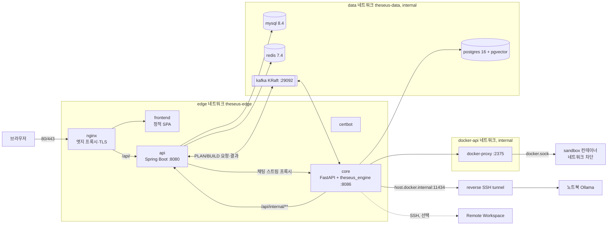
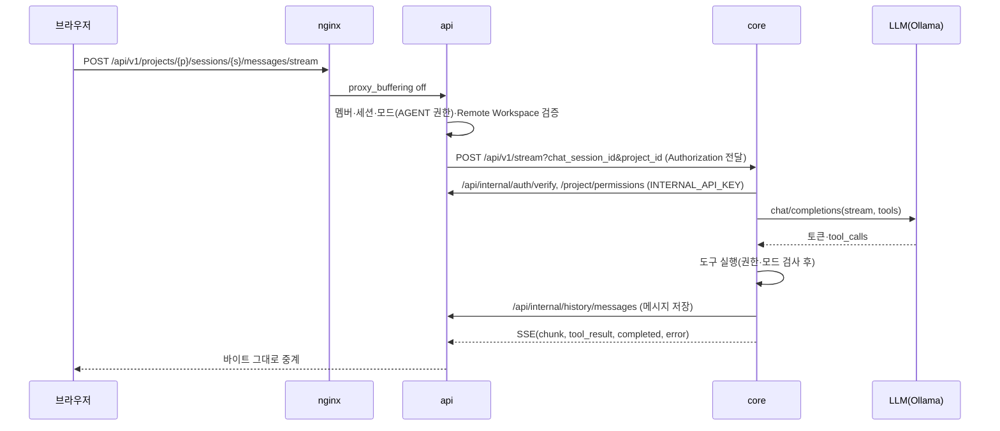
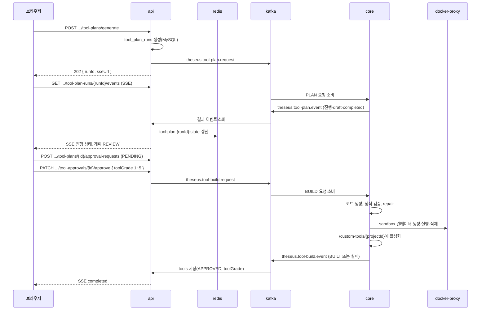

# 시스템 아키텍처

Theseus는 서버 한 대에서 docker compose로 모든 구성 요소(엣지, 애플리케이션, 데이터 저장소)를 함께 실행합니다.
이 문서는 그 단일 서버 구성의 서비스, 네트워크, 포트, 데이터 저장 책임, 주요 요청 흐름을 설명합니다.
설치와 운영 절차는 [셀프호스팅 가이드](../operations/self-hosting.md), 기준 구성 파일은 [`infra/docker/selfhost/docker-compose.yml`](../../infra/docker/selfhost/docker-compose.yml)입니다.

## 1. 전체 구성



| 구분 | 서비스 | 이미지 | 주요 책임 |
| --- | --- | --- | --- |
| 엣지 | nginx | `theseus-nginx`(nginx 1.27.5-alpine 기반) | TLS 종료, `/api/` → api, 나머지 → frontend, SSE 무버퍼링, 내부 경로 차단, 로그인 rate limit, 보안 헤더 |
| | certbot | `certbot/certbot:v3.3.0` | 12시간마다 인증서 갱신(첫 발급은 `scripts/issue-cert.sh`) |
| | frontend | `theseus-frontend` | 빌드된 React SPA 정적 서빙 |
| 애플리케이션 | api | `theseus-api` | 인증(JWT), 사용자·프로젝트·멤버 권한, 채팅 세션·메시지, ToolPlan·승인·Tool 메타데이터, Core 스트림 프록시, Kafka 발행·결과 처리, SSE |
| | core | `theseus-core` | 에이전트 실행(ASK/AGENT 스트림), PLAN 작성, Tool 코드 생성·검증·활성화, Remote Workspace 도구 |
| | docker-proxy | `tecnativa/docker-socket-proxy:0.3.0` | Core가 sandbox 컨테이너를 만들 때 쓰는 제한된 Docker API |
| 데이터 | mysql | `mysql:8.4.6` | API 서비스 데이터(Flyway 마이그레이션) |
| | postgres | `pgvector/pgvector:0.8.1-pg16` | Core 실행 데이터, 지식 검색(pgvector) |
| | redis | `redis:7.4.5-alpine` | refresh 토큰, Run 진행 상태(TTL) |
| | kafka | `confluentinc/cp-kafka:7.6.1` | API ↔ Core 비동기 작업(KRaft 단일 노드) |
| 일회성 | kafka-init | `confluentinc/cp-kafka:7.6.1` | 토픽 4개와 DLT 2개 생성 |
| | core-permissions | `alpine:3.20.6` | Core bind 디렉터리 소유권(uid/gid 999) 정리 |
| 선택 | kafka-ui(`ops` 프로필) | `kafbat/kafka-ui:v1.2.0` | 읽기 전용 Kafka 점검(루프백 8091) |

LLM은 서버에 두지 않습니다. 개발 노트북의 Ollama를 reverse SSH tunnel로 연결하고, 필요하면 외부 provider(OpenAI, Anthropic, Gemini, DeepSeek)로 바꿀 수 있습니다.

## 2. 네트워크와 포트

| 네트워크 | 이름 | 성격 | 연결 서비스 |
| --- | --- | --- | --- |
| edge | `theseus-edge`(브리지 이름 고정) | 외부 통신 가능 | nginx, certbot, frontend, api, core, kafka-ui |
| data | `theseus-data` | `internal: true`(외부 차단) | api, core, mysql, postgres, redis, kafka, kafka-init, kafka-ui |
| docker-api | `theseus-docker-api` | `internal: true` | core, docker-proxy |

core가 edge에도 붙는 이유는 LLM 터널(호스트 docker0 IP), 외부 LLM API처럼 밖으로 나가는 트래픽이 필요하기 때문입니다(Tool RAG 임베딩 모델은 이미지에 들어 있어 내려받지 않습니다). core-permissions는 `network_mode: none`입니다.
ufw는 edge 브리지(`theseus-edge`)에서 docker0 IP의 11434 포트로 들어오는 트래픽만 추가로 허용합니다.

| 서비스 | 컨테이너 포트 | 호스트 publish |
| --- | --- | --- |
| nginx | 80, 443 | **80, 443**(유일한 외부 노출) |
| frontend | 80 | 없음 |
| api | 8080 | 없음 |
| core | 8086 | 없음 |
| kafka | 29092(INTERNAL), 29093(CONTROLLER) | 없음 |
| mysql / postgres / redis | 3306 / 5432 / 6379 | 없음 |
| docker-proxy | 2375 | 없음 |
| kafka-ui | 8080 | `127.0.0.1:8091`(`ops` 프로필에서만) |

nginx가 막는 경로: `/api/internal/**`, `/swagger-ui`, `/v3/api-docs`, `/actuator`는 모두 404입니다. nginx는 location을 고르기 전에 URI를 정규화하므로 `%69nternal`, `//`, `/../` 우회도 같은 규칙에 걸립니다.

## 3. 데이터 저장 책임

| 저장소 | 소유 | 저장 내용 |
| --- | --- | --- |
| MySQL(`theseus`) | api | `users`, `projects`, `project_members`, `chat_sessions`, `chat_messages`, `tool_plan_groups`, `tool_plans`, `tool_plan_runs`, `tool_approvals`, `tools`, `tool_usage_logs`, `remote_workspaces`, `billing_usages`. 스키마는 Flyway(`db/migration/V1__init.sql`)가 소유하고 Hibernate는 검증만 합니다 |
| PostgreSQL(`theseus_core`) | core | `tool_plans`(Core 측 계획), `core_run_checkpoints`, `core_run_events`(Run lease·이벤트 재발행), `billing_outbox`, `knowledge_documents`, `knowledge_chunks`(pgvector) |
| Redis | api | `RT:<userId>`(refresh 토큰), `tool:plan:<runId>:state`(Run 진행 상태, 기본 TTL 30분). 최종 저장소가 아니며 백업하지 않습니다 |
| Kafka | api, core | 작업 요청·결과 이벤트(보관 168시간). 최종 저장소가 아닙니다 |
| `/opt/theseus/custom-tools` | core | 승인·빌드된 Tool 코드(`*_tool.py`)와 메타데이터(`*.meta.json`), 프로젝트별 디렉터리 |
| `/opt/theseus/core-data` | core | 엔진 런타임 데이터(`THESEUS_DATA_DIR`) |
| `/opt/theseus/sandbox-tmp` | core, sandbox | sandbox 검증용 임시 작업 디렉터리(호스트와 Core가 같은 경로를 공유) |
| `theseus-hf-cache` 볼륨 | core | 선택 기능(`requirements-torch.txt`)용 모델 캐시(`HF_HOME`). Tool RAG 모델은 이미지의 `/opt/models/e5-small-int8` |

최종 상태는 MySQL에 두고, 진행 중 상태는 Redis와 SSE로 전달합니다.

## 4. 주요 흐름

### 4.1 인증

- 로그인(`POST /api/v1/auth/login`)은 access 토큰을 응답 본문으로, refresh 토큰을 `refresh_token` 쿠키(`Path=/api/v1/auth`, HttpOnly, prod에서 Secure)로 줍니다. Frontend는 access 토큰을 메모리에만 둡니다.
- 401(`AUTH-*`)을 받으면 Frontend가 refresh를 한 번만(single-flight) 시도합니다. refresh 토큰은 Redis `RT:<userId>`와 대조합니다.
- Core는 사용자 토큰을 직접 검증하지 않고, API의 `/api/internal/auth/verify`에 `INTERNAL_API_KEY`와 함께 물어봅니다.

### 4.2 채팅 스트림(ASK / AGENT)



- API는 Core SSE 본문을 가공하지 않고 그대로 흘려보냅니다. nginx는 이 경로와 Run 이벤트 경로에 `proxy_buffering off`, `gzip off`, 3600초 타임아웃을 겁니다.
- AGENT 모드에서 Core는 프로젝트 권한과 모드에 맞는 도구만 노출합니다. 승인된 custom Tool도 Core 서버 레지스트리에 로드되어 같은 방식으로 호출됩니다.
- Tool RAG(`THESEUS_TOOL_RAG_ENABLED`, 기본 켜짐)가 보이는 도구 중 이번 턴에 보낼 도구만 고릅니다(필수 도구 + 비용 인지 슬롯, 맞는 도구가 없으면 상위 3개 + tool_search). 임베딩은 이미지에 든 multilingual-e5-small ONNX int8이고, 기동 직후 백그라운드 스레드에서 로드합니다. 로드 전이나 검색 실패 시에는 보이는 도구 전부를 보냅니다. tool_search와 도구 실행 뒤 사후 주입도 보이는 도구 안에서만 합니다. 자세한 내용은 [Tool RAG](./tool-rag.md)를 참고하세요.

### 4.3 PLAN → 승인 → BUILD



- PLAN 진행 단계는 REQUEST_RECEIVED → PLAN_DRAFTING → PLAN_STRUCTURING → VALIDATING → COMPLETED이고, BUILD는 VALIDATING → (REPAIRING) → SANDBOXING → ACTIVATING → BUILT 순으로 이벤트가 옵니다.
- SSE가 끊겼다가 다시 붙으면 API가 Redis에 저장한 상태와 draft를 replay합니다.
- API 결과 consumer가 재시도(지수 백오프 1~10초, 4회)를 다 쓴 레코드는 `<토픽>.DLT`로 보냅니다. 결과 이벤트가 30분 동안 오지 않은 Run은 타임아웃 스케줄러가 실패로 처리합니다.
- Kafka 토픽 계약은 [Tool 생성 Kafka 계약](../api/tool-generation-kafka-contract.md)을 참고하세요.

### 4.4 sandbox와 socket proxy

```text
core ── tcp://docker-proxy:2375 ──▶ docker-proxy ── /var/run/docker.sock(ro) ──▶ 호스트 Docker
                                     CONTAINERS=1, IMAGES=1, POST=1, EVENTS=0
                                     (exec, build, networks, volumes, swarm 등은 403)
```

- Core는 docker.sock을 직접 마운트하지 않고 docker-api internal 네트워크의 proxy만 씁니다.
- sandbox 컨테이너는 네트워크 차단, uid 65534, `cap_drop: ALL`, `no-new-privileges`, read-only rootfs + `/tmp` tmpfs, pids·메모리(`SANDBOX_MEMORY_LIMIT`, swap 동일) 제한으로 실행됩니다.
- sandbox 컨테이너는 호스트 Docker가 띄우므로, Core는 호스트 경로(`SANDBOX_HOST_TEMP_ROOT`)와 자기 컨테이너 안 경로(`SANDBOX_CONTAINER_TEMP_ROOT`)를 한 쌍으로 알고 bind mount를 만듭니다.
- 현재 sandbox는 **BUILD 검증 게이트에서만** 씁니다. 승인된 Tool의 실제 실행은 Core 프로세스 안에서 이뤄집니다. proxy는 컨테이너 생성 옵션까지 검사하지 않으므로 노출면 축소이지 완전한 격리는 아닙니다. 자세한 내용은 [셀프호스팅 가이드의 보안 메모](../operations/self-hosting.md#14-보안-메모와-알려진-제한)를 참고하세요.

### 4.5 Remote Workspace

프로젝트에 등록한 외부 서버에 Core가 Paramiko SSH로 접속합니다. Core는 `remoteWorkspaceId`로 API의 `/api/internal/remote-workspaces/connection-config`에서 접속 정보를 받고, SSH 키는 `REMOTE_WORKSPACE_KEYS_DIR`(Core의 `/home/appuser/.ssh`, 읽기 전용)에서 읽습니다.
쓰기와 명령 실행 도구는 Workspace의 `allowWriteExecution` 설정에 따라 노출됩니다.

## 5. 신뢰 경계 요약

| 경계 | 통제 |
| --- | --- |
| 인터넷 → 서버 | nginx 80/443만 publish, ufw(22/80/443), 내부 경로 404, `/api/v1/auth/`(로그인) 분당 10회(burst 20), `/api/v1/auth/refresh` 분당 60회(burst 60) |
| 브라우저 → api | JWT access 토큰, refresh 쿠키, prod CORS off(same-origin) |
| api ↔ core | `INTERNAL_API_KEY` 고정 시간 비교, Core는 외부 미노출·CORS off |
| core → Docker | socket proxy(containers/images API만), sandbox 하드닝 |
| core → LLM | 노트북 Ollama는 docker0 IP에만 바인딩된 reverse tunnel(`PermitListen`) |
| 데이터 계층 | data·docker-api 네트워크는 internal, DB·Redis·Kafka 포트 미노출, Redis `requirepass` |

## 6. 로컬 개발 구성

로컬에서는 [`infra/docker/local/`](../../infra/docker/local/)의 compose로 MySQL(13306), PostgreSQL(15432), Redis(16379), Kafka(19092), Kafka UI(18080)를 `127.0.0.1`에만 열고, API·Core·Frontend는 IDE나 터미널에서 실행합니다.
Frontend 개발 서버는 `/api`를 API(기본 `http://localhost:8080`)로 프록시하므로 운영과 같은 same-origin 요청 구조를 유지합니다. 절차는 [README의 로컬 개발](../../README.md#getting-started)과 [infra/README.md](../../infra/README.md)를 참고하세요.
