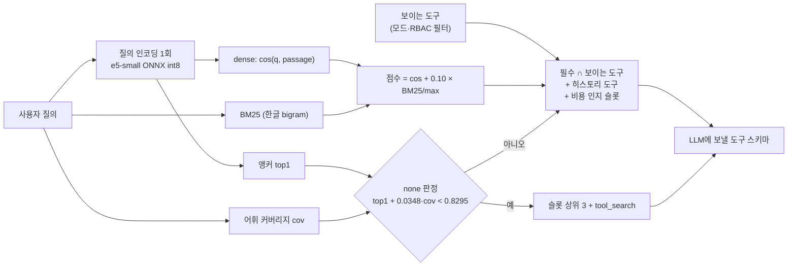

# Tool RAG v2: 질의에 맞는 도구 스키마만 LLM에 보내기

Theseus 에이전트는 코어 도구 36개(Remote Workspace를 붙이면 46개)를 갖고 있습니다. 매 턴 도구 스키마를 전부 보내면
그것만으로 5천~6천 토큰이 들고, 운영 대상인 4B 로컬 모델(컨텍스트 16k)은 도구가 많을수록 고르는 정확도도 떨어집니다.
Tool RAG는 사용자 요청과 관련된 도구만 골라 보내는 검색 단계입니다. 이 문서는 v1의 문제를 평가셋으로 측정한 결과,
v2 설계, 평가 프로토콜, 결과, 한계, 그리고 3단계(임베딩 파인튜닝)를 붙이는 방법을 정리합니다.

- 코드: [`theseus_engine/core/tool_rag/`](../../backend/theseus-core-server/theseus_engine/core/tool_rag/)
- 평가 하네스와 결과: [`benchmarks/tool_rag/`](../../backend/theseus-core-server/benchmarks/tool_rag/README.md)
- 설정: [환경 변수 문서의 Tool RAG 절](../operations/environment-variables.md#tool-rag)

## 1. 요약

같은 평가셋 test 분할(core 레지스트리, 유사도 슬롯 평가 n=70, 질의 106개)에서 v1과 v2를 비교했습니다.

| 지표 | v1 | v2 | 차이 (paired bootstrap 95% CI) |
|---|---|---|---|
| R@3 | 0.636 | **0.895** | +0.260 [+0.152, +0.364], 23승 2패 |
| R@3 한국어 / 영어 | 0.550 / 0.812 | 0.894 / 0.899 | |
| MRR | 0.608 | 0.864 | |
| 실제 전달 집합의 정답 재현율(set_recall) | 0.816 | **0.938** | +0.123 [+0.062, +0.190] |
| 턴당 도구 스키마 토큰 평균 / p95 | 1939 / 2393 | **1622 / 1884** | −317 [−374, −261] |
| 전달 도구 수 평균 | 13.37 | 11.85 | |
| "맞는 도구 없음" 판정 F1 | 0 (한 번도 발동 안 함) | 0.267 | |

서버 기준으로 보면 v1 서버는 검색을 하지 않고 보이는 도구 44개(5593 토큰)를 매 턴 보냈습니다. v2는 같은 서버 레지스트리에서
평균 1606 토큰(−71%)을 보내고 정답 재현율은 0.974에서 0.865로 내려갑니다(5.2절).

자원(같은 하네스, Windows 4스레드 / Linux 컨테이너 2 vCPU·1.5 GB):

| 항목 | v1 (torch + sentence-transformers) | v2 (ONNX int8 + sentencepiece) |
|---|---|---|
| Core 이미지 크기 (`docker image ls`) | 2.46 GB | **1.07 GB** |
| 임베딩 모델 로드 RSS 증가 | +956 MB | **+187 MB** (Linux 컨테이너 +205 MB) |
| 컨테이너에서 `import src.main` + 검색 1회 뒤 프로세스 RSS | 1079~1091 MB | **422~423 MB** |
| 컨테이너 첫 검색(모델 로드·인덱스 포함) | 18.6~20.3 s | **2.1~2.3 s** |
| 웜 검색 p50 / p95 (하네스, test) | 16.6 / 25.1 ms | **5.9 / 10.1 ms** |
| torch import | 함 | 안 함 |

## 2. v1의 문제 (측정 근거)

v1 `ToolRetriever`는 `intfloat/multilingual-e5-small`로 도구마다 "이름: 설명 예시 질문: few-shot…" 한 줄을 임베딩하고,
코사인 + 하드코딩 키워드 보너스로 순위를 매겨 필수 도구 8개 + 상위 k(adaptive)개를 보냈습니다.
동결 평가셋으로 잰 v1의 문제는 다음과 같습니다(베이스라인 결과 `results/baseline_*.json`).

1. **한국어 질의에 약함.** R@3가 한국어 0.533, 영어 0.754(all)였습니다. 도구 설명이 영어라서 한국어 질의는 few-shot 문장에만
   기대고, few-shot이 많은 도구(ingest_document, brief 등)가 상위 3을 차지했습니다(상위 3 등장 횟수 ingest_document 69/213,
   brief 55). few-shot이 없는 도구의 hit@3는 39%로, 있는 도구(77%)의 절반이었습니다.
2. **"맞는 도구 없음"을 판정하지 못함.** 유사도 임계값 0.3은 한 번도 걸리지 않았습니다(최소 코사인 0.695). 그래서 tool_search
   폴백 경로가 사실상 죽어 있었고, none 질의 35개를 하나도 잡지 못했습니다. 반면 top-1 점수만으로도 답 있는 질의와 none 질의를
   AUROC 0.86으로 가를 수 있었습니다.
3. **키워드 리랭크는 효과가 없음.** MRR +0.024였고, 보너스 93건 중 83건이 어차피 항상 들어가는 필수 도구에 붙었습니다.
4. **adaptive k가 한국어에서 부정확.** 공백 단어 수와 정규식으로 복잡도를 셌습니다. k 신호와 정답 개수의 상관은 0.02~0.15였습니다.
5. **서버는 검색을 쓰지 않음.** 서버 조립(`get_query_engine`)은 검색기를 호출하지 않고 보이는 도구를 전부 보냈습니다.
6. **보안 버그.** 서버의 사후 훅(`TheseusHookExecutor._discover_and_inject_tools`)이 `full_registry` 전체에서 도구를 골라
   `active_registry`에 주입했습니다. 검색 결과에는 필수 도구(bash, write_file, edit_file…)가 항상 들어가므로, ASK 모드나
   낮은 user_level에서도 도구 실행 한 번 뒤에 쓰기·실행 도구가 다음 턴 스키마에 들어갔습니다.
7. **자원.** torch CPU가 이미지 2.46 GB의 대부분을 차지했고, 모델 로드만으로 RSS가 약 +950 MB, 첫 로드가 10~20초 걸렸습니다.
   운영 서버는 2 vCPU / 3.8 GB이고 core 컨테이너 상한은 1.5 GB입니다.
8. **피드백 로그 오염.** CLI가 ToolExecutionStarted마다 (질의, 도구)를 기록해서 필수 도구, 에러 난 호출, 중복 질의가 few-shot이
   되었습니다.

## 3. 평가 방법

### 3.1 평가셋과 프로토콜

- 동결 평가셋 236개 질의(한국어 69% / 영어 31%, single·multi·none). `eval_set.jsonl`은 sha256으로 고정돼 있고 하네스가
  해시가 다르면 평가를 거부합니다.
- dev / test를 50:50으로 고정했습니다. **기법 선택과 하이퍼파라미터 튜닝은 dev만** 썼고, test는 최종 구성과 베이스라인에 대해
  **한 번만** 평가했습니다. 최종 구성 코드는 test 평가 전에 sha256으로 고정했고, test 결과를 본 뒤 아무것도 바꾸지 않았습니다.
- 저장소 구현(`--variant v2`)은 그 고정 구성을 옮긴 것입니다. dev·test·all 전 질의에서 상위 8 순위·점수·전달 집합·none 판정이
  Combine 단계 구현과 같았습니다(요약 지표 차이는 nDCG@5의 1e-16 부동소수점 합산 순서뿐).

### 3.2 지표

- **R@k, MRR, Hit@1**: 유사도 슬롯만 평가합니다. 필수 도구는 예측과 정답 모두에서 뺍니다(항상 들어가는 도구로 점수가
  부풀지 않게).
- **set_recall_delivered**: LLM이 실제로 받는 집합(가시성 필터 후)의 정답 재현율입니다. 순위가 좋아도 안 보내면 소용이 없으므로
  운영 지표로는 이것이 더 중요합니다.
- **스키마 토큰**: 전달 집합 도구 스키마(압축 JSON)의 tiktoken cl100k 토큰 수. 로컬 모델 토크나이저의 프록시입니다.
- **none P/R/F1**: 정답이 "맞는 도구 없음"인 질의를 양성으로 봅니다.
- 자원: 콜드 로드 시간, 모델 로드 전후 RSS 차이, 웜 지연(매 호출 전 질의 캐시 비움, 3회 반복).

## 4. 설계



### 4.1 도구 텍스트 (`text.py`, `tool_gloss.py`)

- **순위용 passage**: `"passage: {name} ({이름 단어}): {description} 입력: {파라미터 이름}. 한국어: {용어집 표기} {few-shot…}"`.
  영어 설명 옆에 도구 공통 영→한 용어집(115개 항목, 예: read→읽기, worktree→워크트리)으로 만든 한국어 표기를 붙여 한국어 질의가
  설명과 직접 맞닿게 했습니다. 용어집은 결정적이고 커스텀·MCP 도구에도 자동으로 적용됩니다.
- **BM25 문서**: 이름×3 + (설명 + 용어집 표기) + 파라미터 이름·설명 + few-shot. 토크나이저는 한글을 음절 bigram으로 자르고
  라틴 문자는 camelCase/snake_case로 나눈 뒤 경량 stem과 불용어 제거를 합니다. 형태소 분석기가 없어도 "메모리에"와 "메모리"가
  bigram으로 겹칩니다.
- **앵커**: none 판정 전용으로 v1 레시피("이름: 설명 예시 질문: …")를 따로 임베딩합니다. 보정 계수가 이 분포에 맞춰져 있어서
  피드백 few-shot은 섞지 않습니다.

### 4.2 순위 (`retriever.py`, `lexical.py`)

`score = cos(q, passage) + 0.10 × BM25(q) / max BM25(q)`. 질의 인코딩은 1번이고 BM25·커버리지 계산은 1 ms 미만입니다.
β는 dev에서 0.05~0.2를 훑어 평탄 구간(0.08~0.12)의 가운데를 골랐습니다.

### 4.3 선택 (`selector.py`)

- 필수 도구 7개(read_file, write_file, edit_file, glob, grep, bash, ask_user) ∩ 보이는 도구. create_tool은 필수에서 뺐고,
  PLAN Executing 단계에서 보일 때 고정 포함합니다.
- 대화 히스토리에서 이미 호출한 도구 ∩ 보이는 도구(ghost tool call 방지, 비용 예산과 별개).
- **비용 인지 슬롯**: 나머지 후보의 순위 i(1부터)는 `i × cost(tool) ≤ 700`일 때 넣습니다. cost는 스키마 압축 JSON 글자 수 / 4,
  1위는 항상, 상위 12개까지만 봅니다. 순위 사전확률(1/i)을 스키마 비용으로 나눈 값으로 거르는 것과 같아서, 스키마가 큰 도구는
  상위에 있을 때만 들어갑니다. dev에서 C=700은 adaptive k=8 대비 set_recall +0.002에 토큰 −303이었습니다.
- **none soft fallback**: none으로 판정하면 슬롯을 상위 3개로 줄이고 tool_search를 붙입니다. 슬롯을 비우지 않으므로 오판해도
  정답이 대부분 그대로 전달됩니다(test 오판 9건 중 7건은 정답 전달).

### 4.4 none 판정 (`calibration.py`, `benchmarks/tool_rag/calibrate.py`)

- 특징 2개: 앵커 코사인 최댓값 top1(tool_search 제외), 질의 토큰 중 도구 카탈로그 어휘에 있는 비율 cov.
- dev 전체로 class-balanced 로지스틱 회귀를 적합하고, 임계값은 "답 있는 질의를 none으로 판정하는 비율 ≤ 5%" 중 F1 최대인
  값으로 잡았습니다. 결과 규칙은 `top1 + 0.0348·cov < 0.8295`이면 none입니다.
- 보정 파일(`tool_rag/data/toolrag_calibration.e5-small-int8.json`)은 모델 sha256과 레시피 버전이 맞을 때만 적용됩니다.
  다른 모델을 쓰면 경고를 남기고 none 판정을 끕니다. 절대 코사인 임계값은 모델과 양자화에 묶여 있기 때문입니다.

### 4.5 임베딩 백엔드 (`embedding.py`)

- 기본은 ONNX Runtime입니다. 공식 `onnx/model.onnx`(fp32)를 빌드 시점에 동적 int8로 양자화하고(optimum avx2 설정과 같음),
  토크나이저는 tokenizers(tokenizer.json, 로드만으로 약 +250 MB) 대신 sentencepiece.bpe.model(5 MB)로 XLM-R 규칙을
  재현했습니다. tokenizer.json과의 토큰 ID 일치를 테스트로 확인합니다.
- 동적 int8은 활성값 양자화 범위를 배치 단위로 잡아서, 같은 문장도 배치 구성에 따라 벡터가 달라집니다. 그래서 batch 1로
  고정했고, 스레드 수(1/2/4)와 반복 실행에 대해 비트 단위로 같은 벡터가 나오는 것을 테스트합니다.
- 이 파이프라인에서 int8과 fp32의 dev R@3는 0.918 vs 0.921로 거의 같았고, torch와 ONNX fp32는 순위가 완전히 같았습니다.
  자원 이득이 커서 int8을 기본으로 했습니다.
- `sentence-transformers` 백엔드는 비교·파리티 검증용으로 남겼습니다(`THESEUS_EMBED_BACKEND=sentence-transformers`,
  `requirements-torch.txt`).

### 4.6 인덱스와 캐시 (`index.py`, `cache.py`)

- 인덱스는 전체 레지스트리 기준으로 하나만 만들고, 보이는 범위는 질의 시점의 후보 집합으로 거릅니다. 서버 조립, tool_search,
  훅이 같은 인덱스를 공유합니다(v1은 싱글턴이 레지스트리를 오가며 매번 재인덱싱했습니다).
- fingerprint = sha256(도구별 이름·설명·example_queries·입력 스키마 + 피드백 버전 + 임베더 + 레시피 버전). v1은 이름 집합만 비교해
  설명이 바뀌어도 재인덱싱하지 않았습니다. 인덱스는 fingerprint 기준 LRU 8개, 질의 벡터는 LRU 256개입니다.
- 텍스트→벡터 캐시는 키가 sha256(임베더 fingerprint + 텍스트)이라 커스텀 도구가 하나 추가돼도 그 도구만 새로 인코딩합니다.
  `THESEUS_TOOL_RAG_CACHE_DIR`에 npz로 저장해 재시작 때 인덱스 구축(36개 도구 약 1~1.5 s)을 건너뜁니다.

### 4.7 런타임 경로와 보안 (`assembly.py`)

| 경로 | 동작 |
|---|---|
| 서버 `get_query_engine` | 가시성 정책으로 보이는 도구를 구한 뒤 `select_tools_for_turn`으로 전달 집합을 고릅니다. 모델이 아직 준비되지 않았으면 보이는 도구 전부를 보내고 백그라운드 워밍업을 시작합니다(요청 경로에서 모델 로드를 기다리지 않음). 서버 기동 시에도 워밍업을 시작합니다. |
| CLI/TUI `setup_engine` | 같은 함수를 스레드에서 실행합니다. |
| 폴백 | Tool RAG 끔, 질의 없음, 보이는 도구 12개 이하, 검색 실패이면 **보이는 도구 전부**를 보냅니다. `full_registry`로 폴백하지 않습니다. |
| tool_search | 후보를 `search_injectable_tool_names`(보이는 도구)로 제한해 공유 인덱스에서 찾고, 임베딩이 안 되면 같은 후보에서 BM25로 찾습니다. |
| 사후 훅 주입 | 보이는 도구 중 아직 없는 것만 후보로, 예산 400·세션당 6개까지 주입합니다. 정책 정보가 없으면 주입하지 않습니다. |
| 공통 | 실제 등록은 `inject_visible_tool()`만 거치고, 보이지 않는 도구는 거부합니다. 모드 전환 시 주입 가능 집합도 함께 갱신합니다. |

보안 회귀 테스트(`tests/test_tool_rag_policy.py`): level 1 AGENT 사용자(Remote Workspace 쓰기 허용 포함)에게 훅 주입과
tool_search를 반복해도 bash·write_file·edit_file·remote_run_command가 절대 들어가지 않고, ASK 모드의 전달 집합은 ASK 도구 밖으로
커지지 않습니다.

### 4.8 피드백 로거 (`tool_usage_logger.py`)

필수 도구·tool_search·에러 난 호출·출처(provenance)가 없는 호출은 기록하지 않습니다. 이번 턴에 검색이 고른 도구(슬롯,
tool_search, 훅)가 성공했을 때만 기록하고, 경로·URL·키처럼 보이는 질의는 버립니다. 읽을 때 (질의, 도구)로 중복을 지우고 도구당
5개만 쓰며, 파일이 1 MB를 넘으면 회전합니다. 서버 이미지는 기본으로 끕니다(`THESEUS_TOOL_RAG_FEEDBACK=off`). 멀티테넌트에서
한 사용자의 질의가 다른 프로젝트의 인덱스로 새기 때문입니다.

### 4.9 쓰지 않은 기법 (dev 근거)

| 기법 | v2 위에 더했을 때 dev R@3 (int8) | 결정 |
|---|---|---|
| v1 키워드 리랭크 | +0.008 [0, +0.025] | 잡음 범위, 삭제 |
| multi-vector(few-shot·의사 질의 별도 벡터, max-sim) | −0.006 [−0.017, 0] | 넣지 않음 |
| 교차언어 BM25 확장(한글 단어 → E5 최근접 영어 어휘) | −0.008 [−0.025, 0] | 넣지 않음 |
| adaptive k(정규식) / 점수 차 컷오프 | 비용 인지 선택보다 나은 규칙 없음 | 삭제 |
| 유사도 임계값 0.3 | 한 번도 발동 안 함 | 삭제 |

가장 단순한 조합(dense 1벡터 + BM25 + 비용 인지 선택 + 보정된 none 판정)을 골랐습니다. 선택 편향을 추정하려고 순위기 102개
설정에서 dev를 반으로 나눠 한쪽에서 고르고 다른 쪽에서 재는 일을 200번 반복했고, 낙관 편향은 +0.005(int8)였습니다.
실제 dev → test 하락은 R@3 0.918 → 0.895였습니다.

## 5. 결과

결과 파일은 `backend/theseus-core-server/benchmarks/tool_rag/results/`에 있습니다. v1 수치는 커밋 f9862e4(Python 3.12,
torch 2.15 CPU 4스레드), v2 수치는 커밋 6739df9(Python 3.11, onnxruntime 1.32.0 4스레드)에서 같은 Windows 노트북으로 쟀습니다.

### 5.1 품질 (core 레지스트리)

| split | 구현 | n | R@3 | R@3 KO | R@3 EN | R@5 | R@8 | nDCG@5 | MRR | Hit@1 | set_recall | 토큰 평균 / p95 | 도구 수 | none P / R / F1 |
|---|---|---|---|---|---|---|---|---|---|---|---|---|---|---|
| test | v1 | 70 | 0.636 | 0.550 | 0.812 | 0.681 | 0.773 | 0.576 | 0.608 | 0.486 | 0.816 | 1939 / 2393 | 13.37 | 0 / 0 / 0 |
| test | **v2** | 70 | **0.895** | **0.894** | **0.899** | 0.952 | 0.960 | 0.858 | 0.864 | 0.786 | **0.938** | **1622 / 1884** | 11.85 | 0.308 / 0.235 / 0.267 |
| all | v1 | 129 | 0.605 | 0.533 | 0.754 | 0.671 | 0.763 | 0.566 | 0.613 | 0.496 | 0.822 | 1918 / 2417 | 13.24 | 0 / 0 / 0 |
| all | **v2** | 129 | **0.906** | **0.898** | **0.921** | 0.952 | 0.966 | 0.862 | 0.877 | 0.798 | **0.954** | **1620 / 1862** | 11.80 | 0.567 / 0.486 / 0.523 |

- all 분할은 dev를 포함하므로 none 지표에 dev 적합분이 섞여 있습니다. test 수치를 기준으로 보세요.
- paired bootstrap(질의 재표본 10000회, seed 0, `python -m benchmarks.tool_rag.compare`):
  - test: R@3 +0.260 [+0.152, +0.364](23승 2패), set_recall +0.123 [+0.062, +0.190], 토큰 −317 [−374, −261], 도구 수 −1.52 [−1.91, −1.12]
  - all: R@3 +0.301 [+0.222, +0.379](47승 2패), set_recall +0.132 [+0.090, +0.178], 토큰 −298 [−341, −252]
- 개선 폭은 한국어가 큽니다(test KO +0.344, EN +0.087).

### 5.2 턴당 전송 스키마 토큰 (가시성 필터 후, AGENT user_level 5)

| 경로 | 레지스트리 | 평균 토큰/턴 | p95 | 전달 도구 수 | set_recall test | set_recall all |
|---|---|---|---|---|---|---|
| v1 서버: 검색 없이 보이는 도구 전부 | server (가시 44) | 5593 | 5593 | 44 | 0.974 | 0.980 |
| 같은 방식, core만 | core (가시 34) | 4460 | 4460 | 34 | 0.978 | 0.983 |
| v1 CLI 검색 | core | 1939 | 2393 | 13.37 | 0.816 | 0.822 |
| **v2** | core | **1622** | **1884** | 11.85 | **0.938** | **0.954** |
| **v2** | server | **1606** | **1844** | 12.08 | 0.865 | 0.890 |

- v1 서버 대비 v2 서버: 토큰 −71%(5593 → 1606), set_recall −0.109(0.974 → 0.865). 운영 대상 4B 모델(16k 컨텍스트)에서 약 4천
  토큰을 대화와 도구 결과에 돌려주는 대신 재현율을 일부 내준 트레이드오프입니다. 빠진 도구는 tool_search로 다시 찾을 수 있습니다.
- 보이는 도구 전부를 보내도 재현율이 1이 아닌 이유는 정답 라벨 중 create_tool, local_write_report가 AGENT 모드 가시성 정책으로
  숨겨지기 때문입니다.

### 5.3 자원

| 구현 / 환경 | 콜드 로드 | RSS 증가(로드) | 평가 후 프로세스 RSS | 웜 p50 / p95 | 인덱스 구축 |
|---|---|---|---|---|---|
| v1 torch, Windows 4스레드 (test) | 10.7 s | +957 MB | 1270 MB | 16.6 / 25.1 ms | 2.4 s |
| v2 ONNX int8, Windows 4스레드 (test) | 0.66 s | +187 MB | 333 MB | 5.9 / 10.1 ms | 1.5 s |
| v2 ONNX int8, Linux 컨테이너 2 vCPU·1.5 GB (dev) | 0.49 s | +205 MB | 363 MB | 6.4 / 10.9 ms | 1.3 s |

컨테이너 프로브(`benchmarks/tool_rag/container_probe.py`, `--cpus=2 --memory=1.5g`, 3회): `import src.main` 직후 RSS는 두 이미지
모두 약 186 MB이고, 검색 1회 뒤 v1 1079~1091 MB, v2 422~423 MB였습니다. 첫 검색(모델 로드와 인덱스 구축 포함)은 v1 18.6~20.3 s,
v2 2.1~2.3 s였습니다. 프로브의 v1 웜 검색은 90~194 ms로 하네스 값보다 훨씬 느렸는데, 프로브는 호출마다 `asyncio.run`을 새로
만들고 torch 스레드 수를 고정하지 않기 때문으로 보입니다(원인은 확인하지 않았습니다).

Linux 컨테이너의 v2 dev 결과는 Windows와 질의별 순위·점수·전달 집합까지 같았습니다. Docker 빌드에서 만든 int8 모델도 로컬과
sha256이 같았습니다(7486bedf…).

## 6. 한계와 주의 사항

1. **none 판정이 test에서 일반화되지 않았습니다.** dev in-sample F1 0.743, dev 교차검증 추정 0.653이었지만 test는 0.267
   (tp 4 / fp 9 / fn 13)이었고, 답 있는 질의를 none으로 본 비율이 10.1%였습니다. 오판은 주로 task_* 계열 한국어 질의와 짧은
   grep/glob 질의였고, soft fallback 덕분에 9건 중 7건은 정답이 그대로 전달됐습니다. 놓친 none은 구글 캘린더, 카카오톡, 노션,
   PPT 같은 외부 서비스 요청이었습니다. dev·test none이 각각 18·17개뿐이라 표본이 작습니다. 필요하면
   `THESEUS_TOOL_RAG_NONE_MODE=off`로 끕니다(끈 구성은 test에서 평가하지 않았습니다).
2. **한국어 용어집은 dev 질의를 본 뒤 작성됐습니다.** 항목을 30% 무작위로 지워도 dev R@3 평균 0.882, 50% 지워도 0.856으로
   용어집을 안 쓰는 최선 조합(0.845) 이상이었고, test KO R@3도 0.894였습니다. 새 코어 도구를 추가할 때는 용어집과 few-shot을
   같이 갱신해야 합니다.
3. **서버 레지스트리(Remote Workspace 도구 포함)는 core보다 약합니다**(test R@3 0.778, set_recall 0.865). remote_* 도구에
   few-shot이 없기 때문입니다. remote 도구에 example_queries를 2~3개씩 다는 것이 다음 개선 후보입니다.
4. 비용 예산 700은 dev에서 골랐고, 토큰은 cl100k 프록시라 로컬 모델 토크나이저와 다릅니다.
5. int8 동작은 같은 노트북 CPU(AVX2·VNNI 지원)의 Windows와 Linux 컨테이너에서만 확인했습니다. VNNI가 없는 CPU에서는 확인하지 못했습니다.
   순위가 torch와 완전히 같아야 하면 fp32 ONNX(`--quantization fp32`, RSS 약 +517 MB)를 쓰면 됩니다.
6. 지연과 콜드 로드는 다른 작업이 함께 도는 노트북에서 쟀고 실행마다 수 ms, 수백 ms씩 흔들립니다.
7. 사후 훅의 예산 400과 세션당 6개는 측정하지 않은 제안값입니다. 훅은 서버에서 기본으로 켜져 있고 CLI는
   `THESEUS_ENABLE_AGENT_HOOK=true`일 때만 씁니다.
8. 피드백 few-shot이 섞인 운영 환경의 효과와 보정 드리프트는 측정하지 않았습니다(하네스는 피드백을 끄고 평가합니다).
9. BM25 stem 규칙은 측정한 구성과 같게 고정해서 `files → fil`처럼 어색한 경우가 있습니다. 바꾸면 dev에서 다시 재야 합니다.

## 7. 3단계: 임베딩 파인튜닝 모델을 붙이는 방법

모델 교체 지점은 모델 디렉터리 하나입니다.

1. 파인튜닝한 e5 계열 모델을 ONNX로 내보내고 `scripts/provision_tool_rag_model.py`와 같은 절차로 int8 양자화한 뒤 sha256을 고정합니다.
   디렉터리에는 `model.onnx`, `sentencepiece.bpe.model`(또는 `tokenizer.json` + tokenizers 패키지), `embedder.json`을 둡니다.
   `embedder.json`의 `sha256`, `dim`, `max_length`, `pooling`, `query_prefix`, `passage_prefix`를 런타임이 그대로 읽으므로
   프리픽스나 차원이 달라도 코드는 바꾸지 않습니다.
2. `THESEUS_EMBED_MODEL_DIR=<새 디렉터리> python -m benchmarks.tool_rag.calibrate --out <새 디렉터리>/toolrag_calibration.json`으로
   dev 분할에서 none 규칙을 다시 적합합니다. 보정 파일은 새 모델의 fingerprint를 기록하므로 옛 모델 보정값이 섞이지 않습니다.
3. 비용 예산과 BM25 β도 dev에서 다시 확인합니다(`THESEUS_TOOL_RAG_COST_BUDGET`, `THESEUS_TOOL_RAG_BM25_BETA`).
4. `python -m benchmarks.tool_rag.run --variant v2 --split dev`로 비교하고, 최종 구성만 test를 1회 평가한 뒤
   `compare.py`로 v2(현재 모델)와 비교합니다.
5. Docker 이미지는 model 스테이지에서 새 디렉터리를 만들거나 복사하도록 바꾸고 `THESEUS_EMBED_MODEL_DIR`을 맞춥니다.

## 8. 재현 명령

```bash
cd backend/theseus-core-server
# 모델 준비(최초 1회, builder 전용 의존성: onnx==1.23.2 onnxruntime==1.32.0 huggingface-hub)
python scripts/provision_tool_rag_model.py --out ~/.theseus/models/e5-small-int8
export PYTHONDONTWRITEBYTECODE=1 PYTHONIOENCODING=utf-8 THESEUS_EMBED_MODEL_DIR=~/.theseus/models/e5-small-int8

python -m benchmarks.tool_rag.run --variant v2 --split test --json benchmarks/tool_rag/results/v2_test.json
python -m benchmarks.tool_rag.run --variant v2 --registry server --split test --json benchmarks/tool_rag/results/v2_server_test.json
python -m benchmarks.tool_rag.run --variant all-visible --registry server --split test --passes 0
python -m benchmarks.tool_rag.compare benchmarks/tool_rag/results/baseline_test.json benchmarks/tool_rag/results/v2_test.json
# v1 베이스라인은 torch가 필요합니다(requirements-torch.txt)
python -m benchmarks.tool_rag.run --variant baseline --split test

docker build -t theseus-core:rag2 .
docker run --rm --cpus=2 --memory=1.5g -e PYTHONPATH=/app \
  -v "$PWD/benchmarks/tool_rag:/probe:ro" theseus-core:rag2 python /probe/container_probe.py
```
