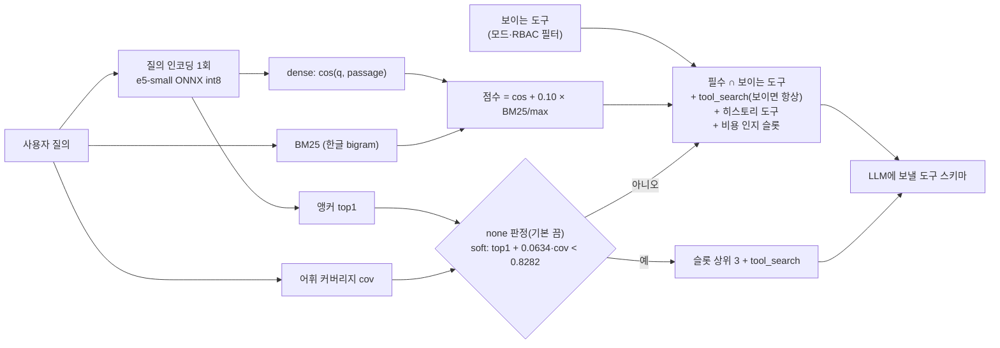

# Tool RAG v2: 질의에 맞는 도구 스키마만 LLM에 보내기

Theseus 에이전트는 코어 도구 36개(Remote Workspace를 붙이면 46개)를 갖고 있습니다. 매 턴 도구 스키마를 전부 보내면
그것만으로 5천~6천 토큰이 들고, 운영 대상인 4B 로컬 모델(컨텍스트 16k)은 도구가 많을수록 고르는 정확도도 떨어집니다.
Tool RAG는 사용자 요청과 관련된 도구만 골라 보내는 검색 단계입니다. 이 문서는 v1의 문제를 평가셋으로 측정한 결과,
v2 설계, 평가 프로토콜, 결과, 한계, 그리고 3단계(임베딩 파인튜닝)를 붙이는 방법을 정리합니다.

- 코드: [`theseus_engine/core/tool_rag/`](../../backend/theseus-core-server/theseus_engine/core/tool_rag/)
- 평가 하네스와 결과: [`benchmarks/tool_rag/`](../../backend/theseus-core-server/benchmarks/tool_rag/README.md)
- 설정: [환경 변수 문서의 Tool RAG 절](../operations/environment-variables.md#tool-rag)

## 1. 요약

최종 수치는 **홀드아웃**으로 냅니다. 홀드아웃은 평가셋·용어집·few-shot을 본 적 없는 작성자가 도구 카탈로그만 보고 쓴 질의
140개이고, 다른 주석자가 독립으로 라벨링했습니다. 개발을 시작하기 전에 sha256을 고정했고(커밋 0771e25), 최종 구성(커밋 63e1e19)과
비교 대상만 **한 번** 평가했습니다(만든 방법과 한계는 3.3절). 아래 수치는 모두 `benchmarks/tool_rag/results/`의 결과 JSON에서 옮겼습니다.

**홀드아웃 core 레지스트리** (유사도 슬롯 평가 n=67, 질의 111개, `baseline_holdout.json`, `v2_holdout.json`, `compare_baseline_v2_holdout.json`)

| 지표 | v1 | v2 | 차이 (paired bootstrap 95% CI) |
|---|---|---|---|
| R@3 | 0.493 | **0.806** | +0.313 [+0.201, +0.433], 24승 1패 |
| R@3 한국어 / 영어 | 0.549 / 0.404 | 0.841 / 0.750 | |
| MRR | 0.497 | 0.752 | |
| 실제 전달 집합의 정답 재현율(set_recall) | 0.708 | **0.899** | +0.190 [+0.118, +0.268], 22승 1패 |
| 턴당 도구 스키마 토큰 평균 / p95 | 1968 / 2417 | **1771 / 1999** | −197 [−256, −139] |
| 전달 도구 수 평균 | 13.75 | 12.95 | −0.79 [−1.21, −0.37] |
| "맞는 도구 없음" 판정 F1 | 0 (한 번도 발동 안 함) | 0 (기본 끔, 4.4절) | |

**홀드아웃 실제 서버 기본값** (`server-default`: core + Remote Workspace 도구, 엔진 RAG 도구 2개 숨김. 순위 n=96, 질의 140개)

| 지표 | v1 서버 동작(검색 없이 보이는 도구 전부) | v1 검색기 | v2 개선 전(87df973) | v2 |
|---|---|---|---|---|
| R@3 (한국어 / 영어) | 해당 없음 | 0.399 (0.438 / 0.338) | 0.684 (0.655 / 0.730) | **0.818** (0.822 / 0.811) |
| set_recall | 0.935 | 0.610 | 0.764 | **0.842** |
| 토큰 평균 / p95 | 5367 / 5367 | 1880 / 2307 | 1754 / 2020 | **1769 / 1980** |
| 전달 도구 수 평균 | 42 | 13.34 | 13.39 | 13.50 |
| none F1 | 해당 없음 | 0 | 0.588 | 0 (끔) |

- 결과 파일: `all_visible_holdout_server_default.json`, `baseline_holdout_server_default.json`, `v2pre_holdout_server_default.json`,
  `v2_holdout_server_default.json`.
- v1 검색기 → v2 (`compare_baseline_v2_holdout_server_default.json`): R@3 +0.418 [+0.328, +0.512](46승 0패), set_recall +0.231
  [+0.157, +0.310](37승 5패), 토큰 −111 [−160, −63].
- 개선 전 v2 → v2 (`compare_v2pre_v2_holdout_server_default.json`): R@3 +0.134 [+0.075, +0.203](16승 0패), set_recall +0.077
  [+0.023, +0.134](15승 3패), 토큰 +15 [−8, +38]. 3차 변경(remote_* few-shot, `remote → 원격`, none 기본 끔)의 효과입니다.
  core에서는 두 구성의 R@3·set_recall이 같았습니다(5.1절).
- v1 서버는 검색을 하지 않고 보이는 도구를 전부 매 턴 보냈습니다. 같은 조건에서 v2는 토큰을 5367에서 1769로 약 67% 줄이고,
  정답 재현율은 0.935에서 0.842로 0.094 내줍니다. 빠진 도구는 모든 턴에 들어 있는 `tool_search`로 다시 찾을 수 있습니다(4.3절).

v2 토큰에는 일부만 보내는 모든 턴에 고정으로 넣는 `tool_search` 스키마(176 토큰)가 들어 있습니다(4.3절). 슬롯이 정답을 놓친
턴에서 모델이 나머지 보이는 도구를 찾을 경로라서 비용 예산 밖에 둡니다.

홀드아웃 R@3는 dev(0.918)·test(0.895)보다 낮은 0.806입니다. v1도 dev 0.568 · test 0.636에서 홀드아웃 0.493으로 함께 내려가서,
다른 작성자가 쓴 홀드아웃이 평가셋보다 어렵거나 분포가 다른 것으로 보입니다. v1 대비 이득(+0.313)은 test(+0.260)와 비슷하게
유지됐습니다. 홀드아웃 영어 R@3(0.750)는 한국어(0.841)보다 낮습니다(3.3절 한계).

**test 분할 (부분 오염, 두 번째 평가)** (core, 유사도 슬롯 n=70, 질의 106개, `baseline_test.json`, `v2_test.json`, `compare_baseline_v2_test.json`)

| 지표 | v1 | v2 | 차이 (95% CI) |
|---|---|---|---|
| R@3 (한국어 / 영어) | 0.636 (0.550 / 0.812) | 0.895 (0.894 / 0.899) | +0.260 [+0.152, +0.364], 23승 2패 |
| MRR | 0.608 | 0.864 | |
| set_recall | 0.816 | 0.942 | +0.126 [+0.066, +0.193] |
| 토큰 평균 / p95 | 1939 / 2393 | 1792 / 2064 | −147 [−204, −89] |

test는 같은 평가셋에서 dev와 함께 나눈 분할입니다. 튜닝 단계에 입력으로 쓴 베이스라인 진단 보고서에 test 질의가 섞여 있었고,
한국어 용어집 항목 하나(`background → 백그라운드`)가 test R@3 이득의 약 20%를 차지합니다(6장 2항). 또 test는 18c26bb 구성으로
한 번 평가한 뒤, 3차 변경 후 현재 구성으로 다시 평가한 **두 번째 평가**입니다. 그래서 test는 보조 지표로만 읽습니다.

자원(같은 하네스, Windows 4스레드 / Linux 컨테이너 2 vCPU·1.5 GB):

| 항목 | v1 (torch + sentence-transformers) | v2 (ONNX int8 + sentencepiece) |
|---|---|---|
| Core 이미지 크기 (`docker image ls`) | 2.46 GB | **1.07 GB** |
| 임베딩 모델 로드 RSS 증가(하네스 `rss_delta_mb`, v1은 torch import 뒤 기준점) | +959 MB | **+186 MB** (Linux 컨테이너 +202 MB) |
| 컨테이너에서 `import src.main` + 검색 1회 뒤 프로세스 RSS | 1079~1091 MB | **419~421 MB** |
| 컨테이너 첫 검색(모델 로드·인덱스 포함) | 18.6~20.3 s | **1.8~1.9 s** |
| 웜 검색 p50 / p95 (하네스, 홀드아웃 core) | 18.9 / 25.7 ms | **5.9 / 8.3 ms** |
| torch import | 함 | 안 함 |

## 2. v1의 문제 (측정 근거)

v1 `ToolRetriever`는 `intfloat/multilingual-e5-small`로 도구마다 "이름: 설명 예시 질문: few-shot…" 한 줄을 임베딩하고,
코사인 + 하드코딩 키워드 보너스로 순위를 매겨 필수 도구 8개 + 상위 k(adaptive)개를 보냈습니다.
동결 평가셋으로 잰 v1의 문제는 다음과 같습니다(베이스라인 결과 `results/baseline_*.json`).

1. **한국어 질의에 약함.** R@3가 한국어 0.533, 영어 0.754(all)였습니다. 도구 설명이 영어라서 한국어 질의는 few-shot 문장에만
   기대고, few-shot이 많은 도구(ingest_document, brief 등)가 상위 3을 차지했습니다(상위 3 등장 횟수 ingest_document 69/213,
   brief 55). few-shot이 없는 도구의 hit@3는 39%로, 있는 도구(77%)의 절반이었습니다.
2. **"맞는 도구 없음"을 판정하지 못함.** 유사도 임계값 0.3은 한 번도 걸리지 않았습니다(최소 코사인 0.695). 그래서 tool_search
   폴백 경로가 사실상 죽어 있었고, none 질의 35개를 하나도 잡지 못했습니다. 반면 top-1 점수만으로도 답 있는 질의와 none 질의를
   AUROC 0.86으로 가를 수 있었습니다.
3. **키워드 리랭크는 효과가 없음.** MRR +0.024였고, 보너스 93건 중 83건이 어차피 항상 들어가는 필수 도구에 붙었습니다.
4. **adaptive k가 한국어에서 부정확.** 공백 단어 수와 정규식으로 복잡도를 셌습니다. k 신호와 정답 개수의 상관은 0.02~0.15였습니다.
5. **서버는 검색을 쓰지 않음.** 서버 조립(`get_query_engine`)은 검색기를 호출하지 않고 보이는 도구를 전부 보냈습니다.
6. **보안 버그.** 서버의 사후 훅(`TheseusHookExecutor._discover_and_inject_tools`)이 `full_registry` 전체에서 도구를 골라
   `active_registry`에 주입했습니다. 검색 결과에는 필수 도구(bash, write_file, edit_file…)가 항상 들어가므로, ASK 모드나
   낮은 user_level에서도 도구 실행 한 번 뒤에 쓰기·실행 도구가 다음 턴 스키마에 들어갔습니다.
7. **자원.** torch CPU가 이미지 2.46 GB의 대부분을 차지했고, 모델 로드만으로 RSS가 약 +950 MB, 첫 로드가 10~20초 걸렸습니다.
   운영 서버는 2 vCPU / 3.8 GB이고 core 컨테이너 상한은 1.5 GB입니다.
8. **피드백 로그 오염.** CLI가 ToolExecutionStarted마다 (질의, 도구)를 기록해서 필수 도구, 에러 난 호출, 중복 질의가 few-shot이
   되었습니다.

## 3. 평가 방법

### 3.1 평가셋과 프로토콜

- 동결 평가셋 236개 질의(한국어 69% / 영어 31%, single·multi·none). `eval_set.jsonl`은 sha256으로 고정돼 있고 하네스가
  해시가 다르면 평가를 거부합니다.
- dev / test를 50:50으로 고정했습니다. **기법 선택과 하이퍼파라미터 튜닝은 dev만** 썼습니다. 2차 구성(18c26bb까지)은 코드를 sha256으로
  고정한 뒤 test를 평가했고, test 결과를 보고 튜닝하지 않았습니다.
  예외 하나: 코드 리뷰에서 "일부만 보내는 턴에 tool_search가 없다"는 설계 결함이 나와 tool_search를 항상 넣도록 고쳤고, 이는 전달
  집합을 바꾸므로 dev에서 효과를 확인한 뒤 test·all을 한 번 더 평가했습니다(순위·none 판정은 그대로). 같은 리뷰에서 나온 none 특징
  정의 변경(보이는 도구 기준)은 dev에서 none F1이 0.743 → 0.667로 떨어져 넣지 않았고 test에서는 재지 않았습니다.
- test는 이미 한 번 본 데이터이고 오염 가능성도 있어서(아래), 3차 변경(4.10절)의 최종 평가는 **별도 홀드아웃**으로 했습니다(3.3절).
  3차 변경은 dev와 보정용 질의 세트만으로 정했고, 홀드아웃은 최종 구성(63e1e19)·v1·개선 전 v2(87df973)에 대해 한 번만 평가했습니다.
  같은 실행에서 현재 구성의 test·all도 다시 쟀습니다(test는 두 번째 평가). 실행 명령은 `benchmarks/tool_rag/final_eval.sh`입니다.
- **오염 가능성**: 튜닝 단계에 입력으로 쓴 동결 베이스라인 진단 보고서(`report_baseline.md`)는 실패 분석을 dev·test를 합친 213개
  질의로 계산했고, 원문을 인용한 평가 질의 19개 중 6개가 test 질의였습니다. 영향은 6장 2항에 적었습니다.
- 저장소 구현(`--variant v2`)은 그 고정 구성을 옮긴 것입니다. dev·test·all 전 질의에서 상위 8 순위·점수·전달 집합·none 판정이
  Combine 단계 구현과 같았습니다(요약 지표 차이는 nDCG@5의 1e-16 부동소수점 합산 순서뿐).

### 3.2 지표

- **R@k, MRR, Hit@1**: 유사도 슬롯만 평가합니다. 필수 도구는 예측과 정답 모두에서 뺍니다(항상 들어가는 도구로 점수가
  부풀지 않게).
- **set_recall_delivered**: LLM이 실제로 받는 집합(가시성 필터 후)의 정답 재현율입니다. 순위가 좋아도 안 보내면 소용이 없으므로
  운영 지표로는 이것이 더 중요합니다.
- **스키마 토큰**: 전달 집합 도구 스키마(압축 JSON)의 tiktoken cl100k 토큰 수. 로컬 모델 토크나이저의 프록시입니다.
- **none P/R/F1**: 정답이 "맞는 도구 없음"인 질의를 양성으로 봅니다.
- 자원: 콜드 로드 시간, 모델 로드 전후 RSS 차이, 웜 지연(매 호출 전 질의 캐시 비움, 3회 반복).

### 3.3 홀드아웃과 보정용 질의 세트

**홀드아웃(`holdout_set.jsonl`, 140개).** 평가셋·용어집·few-shot·이전 보고서를 볼 수 없는 작성자 2명(한국어 90, 영어 50)이 도구 카탈로그 덤프(server 레지스트리 도구
46개의 이름, 설명, 파라미터)만 보고 질의를 썼습니다. 같은 실행의 세 번째 블라인드 작성자는 홀드아웃이 아니라 보정용 질의 세트와
remote few-shot을 썼습니다. 다른 주석자 1명이 같은 카탈로그만 보고 독립으로 라벨을 붙였고, 두 라벨은 140개 중
135개에서 정확히 일치했습니다. 불일치 5개는 판정자(역시 카탈로그만 읽음)가 라벨을 정했고 버린 질의는 없습니다. 각 단계가 카탈로그
파일 하나만 읽었다는 것은 작업 기록으로 확인했습니다. 구성은 한국어 90 / 영어 50, single 80 · multi 41 · none 19이고 Remote Workspace
질의가 29개입니다(core 레지스트리 질의 111개, 그중 유사도 슬롯 평가 대상 67개, server 레지스트리는 140개 전체에 순위 대상 96개).
평가셋 질의와 문자열 유사도(difflib)가 0.75 이상인 근접 중복이 3개(h004, h014, h040) 있습니다. 세 개를 빼고 `v2_holdout.json`의
`per_item`으로 다시 계산하면 core R@3는 v1 0.500 / v2 0.818(n=66)로, 근접 중복이 v2 점수를 올리지는 않았습니다(h014는 v2도 놓침).

해시는 개발을 시작하기 전에 고정했습니다. 커밋 0771e25가 `harness.HOLDOUT_SET_SHA256`(2948379…)만 넣고 홀드아웃 파일은 넣지 않았으며,
파일은 최종 평가 커밋(3ef5ee0)에서 추가했습니다. 개발 단계에서 저장소에는 홀드아웃이 없었습니다. 다만 홀드아웃을 조립한 조정자
(미리 정한 규칙 R1~R4와 탐색 단계 지시문을 쓴 사람)는 조립하면서 구성 통계와 질의 약 14개(판정한 5개, 근접 중복 쌍)의 문구를 봤습니다.
결과는 보지 않았고 규칙이 그 질의를 노린 흔적은 찾지 못했습니다. 다음 홀드아웃은 질의 문구를 출력하지 않는 스크립트로 조립·필터링합니다.

**보정용 질의 세트(`calibration_set.jsonl`, 205개).** 홀드아웃과 다른 블라인드 작성자가 쓴 튜닝용 질의입니다. 처음 220개 중 홀드아웃이나
평가셋과 유사도 0.75 이상인 15개를 뺐습니다. core 184개(none 86), server_remote 21개이고 한국어 142 / 영어 63입니다. 답 있는 질의의
`relevant`는 작성자 한 명의 추정이라 순위 평가에는 쓰지 않고, none 판정 보정과 전이 측정(4.4절)에만 씁니다.
보정 세트의 구성(짧은 질의, 백그라운드 작업 관리, 코드 검색 요청을 일부러 넣고 none은 캘린더·메신저·오피스 문서 같은 외부 서비스)과
탐색 단계 지시문은 앞선 test 오류 분석(task_*·짧은 grep/glob 오판, 외부 서비스 누락)을 보고 정했습니다. 그래서 보정 세트는 설계상
test와 독립이 아니고, 3차 변경 뒤 test를 다시 잰 결과(두 번째 평가)는 그만큼 더 낙관적일 수 있습니다. 홀드아웃 작성 지시문의 none
예시(메신저·캘린더·오피스 앱 등)도 같은 범주입니다.

**한계.**

- 질의를 쓴 작성자와 주석자가 모두 같은 모델 계열의 LLM입니다. 실제 사용자 질의보다 문장이 깨끗하고 도구 설명의 어휘를 더 많이 쓸
  수 있습니다. 135/140 일치도 서로 독립이라기보다 같은 편향을 공유한 결과일 수 있습니다.
- core 순위 지표는 n=67이라 신뢰구간이 넓습니다(R@3 이득 +0.313의 95% CI가 [+0.201, +0.433]). none 질의는 19개뿐입니다.
- 홀드아웃 core에서 영어 R@3가 0.750으로 한국어 0.841보다 낮습니다(영어 순위 대상 26개). set_recall도 한국어 0.932 / 영어 0.838입니다
  (`v2_holdout.json`의 `delivered_set.set_recall_by_lang`). 평가셋 test에서는 영어가 조금 높았으므로(영어 0.899 / 한국어 0.894) 영어 질의 쪽은
  홀드아웃 기준으로 더 약하다고 봐야 합니다.
- 홀드아웃은 이제 한 번 봤습니다. 이 결과를 보고 구성을 바꾸면 다음 최종 평가에는 새 홀드아웃이 필요합니다.

## 4. 설계



### 4.1 도구 텍스트 (`text.py`, `tool_gloss.py`)

- **순위용 passage**: `"passage: {name} ({이름 단어}): {description} 입력: {파라미터 이름}. 한국어: {용어집 표기} {few-shot…}"`.
  영어 설명 옆에 도구 공통 영→한 용어집(116개 항목, 예: read→읽기, worktree→워크트리)으로 만든 한국어 표기를 붙여 한국어 질의가
  설명과 직접 맞닿게 했습니다. 용어집은 결정적이고 커스텀·MCP 도구에도 자동으로 적용됩니다.
- **용어집 출처**: 지금 용어집은 dev 질의를 본 뒤 작성됐습니다(6장 2항). 출처가 깨끗한 대안으로, 질의를 한 번도 보지 않은
  작성자가 도구 카탈로그 어휘만으로 만든 블라인드 용어집(335개 항목)과 미리 정한 규칙으로 비교했고 현재 용어집을 유지했습니다(4.10절).
  `remote → 원격`(블라인드 용어집에도 있는 어휘)만 더했습니다. 홀드아웃 작성자는 용어집을 보지 않았으므로, 홀드아웃 수치(1장)는
  dev를 보고 만든 용어집이 처음 보는 질의에 얼마나 통하는지를 잰 값입니다.
- **few-shot**: 코어 도구는 `examples.TOOL_EXAMPLE_QUERIES`(passage·BM25·앵커·커버리지에 모두 들어감). Remote Workspace 도구 10개는
  평가셋·용어집을 보지 않은 작성자가 카탈로그만 보고 쓴 예시(도구당 한국어 2 + 영어 2)를 `examples.RANKING_ONLY_EXAMPLE_QUERIES`로
  붙이며, **순위용 passage와 BM25에만** 넣습니다. none 규칙은 core 레지스트리(remote_* 없음)로 보정하므로, remote 앵커까지 넓히면
  서버 레지스트리의 none 특징이 보정 분포 밖으로 나갑니다(dev server-default에서 none 재현율 0.722 → 0.556). 도구 클래스 속성
  대신 이 표에 둔 이유는 앵커에서 빼야 하고, 코어 few-shot과 한곳에서 검토하며 `RECIPE_VERSION`(현재 v2.3)으로 함께 관리하기 위해서입니다.
  홀드아웃 server-default에서 개선 전 v2 대비 R@3 0.684 → 0.818(+0.134 [+0.075, +0.203]), set_recall 0.764 → 0.842였습니다
  (`compare_v2pre_v2_holdout_server_default.json`, `remote → 원격` 용어집 항목과 none 끔 효과가 함께 들어 있음). core 레지스트리에는
  remote_* 도구가 없어 순위가 그대로입니다.
- **BM25 문서**: 이름×3 + (설명 + 용어집 표기) + 파라미터 이름·설명 + few-shot. 토크나이저는 한글을 음절 bigram으로 자르고
  라틴 문자는 camelCase/snake_case로 나눈 뒤 경량 stem과 불용어 제거를 합니다. 형태소 분석기가 없어도 "메모리에"와 "메모리"가
  bigram으로 겹칩니다.
- **앵커**: none 판정 전용으로 v1 레시피("이름: 설명 예시 질문: …")를 따로 임베딩합니다. 보정 계수가 이 분포에 맞춰져 있어서
  피드백 few-shot과 순위 전용 few-shot(remote_*)은 섞지 않습니다. 용어집도 앵커·커버리지에는 들어가지 않습니다.

### 4.2 순위 (`retriever.py`, `lexical.py`)

`score = cos(q, passage) + 0.10 × BM25(q) / max BM25(q)`. 질의 인코딩은 1번이고 BM25·커버리지 계산은 1 ms 미만입니다.
β는 dev에서 0.05~0.2를 훑어 평탄 구간(0.08~0.12)의 가운데를 골랐습니다.

### 4.3 선택 (`selector.py`)

- 필수 도구 7개(read_file, write_file, edit_file, glob, grep, bash, ask_user) ∩ 보이는 도구. create_tool은 필수에서 뺐고,
  PLAN Executing 단계에서 보일 때 고정 포함합니다.
- **tool_search 고정**: tool_search가 보이면 필수처럼 비용 예산 밖에서 항상 넣고, system prompt에 "목록에 없는 기능은
  tool_search로 찾으라"는 안내(46 토큰)를 붙입니다. 처음 구현은 none 판정이나 순위 슬롯으로만 넣어서, 커밋했던 server test 결과에서
  정답 도구를 다 받지 못한 질의 18개 중 13개가 tool_search도 받지 못했습니다(복구 경로 없음). 고정 후 test·dev 모든 턴에
  tool_search가 들어가고, 비용은 dev 평균 +143 토큰(스키마 176 토큰, 이미 슬롯에 있던 턴 제외)입니다. 사후 훅 주입에는 넣지 않습니다.
- 대화 히스토리에서 이미 호출한 도구 ∩ 보이는 도구(ghost tool call 방지, 비용 예산과 별개).
- **비용 인지 슬롯**: 나머지 후보의 순위 i(1부터)는 `i × cost(tool) ≤ 700`일 때 넣습니다. cost는 스키마 압축 JSON 글자 수 / 4,
  1위는 항상, 상위 12개까지만 봅니다. 순위 사전확률(1/i)을 스키마 비용으로 나눈 값으로 거르는 것과 같아서, 스키마가 큰 도구는
  상위에 있을 때만 들어갑니다. dev에서 C=700은 adaptive k=8 대비 set_recall +0.002에 토큰 −303이었습니다.
- **none soft fallback**(기본 꺼짐, `THESEUS_TOOL_RAG_NONE_MODE=soft`로 켬): none으로 판정하면 슬롯을 상위 3개로 줄입니다(tool_search는 위 규칙으로 이미 들어 있음). 슬롯을 비우지
  않으므로 오판해도 정답이 대부분 그대로 전달됩니다(18c26bb 구성 test 오판 9건 중 7건은 정답 전달).

### 4.4 none 판정 (`calibration.py`, `benchmarks/tool_rag/calibrate.py`)

- 특징 2개: 앵커 코사인 최댓값 top1(tool_search 제외), 질의 토큰 중 도구 카탈로그 어휘에 있는 비율 cov. 둘 다 **인덱스 전체 도구**
  기준이라 모드·RBAC로 숨긴 도구도 들어갑니다. 그래서 "보이는 도구 중에 맞는 것이 없다"가 아니라 "카탈로그 전체에 맞는 것이
  없다"를 판정합니다(6장 10항).
- **기본은 끕니다**(`THESEUS_TOOL_RAG_NONE_MODE=off`). 판정이 다른 작성자의 질의로 전이되지 않았기 때문입니다(아래 표, 4.10절 R3).
  `score()`는 top1·cov를 어차피 계산하므로 끈다고 지연이 줄지는 않고, 턴당 토큰이 dev core 1761.7 → 1782.6, server-default
  1765.6 → 1788.3으로 늘며 set_recall은 같습니다(none on/off 하네스, 둘 다 커밋 0771e25 구성).
- soft로 켤 때 쓰는 규칙은 평가셋 dev core 107개(none 18) + 보정용 질의 세트 `calibration_set.jsonl` core 184개(none 86, 평가셋·
  용어집·few-shot을 보지 않은 작성자가 쓴 질의)를 합친 291개로 적합합니다. class-balanced 로지스틱 회귀, 임계값은 "답 있는 질의를
  none으로 판정하는 비율 ≤ 5%" 중 F1 최대. 결과 규칙은 `top1 + 0.0634·cov < 0.8282`이면 none입니다(이전: dev만으로 적합한
  `top1 + 0.0348·cov < 0.8295`). 합친 데이터의 반복 5-fold × 20 CV는 F1 0.677 ± 0.020, false-none 5.1%입니다.
- 두 세트 사이 전이(한쪽으로 적합 → 다른 쪽 평가)는 보정 파일 `fit.transfer`에 함께 기록합니다. 두 작성자는 none의 정의가
  달라서(dev는 외부 서비스 요청 위주, 보정 세트는 잡담·일반 지식까지 none) 한쪽에서 잡은 임계값이 다른 쪽에서 크게 빗나갑니다.

  | 방법 (탐색 단계 추천안) | 보정 세트 → dev F1 / false-none | dev → 보정 세트 F1 / false-none | 합친 CV F1 |
  |---|---|---|---|
  | [top1, cov] (현재 절차) | 0.190 / 1.1% | 0.819 / 12.2% | 0.677 |
  | [top3 앵커 평균, cov, BM25/토큰, 한글 비율] | 0.538 / 1.1% | 0.815 / 7.1% | 0.757(선택 편향 보정 0.701) |
  | [top1, cov, 프로토타입 margin] (질의 291개를 프로토타입으로 탑재) | 0.743 / 4.5% | 0.835 / 6.1% | 0.850 |

  미리 정한 채택 기준(양방향 모두 F1 ≥ 0.5이고 false-none ≤ 5%)을 넘는 추천안이 없어 기본값을 끔으로 정했습니다. 추천안이 아니었던
  순수 kNN 투표 일부 설정(k=5·9, τ=0.05)은 기준을 넘었지만 k·τ에 따라 전이 F1이 0.55~0.83으로 흔들려, 전이 결과로 설정을 고르는
  것이 곧 그 지표에 맞추는 일이라 후보로 삼지 않았습니다.
- **홀드아웃 사후 관찰(결정에 쓰지 않음).** 끄기로 한 결정은 홀드아웃을 평가하기 전에 미리 정한 규칙으로 내렸습니다. 홀드아웃을
  평가한 뒤 보니, 개선 전 v2(87df973, dev만으로 적합한 옛 규칙 `top1 + 0.0348·cov < 0.8295`, soft)는 홀드아웃 core에서 none
  P/R/F1 0.714 / 0.526 / 0.606(tp 10 / fp 4 / fn 9, 답 있는 질의 오판 4.3%)이었습니다(`v2pre_holdout.json`의 `none_detection`).
  core에서 이 구성과 현재 구성은 R@3·set_recall이 같았고(차이 0, `compare_v2pre_v2_holdout.json`), 판정을 끈 현재 구성이 턴당
  토큰을 +20 [+10, +32] 더 썼습니다. server-default에서 옛 규칙은 0.667 / 0.526 / 0.588입니다. 즉 이 홀드아웃에서는 옛 규칙이
  test(F1 0.267)보다 잘 통했고 R@3·set_recall 손실도 없었습니다. 그래도 이것은 **사후 관찰**이고 none 질의가 19개뿐이라, 이 결과를 보고 기본값을
  다시 켜면 홀드아웃에 맞춰 고르는 일이 됩니다. 기본값은 끔으로 유지합니다. 현재 보정 파일의 재적합 규칙(`top1 + 0.0634·cov < 0.8282`)은
  홀드아웃에서 재지 않았습니다.
- 보정 파일(`tool_rag/data/toolrag_calibration.e5-small-int8.json`)은 모델 sha256과 레시피 버전이 맞을 때만 적용됩니다. 런타임은 로드할 때 `model.onnx`와 sentencepiece 모델의 실제 sha256을 계산해 `embedder.json` 선언값과 비교하고(약 0.1 s), 다르면 모델을 쓰지 않고 보이는 도구 전부를 보냅니다. 임베더 fingerprint도 계산한 해시로 만듭니다.
  다른 모델을 쓰면 경고를 남기고 none 판정을 끕니다. 절대 코사인 임계값은 모델과 양자화에 묶여 있기 때문입니다.

### 4.5 임베딩 백엔드 (`embedding.py`)

- 기본은 ONNX Runtime입니다. 공식 `onnx/model.onnx`(fp32)를 빌드 시점에 동적 int8로 양자화하고(optimum avx2 설정과 같음),
  토크나이저는 tokenizers(tokenizer.json, 로드만으로 약 +250 MB) 대신 sentencepiece.bpe.model(5 MB)로 XLM-R 규칙을
  재현했습니다. tokenizer.json과의 토큰 ID 일치를 테스트로 확인합니다.
- 동적 int8은 활성값 양자화 범위를 배치 단위로 잡아서, 같은 문장도 배치 구성에 따라 벡터가 달라집니다. 그래서 batch 1로
  고정했고, 스레드 수(1/2/4)와 반복 실행에 대해 비트 단위로 같은 벡터가 나오는 것을 테스트합니다.
- 이 파이프라인에서 int8과 fp32의 dev R@3는 0.918 vs 0.921로 거의 같았고, torch와 ONNX fp32는 순위가 완전히 같았습니다.
  자원 이득이 커서 int8을 기본으로 했습니다.
- `sentence-transformers` 백엔드는 비교·파리티 검증용으로 남겼습니다(`THESEUS_EMBED_BACKEND=sentence-transformers`,
  `requirements-torch.txt`).

### 4.6 인덱스와 캐시 (`index.py`, `cache.py`)

- 인덱스는 전체 레지스트리 기준으로 하나만 만들고, 보이는 범위는 질의 시점의 후보 집합으로 거릅니다. 서버 조립, tool_search,
  훅이 같은 인덱스를 공유합니다(v1은 싱글턴이 레지스트리를 오가며 매번 재인덱싱했습니다).
- fingerprint = sha256(도구별 이름·설명·example_queries·입력 스키마 + 피드백 버전 + 임베더 + 레시피 버전). v1은 이름 집합만 비교해
  설명이 바뀌어도 재인덱싱하지 않았습니다. 인덱스는 fingerprint 기준 LRU 8개, 질의 벡터는 LRU 256개입니다.
- 텍스트→벡터 캐시는 키가 sha256(임베더 fingerprint + 텍스트)이라 커스텀 도구가 하나 추가돼도 그 도구만 새로 인코딩합니다.
  `THESEUS_TOOL_RAG_CACHE_DIR`에 npz로 저장해 재시작 때 인덱스 구축(36개 도구 약 1~1.5 s)을 건너뜁니다. 파일은 임베더당 하나이고
  저장할 때 기존 벡터와 합치므로(최대 4096개), core와 Remote Workspace 레지스트리가 번갈아 와도 서로의 벡터를 지우지 않습니다.
- 인덱스에는 이름·벡터·비용만 있고 도구 인스턴스는 없습니다. fingerprint는 인스턴스 상태(Remote Workspace 접속 정보, 매 턴 다시
  로드한 custom tool 모듈)를 담지 않으므로, 반환할 도구는 항상 이번 요청의 레지스트리에서 이름으로 찾습니다. 처음 구현은 인덱스를
  만든 첫 레지스트리의 인스턴스를 돌려줘서, 같은 도구 구성의 다른 Remote Workspace 세션이 첫 세션의 SSH 설정에 묶인 remote_* 도구를
  받을 수 있었습니다(리뷰에서 발견해 수정, 회귀 테스트 `InstanceIsolationTest`).

### 4.7 런타임 경로와 보안 (`assembly.py`)

| 경로 | 동작 |
|---|---|
| 서버 `get_query_engine` | 가시성 정책으로 보이는 도구를 구한 뒤 `select_tools_for_turn`으로 전달 집합을 고릅니다. 모델이 아직 준비되지 않았으면 보이는 도구 전부를 보내고 백그라운드 워밍업을 시작합니다(요청 경로에서 모델 로드를 기다리지 않음). 서버 기동 시에도 워밍업을 시작합니다. SSE 경로(`stream.py`)는 조립 전체를 `asyncio.to_thread`로 돌려 질의 인코딩·처음 보는 레지스트리의 인덱스 구축(리뷰 측정 253.5 ms)이 이벤트 루프를 막지 않게 합니다. |
| CLI/TUI `setup_engine` | 같은 함수를 스레드에서 실행합니다. 모델을 못 불러오면 준비 명령을 프로세스당 한 번만 안내합니다. 설치 스크립트(`install-vscode-extension.sh`/`.ps1`)는 모델이 없으면 준비 단계를 실행합니다. `EMBEDDING_PROVIDER=local`인데 sentence-transformers가 없으면 엔진 RAG 도구 2개를 보이는 도구에서 뺍니다. |
| 폴백 | Tool RAG 끔, 질의 없음, 보이는 도구 12개 이하, 검색 실패이면 **보이는 도구 전부**를 보냅니다. `full_registry`로 폴백하지 않습니다. |
| tool_search | 후보를 `search_injectable_tool_names`(보이는 도구)로 제한해 공유 인덱스에서 찾고, 임베딩이 안 되면 같은 후보에서 BM25로 찾습니다. |
| 사후 훅 주입 | 보이는 도구 중 아직 없는 것만 후보로, 예산 400·턴당 6개까지 주입합니다(엔진과 훅 실행기를 턴마다 새로 만들고, 주입한 도구는 호출하지 않으면 다음 턴에 남지 않습니다). 정책 정보가 없으면 주입하지 않습니다. |
| 공통 | 실제 등록은 `inject_visible_tool()`만 거치고, 보이지 않는 도구는 거부합니다. 모드 전환 시 주입 가능 집합도 함께 갱신합니다. |

보안 회귀 테스트(`tests/test_tool_rag_policy.py`): level 1 AGENT 사용자(Remote Workspace 쓰기 허용 포함)에게 훅 주입과
tool_search를 반복해도 bash·write_file·edit_file·remote_run_command가 절대 들어가지 않고, ASK 모드의 전달 집합은 ASK 도구 밖으로
커지지 않습니다.

### 4.8 피드백 로거 (`tool_usage_logger.py`)

필수 도구·tool_search·에러 난 호출·출처(provenance)가 없는 호출은 기록하지 않습니다. 이번 턴의 초기 검색이 유사도 슬롯으로 고른
도구가 성공했을 때만 기록하고(tool_search·사후 훅으로 들어온 도구는 기록하지도 읽지도 않음. 이 두 경로는 모델이 스스로
시작할 수 있어서, 모델이 읽은 파일·웹 페이지의 프롬프트 주입이 few-shot을 심을 수 있기 때문입니다), 경로·URL·키처럼 보이는 질의는 버립니다. 읽을 때 (질의, 도구)로 중복을 지우고 도구당
5개만 쓰며, 파일이 1 MB를 넘으면 회전합니다. 서버 이미지는 기본으로 끕니다(`THESEUS_TOOL_RAG_FEEDBACK=off`). 멀티테넌트에서
한 사용자의 질의가 다른 프로젝트의 인덱스로 새기 때문입니다.

### 4.9 쓰지 않은 기법 (dev 근거)

| 기법 | v2 위에 더했을 때 dev R@3 (int8) | 결정 |
|---|---|---|
| v1 키워드 리랭크 | +0.008 [0, +0.025] | 잡음 범위, 삭제 |
| multi-vector(few-shot·의사 질의 별도 벡터, max-sim) | −0.006 [−0.017, 0] | 넣지 않음 |
| 교차언어 BM25 확장(한글 단어 → E5 최근접 영어 어휘) | −0.008 [−0.025, 0] | 넣지 않음 |
| adaptive k(정규식) / 점수 차 컷오프 | 비용 인지 선택보다 나은 규칙 없음 | 삭제 |
| 유사도 임계값 0.3 | 한 번도 발동 안 함 | 삭제 |

가장 단순한 조합(dense 1벡터 + BM25 + 비용 인지 선택 + 보정된 none 판정)을 골랐습니다. 선택 편향을 추정하려고 순위기 102개
설정에서 dev를 반으로 나눠 한쪽에서 고르고 다른 쪽에서 재는 일을 200번 반복했고, 낙관 편향은 +0.005(int8)였습니다.
실제 dev → test 하락은 R@3 0.918 → 0.895였고, 다른 작성자가 쓴 홀드아웃에서는 0.806이었습니다(v1도 같은 순서로 0.568 → 0.636 → 0.493).

### 4.10 3차 변경: 미리 정한 규칙과 dev 측정

결과를 보기 전에 규칙(R1~R4)을 정해 두고 그대로 따랐습니다. 쓴 데이터는 평가셋 dev 분할과 `calibration_set.jsonl`뿐이고 test·holdout은
읽지 않았습니다. 다만 보정 세트의 구성과 탐색 단계 지시문은 앞선 test 오류 분석을 보고 정했습니다(3.3절). 명령은 모두 `python -m benchmarks.tool_rag.run --split dev --passes 0`(저장소 밖 변형으로 옵션 전환).
네 규칙의 결과는 커밋 6c2ecb6 · 650158c · 06117c1로 먼저 고정했고, 홀드아웃은 그 뒤(3ef5ee0)에 처음 평가했습니다.

**R1 remote few-shot** (유지 조건: dev server-default set_recall과 dev server R@3가 **둘 다** 나빠지지 않을 것 → 유지, 순위 전용 배치)

| 배치 (none soft, 보정 그대로) | server-default set_recall | server R@3 | server set_recall | none F1 (server-default) |
|---|---|---|---|---|
| 없음 | 0.898 | 0.826 | 0.918 | 0.743 |
| 순위 전용(passage·BM25) | 0.935 | 0.881 | 0.953 | 0.743 |
| 앵커·커버리지까지 | 0.935 | 0.881 | 0.953 | 0.645 |

core는 remote 도구가 없어 모든 지표가 같습니다.

**R2 용어집** (블라인드가 dev core R@3 최선보다 0.010 넘게 낮지 않으면 블라인드, 아니면 합집합이 0.010 안이면 합집합, 아니면 현재 → **현재 유지**)

| 용어집 | 항목 | core R@3 | core MRR | core set_recall | server-default R@3 | server-default set_recall |
|---|---|---|---|---|---|---|
| 현재(dev를 본 뒤 작성) | 115 | **0.9181** | 0.894 | 0.970 | 0.881 | 0.935 |
| 블라인드(카탈로그 어휘만) | 335 | 0.9040 | 0.858 | 0.961 | 0.883 | 0.925 |
| 합집합(블라인드 + replace, sub-agent, mcp) | 338 | 0.8955 | 0.858 | 0.955 | 0.883 | 0.925 |

**R4 서버 격차 보고서의 제안**: dev 측정으로 뒷받침되는 것만 넣었습니다. 제안 1(remote 한국어 few-shot)은 R1로 반영했습니다(블라인드
예시 전체, 도구당 4개). 제안 2 `remote → 원격` 용어집 항목은 R1 위에서 dev server·server-default R@3 0.881 → 0.895, MRR 0.836 → 0.844,
set_recall 같음, core 변화 없음이라 넣었습니다. 비용 예산(C=900: +0.010 set_recall에 +114 토큰)과 remote 비용 할인은 넣지 않았습니다.

**R3 none 판정** (추천안의 양방향 전이 우선 → 기준 미달이면 off): 4.4절 표처럼 어느 추천안도 양방향 F1 ≥ 0.5·false-none ≤ 5%를 넘지 못해
**off**. 탐색 단계의 의사결정 분석(탐색 C)은 판정의 이득이 턴당 약 20~75 토큰(스키마 프롬프트의 1~4%)으로 작고 완벽한 분류기라도
dev 비율에서 턴당 약 22 토큰이 상한이라고 했지만, core에서 잴 수 있는 재현율 손실이 없다며 soft 유지를 권했습니다. 그래서 R3의 두 번째
off 조건(이득이 재현율 비용만 못함)은 해당하지 않았고, off는 첫 번째 조건, 곧 "추천안 중" 양방향 전이 기준을 넘는 것이 없다는 해석에만
기댑니다. 추천안이 아닌 kNN 일부 설정은 기준을 넘었습니다(4.4절).

## 5. 결과

결과 파일은 `backend/theseus-core-server/benchmarks/tool_rag/results/`에 있고, 아래 수치는 각 파일의 `summary`와 `compare_*.json`에서
옮겼습니다. 모두 같은 Windows 노트북에서 쟀습니다.

- v1: v1 검색기 코드(f9862e4와 같음), Python 3.12, torch 2.15 CPU 4스레드. 평가셋 결과(`baseline_{dev,test,all}.json`)의 `meta.commit`은
  측정 당시 HEAD 3b9467e, 홀드아웃 결과(`baseline_holdout*.json`)는 63e1e19입니다.
- v2: 홀드아웃·test·all은 커밋 63e1e19(`engine_src_dirty=false`, Python 3.11, onnxruntime 1.32.0 4스레드), dev는 06117c1입니다.
- 개선 전 v2(`v2pre_holdout*.json`): 커밋 87df973 worktree에 현재 하네스(holdout 분할 지원만 다름)를 복사해 쟀습니다. none 판정이 켜진
  (soft, dev만으로 적합한 규칙) 3차 변경 전 구성입니다.
- 실행 명령은 `benchmarks/tool_rag/final_eval.sh`이고, 스크립트의 각 실행 줄은 해당 결과 JSON의 `meta.command`와 같습니다(실행 로그는
  저장소 밖에 있고 구간 제목·요약만 남깁니다).

### 5.1 홀드아웃 (최종, 1회 평가)

| 레지스트리 | 구현 | n | R@3 | R@3 KO | R@3 EN | R@5 | R@8 | nDCG@5 | MRR | Hit@1 | set_recall | 토큰 평균 / p95 | 도구 수 | none P / R / F1 |
|---|---|---|---|---|---|---|---|---|---|---|---|---|---|---|
| core | v1 | 67 | 0.493 | 0.549 | 0.404 | 0.567 | 0.627 | 0.478 | 0.497 | 0.388 | 0.708 | 1968 / 2417 | 13.75 | 0 / 0 / 0 |
| core | v2 개선 전 | 67 | 0.806 | 0.841 | 0.750 | 0.873 | 0.925 | 0.756 | 0.752 | 0.642 | 0.899 | 1750 / 1999 | 12.72 | 0.714 / 0.526 / 0.606 |
| core | **v2** | 67 | **0.806** | **0.841** | **0.750** | 0.873 | 0.925 | 0.756 | 0.752 | 0.642 | **0.899** | **1771 / 1999** | 12.95 | 끔 |
| core | 전부 전송 | | | | | | | | | | 0.978 | 4460 / 4460 | 34 | |
| server-default | v1 | 96 | 0.399 | 0.438 | 0.338 | 0.465 | 0.569 | 0.404 | 0.442 | 0.344 | 0.610 | 1880 / 2307 | 13.34 | 0 / 0 / 0 |
| server-default | v2 개선 전 | 96 | 0.684 | 0.655 | 0.730 | 0.726 | 0.809 | 0.651 | 0.671 | 0.573 | 0.764 | 1754 / 2020 | 13.39 | 0.667 / 0.526 / 0.588 |
| server-default | **v2** | 96 | **0.818** | **0.822** | **0.811** | 0.870 | 0.917 | 0.754 | 0.761 | 0.656 | **0.842** | **1769 / 1980** | 13.50 | 끔 |
| server-default | 전부 전송(v1 서버 동작) | | | | | | | | | | 0.935 | 5367 / 5367 | 42 | |
| server | v1 | 96 | 0.399 | 0.438 | 0.338 | 0.465 | 0.569 | 0.404 | 0.442 | 0.344 | 0.639 | 1947 / 2417 | 13.95 | 0 / 0 / 0 |
| server | v2 개선 전 | 96 | 0.684 | 0.655 | 0.730 | 0.726 | 0.809 | 0.651 | 0.671 | 0.573 | 0.777 | 1743 / 1974 | 13.27 | 0.667 / 0.526 / 0.588 |
| server | **v2** | 96 | **0.818** | **0.822** | **0.811** | 0.870 | 0.917 | 0.754 | 0.761 | 0.656 | **0.862** | **1759 / 1977** | 13.39 | 끔 |
| server | 전부 전송 | | | | | | | | | | 0.972 | 5593 / 5593 | 44 | |

- 파일: core는 `baseline_holdout.json`, `v2pre_holdout.json`, `v2_holdout.json`, `all_visible_holdout.json`, server-default·server는 같은
  이름에 `_server_default`, `_server`를 붙인 파일입니다. 전부 전송(`--variant all-visible`)은 검색을 하지 않으므로 순위 지표를 적지 않았습니다.
- 질의 수: core 111개(답 있는 질의 92, none 19), server 레지스트리 140개. n은 유사도 슬롯 평가 대상 수입니다(core 한국어 41 / 영어 26).
- paired bootstrap(질의 재표본 10000회, seed 0, `python -m benchmarks.tool_rag.compare`):
  - core v1 → v2 (`compare_baseline_v2_holdout.json`): R@3 +0.313 [+0.201, +0.433](24승 1패), set_recall +0.190 [+0.118, +0.268]
    (22승 1패), 토큰 −197 [−256, −139], 도구 수 −0.79 [−1.21, −0.37]
  - core 개선 전 → v2 (`compare_v2pre_v2_holdout.json`): R@3·set_recall 차이 0(바뀐 질의 0개), 토큰 +20 [+10, +32](13개 질의에서 증가,
    감소 0), 도구 수 +0.23 [+0.11, +0.38]. 차이는 none 판정을 끈 것뿐입니다(4.4절 사후 관찰).
  - server-default v1 → v2 (`compare_baseline_v2_holdout_server_default.json`): R@3 +0.418 [+0.328, +0.512](46승 0패), set_recall
    +0.231 [+0.157, +0.310](37승 5패), 토큰 −111 [−160, −63], 도구 수 +0.16 [−0.20, +0.52]
  - server-default 개선 전 → v2 (`compare_v2pre_v2_holdout_server_default.json`): R@3 +0.134 [+0.075, +0.203](16승 0패), set_recall
    +0.077 [+0.023, +0.134](15승 3패), 토큰 +15 [−8, +38]
  - server v1 → v2 (`compare_baseline_v2_holdout_server.json`): R@3 +0.418 [+0.328, +0.512], set_recall +0.223 [+0.149, +0.302]
    (36승 5패), 토큰 −188 [−239, −139]
  - server 개선 전 → v2 (`compare_v2pre_v2_holdout_server.json`): R@3 +0.134 [+0.075, +0.203], set_recall +0.085 [+0.036, +0.139]
    (15승 2패), 토큰 +15 [−7, +38]
- 홀드아웃에서는 server 레지스트리의 R@3(0.818)가 core(0.806)와 비슷합니다. 전달 집합 기준으로는 전부 전송과의 격차가 core 0.080
  (0.978 → 0.899), server-default 0.094(0.935 → 0.842)입니다.
- 홀드아웃 core v2의 set_recall은 한국어 0.932 / 영어 0.838입니다(`v2_holdout.json`의 `delivered_set.set_recall_by_lang`).
- 평가셋과 근접 중복인 홀드아웃 질의 3개(3.3절)를 빼고 `per_item`으로 다시 계산한 core R@3는 v1 0.500 / v2 0.818(n=66)입니다.

### 5.2 test·all (부분 오염, 두 번째 평가)

test는 18c26bb 구성으로 한 번 평가했고, 3차 변경 뒤 현재 구성(63e1e19)으로 다시 평가했습니다. 튜닝 입력에 test 질의가 섞였을 가능성도
있어(6장 2항) 보조 지표로만 봅니다.

| split | 구현 | n | R@3 | R@3 KO | R@3 EN | R@5 | R@8 | nDCG@5 | MRR | Hit@1 | set_recall | 토큰 평균 / p95 | 도구 수 | none P / R / F1 |
|---|---|---|---|---|---|---|---|---|---|---|---|---|---|---|
| test | v1 | 70 | 0.636 | 0.550 | 0.812 | 0.681 | 0.773 | 0.576 | 0.608 | 0.486 | 0.816 | 1939 / 2393 | 13.37 | 0 / 0 / 0 |
| test | **v2** | 70 | **0.895** | **0.894** | **0.899** | 0.952 | 0.960 | 0.858 | 0.864 | 0.786 | **0.942** | **1792 / 2064** | 13.08 | 끔 |
| all | v1 | 129 | 0.605 | 0.533 | 0.754 | 0.671 | 0.763 | 0.566 | 0.613 | 0.496 | 0.822 | 1918 / 2417 | 13.24 | 0 / 0 / 0 |
| all | **v2** | 129 | **0.906** | **0.898** | **0.921** | 0.952 | 0.966 | 0.862 | 0.877 | 0.798 | **0.956** | **1787 / 1990** | 12.97 | 끔 |
| dev | v2 (06117c1) | 59 | 0.918 | 0.904 | 0.947 | 0.952 | 0.975 | 0.867 | 0.894 | 0.814 | 0.970 | 1783 / 1983 | 12.85 | 끔 |

- 파일: `baseline_{test,all}.json`, `v2_{test,all,dev}.json`.
- core 순위는 18c26bb와 같습니다(remote_* few-shot과 `remote → 원격`은 core에 영향이 없음). 첫 test 평가(18c26bb, none 켬)는 set_recall
  0.942, 토큰 1770 / 2011, 도구 수 12.78, none P/R/F1 0.308 / 0.235 / 0.267이었습니다(커밋 87df973의 `results/v2_test.json`).
- tool_search 고정 전 v2(커밋 6739df9)는 test set_recall 0.938, 토큰 1622 / 1884, 도구 수 11.85였습니다.
- paired bootstrap:
  - test (`compare_baseline_v2_test.json`): R@3 +0.260 [+0.152, +0.364](23승 2패), set_recall +0.126 [+0.066, +0.193](15승 0패),
    토큰 −147 [−204, −89], 도구 수 −0.28 [−0.69, +0.12]
  - all (`compare_baseline_v2_all.json`): R@3 +0.301 [+0.222, +0.379](47승 2패), set_recall +0.134 [+0.091, +0.180], 토큰 −131 [−175, −86]
  - dev (`compare_baseline_v2_dev.json`): R@3 +0.350 [+0.240, +0.463](24승 0패), set_recall +0.141 [+0.080, +0.207], 토큰 −115 [−183, −47]
- test에서는 개선 폭이 한국어에 몰려 있습니다(KO +0.344, EN +0.087). 홀드아웃에서는 v1의 영어가 더 약해서(0.404) 영어 이득도
  큽니다(KO +0.292, EN +0.346).

### 5.3 턴당 전송 스키마 토큰 (가시성 필터 후, AGENT user_level 5)

| 경로 | 레지스트리 | 홀드아웃 토큰 평균 / p95 | 홀드아웃 도구 수 | 홀드아웃 set_recall | test 토큰 평균 | test set_recall | all set_recall |
|---|---|---|---|---|---|---|---|
| **실제 서버 기본값**: v1, 검색 없이 보이는 도구 전부 | server-default (가시 42) | 5367 / 5367 | 42 | 0.935 | 5367 | 0.922 | 0.937 |
| **실제 서버 기본값**: v2 | server-default | **1769 / 1980** | 13.50 | 0.842 | **1801** | 0.859 | 0.897 |
| 하네스 server(엔진 RAG 도구 포함, CLI AGENT 정책): 전부 전송 | server (가시 44) | 5593 / 5593 | 44 | 0.972 | 5593 | 0.974 | 0.980 |
| 하네스 server: v2 | server | 1759 / 1977 | 13.39 | 0.862 | 1792 | 0.912 | 0.932 |
| 같은 방식(전부 전송), core만 | core (가시 34) | 4460 / 4460 | 34 | 0.978 | 4460 | 0.978 | 0.983 |
| v1 CLI 검색 | core | 1968 / 2417 | 13.75 | 0.708 | 1939 | 0.816 | 0.822 |
| **v2** | core | **1771 / 1999** | 12.95 | **0.899** | **1792** | **0.942** | **0.956** |

- 파일: 홀드아웃은 5.1절, test·all은 `all_visible_{core,server,server_default}_{test,all}.json`, `v2_server_{test,all}.json`,
  `v2_server_default_{test,all}.json`, `v2_{test,all}.json`, `baseline_{test,all}.json`. 전부 전송 결과 중 `all_visible_core_*`,
  `all_visible_server_{test,all}`은 6739df9, `all_visible_server_default_*`는 18c26bb에서 쟀습니다(검색을 하지 않아 v2 구성과 무관).
- `server-default`는 서버 레지스트리(core + remote_*)에 실제 서버 기본 가시성(`THESEUS_ENABLE_ENGINE_RAG_TOOLS=false`라서
  search_knowledge_base·ingest_document를 숨김)을 적용한 것입니다. `server`는 같은 레지스트리에 CLI AGENT 정책을 써서 두 도구가
  보입니다. 처음 문서의 "v1 서버 44개 / 5593 토큰"은 `server` 기준이라 실제 서버 기본 구성이 아니었습니다.
- 실제 서버 기본값 기준 v1 → v2(홀드아웃): 토큰 약 −67%(5367 → 1769), set_recall −0.094(0.935 → 0.842). test에서는 토큰 약 −66%
  (5367 → 1801), set_recall −0.063(0.922 → 0.859). 하네스 server 기준 홀드아웃은 토큰 약 −69%(5593 → 1759), set_recall −0.110
  (0.972 → 0.862). 운영 대상 4B 모델(16k 컨텍스트)에서 약 3.6천 토큰을 대화와 도구 결과에 돌려주는 대신 재현율을 일부 내준
  트레이드오프입니다. 빠진 도구는 모든 턴에 들어 있는 tool_search로 다시 찾을 수 있습니다(tool_search로 복구한 비율은 오프라인
  하네스로 재지 못했습니다).
- 보이는 도구 전부를 보내도 재현율이 1이 아닌 이유는 정답 라벨 중 create_tool, local_write_report(그리고 server-default에서는 엔진
  RAG 도구 2개)가 가시성 정책으로 숨겨지기 때문입니다.

### 5.4 자원

| 구현 / 환경 | 콜드 로드 | RSS 증가(로드) | 평가 후 프로세스 RSS | 웜 p50 / p95 | 인덱스 구축 |
|---|---|---|---|---|---|
| v1 torch, Windows 4스레드 (holdout core) | 10.6 s | +959 MB | 1267 MB | 18.9 / 25.7 ms | 2.9 s |
| v1 torch, Windows 4스레드 (test) | 10.7 s | +957 MB | 1269 MB | 16.6 / 25.1 ms | 2.4 s |
| v2 ONNX int8, Windows 4스레드 (holdout core) | 0.70 s | +186 MB | 334 MB | 5.9 / 8.3 ms | 1.1 s |
| v2 ONNX int8, Windows 4스레드 (test) | 0.72 s | +186 MB | 333 MB | 5.3 / 7.6 ms | 1.0 s |
| v2 ONNX int8, Linux 컨테이너 2 vCPU·1.5 GB (dev, 18c26bb) | 0.59 s | +202 MB | 361 MB | 5.6 / 8.9 ms | 1.4 s |

- 파일과 키: `baseline_holdout.json`, `baseline_test.json`, `v2_holdout.json`, `v2_test.json`, `v2_dev_linux_2cpu.json`의 `resources`
  (`cold_load_s`, `rss_delta_mb`, `rss_after_eval_mb`, `index_build_ms`)와 `summary`(`warm_p50_ms`, `warm_p95_ms`).
- v2 콜드 로드에는 모델 파일 sha256 검증(약 0.1 s)이 들어 있습니다.
- RSS 증가는 하네스 `rss_delta_mb`입니다. v1(torch) 변형은 torch import·스레드 고정 뒤에 기준점을 잡으므로 torch import 비용이
  빠져 있고, v2는 load() 안의 onnxruntime import를 포함합니다. 프로세스 전체 비교는 아래 컨테이너 프로브 값을 보세요.

컨테이너 프로브(`benchmarks/tool_rag/container_probe.py`, `--cpus=2 --memory=1.5g`, 3회): `import src.main` 직후 RSS는 두 이미지
모두 약 186 MB이고, 검색 1회 뒤 v1(theseus-core:cd7188f) 1079~1091 MB, v2(theseus-core:rag2-18c26bb) 419~421 MB였습니다.
첫 검색(모델 로드와 인덱스 구축 포함)은 v1 18.6~20.3 s, v2 1.8~1.9 s였습니다. 프로브의 v1 웜 검색은 90~194 ms로 하네스 값보다 훨씬 느렸는데, 프로브는 호출마다 `asyncio.run`을 새로
만들고 torch 스레드 수를 고정하지 않기 때문으로 보입니다(원인은 확인하지 않았습니다).

Linux 컨테이너의 v2 dev 결과(`results/v2_dev_linux_2cpu.json`, 이미지 theseus-core:rag2-18c26bb, 소스 커밋 18c26bb를
`meta.commit`·`meta.image`에 기록)는 그때의 Windows dev 결과와 질의 107개 모두에서 순위·전달 집합·none 판정이 같았습니다.
Docker 빌드에서 만든 int8 모델도 로컬과 sha256이 같았습니다(7486bedf…). 3차 변경 뒤 구성은 Linux 컨테이너에서 다시 재지 않았습니다.

### 5.5 현재 구성 dev 결과 (3차 변경 뒤)

커밋 06117c1(`engine_src_dirty=false`), Windows 4스레드, 같은 하네스. dev 분할만 다시 쟀습니다.

```bash
python -m benchmarks.tool_rag.run --variant v2 --split dev --json benchmarks/tool_rag/results/v2_dev.json
python -m benchmarks.tool_rag.run --variant v2 --registry server --split dev --json benchmarks/tool_rag/results/v2_server_dev.json
python -m benchmarks.tool_rag.run --variant v2 --registry server-default --split dev --json benchmarks/tool_rag/results/v2_server_default_dev.json
```

| 레지스트리 | 구성 | R@3 | MRR | set_recall | 토큰 평균 / p95 | none |
|---|---|---|---|---|---|---|
| core | 18c26bb | 0.918 | 0.894 | 0.970 | 1762 / 1976 | soft (F1 0.743, in-sample) |
| core | **06117c1** | 0.918 | 0.894 | 0.970 | 1783 / 1983 | off |
| server | 0771e25 | 0.826 | 0.812 | 0.918 | 1767 / 1979 | soft |
| server | **06117c1** | **0.895** | 0.844 | **0.953** | 1788 / 1998 | off |
| server-default | 0771e25 | 0.826 | 0.812 | 0.898 | 1766 / 1985 | soft |
| server-default | **06117c1** | **0.895** | 0.844 | **0.935** | 1804 / 1998 | off |

- core는 순위·set_recall이 같고 none을 끈 만큼 토큰이 약 21 늘었습니다. 서버 레지스트리는 remote few-shot으로 R@3 +0.069,
  set_recall +0.035~0.037이고, 같은 조건의 전부 전송(server-default 0.953, server 0.985) 대비 격차가 0.055 → 0.018, 0.067 → 0.032로 줄었습니다.
- `results/v2_dev_linux_2cpu.json`은 18c26bb 구성 그대로입니다(Linux 컨테이너는 다시 재지 않았습니다).

## 6. 한계와 주의 사항

1. **none 판정은 기본으로 꺼져 있습니다.** 18c26bb 구성에서 dev in-sample F1 0.743, dev 교차검증 추정 0.653이었지만 test는 0.267
   (tp 4 / fp 9 / fn 13)이었고, 답 있는 질의를 none으로 본 비율이 10.1%였습니다. 오판은 주로 task_* 계열 한국어 질의와 짧은
   grep/glob 질의였고, soft fallback 덕분에 9건 중 7건은 정답이 그대로 전달됐습니다. 놓친 none은 구글 캘린더, 카카오톡, 노션,
   PPT 같은 외부 서비스 요청이었습니다. 3차 변경에서 다른 작성자의 보정용 질의 세트로 전이를 재 보니 이 문제가 재현돼(4.4절)
   미리 정한 규칙대로 기본값을 `off`로 바꿨습니다. 켜려면 `THESEUS_TOOL_RAG_NONE_MODE=soft`입니다. 그 뒤 홀드아웃에서는 옛 규칙이
   F1 0.606으로 test보다 잘 통했는데(4.4절 사후 관찰), none 질의가 dev·test·홀드아웃 각각 18·17·19개뿐이라 작성자와 표본에 따라
   결과가 크게 흔들린다는 뜻으로 읽었고 결정은 바꾸지 않았습니다.
2. **한국어 용어집은 dev 질의를 본 뒤 작성됐고, test 정보가 일부 섞였을 수 있습니다.** 항목을 30% 무작위로 지워도 dev R@3 평균
   0.882, 50% 지워도 0.856으로 용어집을 안 쓰는 최선 조합(0.845) 이상이었습니다. 다만 튜닝 입력이던 베이스라인 진단 보고서가
   dev·test 합산 실패 분석으로 "task_create는 백그라운드 요청에서 거의 안 뽑힌다"고 적었는데, '백그라운드'가 들어간 평가 질의 8개
   (q023, q024, q026, q096, q097, q109, q114, q128)는 모두 test이고 dev와 few-shot에는 0개입니다(task_create가 1순위 정답인 질의도
   dev 2개, test 6개). 그래서 용어집 항목 `background → 백그라운드`는 dev로 검증할 수 없는 항목입니다. 이 항목 하나만 뺀 측정
   (`tool_gloss.GLOSSARY.pop("background")` 뒤 같은 하네스로 dev·test 평가, 현재 코드, 공개용 진단이며 구성은 바꾸지 않음): dev R@3 0.918 → 0.912, MRR
   0.894 → 0.902, test R@3 0.895 → **0.844**(−0.051, v1 대비 이득 +0.260의 약 20%), test KO R@3 0.894 → 0.839, test set_recall
   0.942 → 0.913, 해당 8개 질의 R@3 0.812 → 0.490. 영어 설명을 기계적으로 옮긴 자연스러운 항목이라 의도적 test 적합의 증거는
   아니지만, test 수치는 "부분적으로 오염됐을 수 있음"으로 읽어야 합니다. 3단계에서는 진단 보고서를 dev 전용으로 다시 만들고,
   dev에 근거가 있는 용어집 항목만으로 구성을 다시 골라야 합니다. 새 코어 도구를 추가할 때는 용어집과 few-shot을 같이 갱신해야 합니다.
   3차 변경에서 질의를 보지 않고 카탈로그 어휘만으로 만든 블라인드 용어집과 비교했습니다(4.10절 R2). 블라인드 용어집에도
   `background → 백그라운드`가 같은 표기로 들어 있어(task_* 설명의 카탈로그 어휘) 이 항목은 카탈로그만 봐도 나오는 항목입니다.
   블라인드 용어집은 dev core R@3가 0.904로 현재(0.918)보다 0.014 낮아 미리 정한 허용폭(0.010)을 넘었고, 현재 용어집을 유지했습니다.
   이런 이유로 최종 수치는 용어집·few-shot·진단 보고서와 무관하게 만든 홀드아웃(3.3절)으로 냅니다. 홀드아웃 core에서도 v1 대비
   R@3 이득은 +0.313 [+0.201, +0.433]이었습니다.
3. **서버 레지스트리의 전달 재현율 격차.** 18c26bb 구성에서는 서버 레지스트리 순위가 core보다 약했습니다(test R@3 0.778). remote_*
   도구에 few-shot이 없었기 때문이고, 3차 변경에서 순위 전용 few-shot을 붙인 뒤 test R@3는 0.869(`v2_server_test.json`), 홀드아웃은
   0.818로 core(0.806)와 비슷해졌습니다. remote few-shot은 평가셋과 근접 중복 필터를 거치지 않았고, 그중 하나("open config.yml on the
   remote server")가 test q205와 유사도 0.765라 q205가 미스 → 1위로 바뀌었습니다(dev q206과도 0.929, q206은 원래 1위). 그래서 test의
   이득에는 근접 중복 효과가 섞여 있고, 깨끗한 추정은 홀드아웃 수치입니다(few-shot과 홀드아웃 질의의 최대 유사도 0.593). 이후 few-shot도
   0.75 필터를 거칩니다. 남은 격차는 전달 집합입니다. 홀드아웃 set_recall은 server-default 0.842로 core 0.899보다 낮고,
   전부 전송(0.935)과 0.094 차이입니다. dev에서 남은 격차는 코어 도구 순위(모호한 질의 "저번에 하던 거 불러와",
   web_search를 가리는 deep_research)와 비용 규칙입니다. few-shot이 붙은 remote 도구가 remote가 아닌 질의의 상위 3에 더 자주
   들어가는 부작용이 있습니다(dev server, remote 정답이 없는 질의 107개의 상위 3에 remote 도구 22 → 69회). 그 때문에 비용 규칙에
   밀려 빠진 정답이 dev server-default 1건(q032 deep_research), server 3건(q032, q066 web_search, q101 skill_save) 생겼습니다
   (같은 비교에서 새로 전달된 질의는 server-default 5건, server 7건). 블라인드 예시 중 한국어 2개만 쓰면 q032는 잃지 않았다는
   탐색 단계 측정이 있지만, 미리 정한 규칙대로 예시 전체를 넣었습니다.
4. 비용 예산 700은 dev에서 골랐고, 토큰은 cl100k 프록시라 로컬 모델 토크나이저와 다릅니다.
5. int8 동작은 같은 노트북 CPU(AVX2·VNNI 지원)의 Windows와 Linux 컨테이너에서만 확인했습니다. VNNI가 없는 CPU에서는 확인하지 못했습니다.
   순위가 torch와 완전히 같아야 하면 fp32 ONNX(`--quantization fp32`, RSS 약 +517 MB)를 쓰면 됩니다.
6. 지연과 콜드 로드는 다른 작업이 함께 도는 노트북에서 쟀고 실행마다 수 ms, 수백 ms씩 흔들립니다.
7. 사후 훅의 예산 400과 턴당 6개는 측정하지 않은 제안값입니다. 훅은 서버에서 기본으로 켜져 있고 CLI는
   `THESEUS_ENABLE_AGENT_HOOK=true`일 때만 씁니다.
8. 피드백 few-shot이 섞인 운영 환경의 효과와 보정 드리프트는 측정하지 않았습니다(하네스는 피드백을 끄고 평가합니다).
9. BM25 stem 규칙은 측정한 구성과 같게 고정해서 `files → fil`처럼 어색한 경우가 있습니다. 바꾸면 dev에서 다시 재야 합니다.
10. **none 특징은 숨긴 도구까지 포함한 인덱스 전체 기준입니다.** ASK 모드처럼 많은 도구가 숨겨진 턴에서는 "보이는 도구 중 맞는
    것이 없다"를 판정하지 못합니다(리뷰 측정: ASK 가시성으로 core 213개 중 21개 판정이 뒤집힘). 보이는 도구 기준으로 바꾸고 dev로
    다시 보정해 봤지만 dev none F1이 0.743 → 0.667(교차검증 0.653 → 0.585)로 떨어지고 R@k·set_recall·토큰은 같아서 넣지 않았습니다.
    평가셋의 none 라벨이 "카탈로그 전체에 맞는 도구 없음"으로 붙어 있어 이 변경의 이득을 잴 수 없는 점도 있습니다. tool_search가
    모든 턴에 들어가므로 오판 비용은 슬롯이 3개로 줄어드는 정도입니다.
11. 사후 훅과 tool_search로 들어온 도구는 피드백 few-shot으로 기록하지 않습니다(프롬프트 주입으로 few-shot을 심는 경로 차단).
    로그는 아직 프로젝트별로 나뉘지 않아 한 CLI 프로젝트의 기록이 다른 프로젝트 검색에도 쓰입니다.
12. **홀드아웃도 LLM이 쓴 질의입니다**(3.3절). 같은 모델 계열의 작성자·주석자라 실제 사용자 질의보다 깨끗할 수 있고, 라벨 일치
    135/140은 공유된 편향일 수 있습니다. core 순위 지표 n=67이라 신뢰구간이 넓고, 영어 R@3(0.750)가 한국어(0.841)보다 낮습니다.
    실제 사용자 질의로 잰 값은 아직 없습니다.

## 7. 3단계: 임베딩 파인튜닝 모델을 붙이는 방법

모델 교체 지점은 모델 디렉터리 하나입니다.

1. 파인튜닝한 e5 계열 모델을 ONNX로 내보내고 `scripts/provision_tool_rag_model.py`와 같은 절차로 int8 양자화한 뒤 sha256을 고정합니다.
   디렉터리에는 `model.onnx`, `sentencepiece.bpe.model`(또는 `tokenizer.json` + tokenizers 패키지), `embedder.json`을 둡니다.
   `embedder.json`의 `sha256`, `dim`, `max_length`, `pooling`, `query_prefix`, `passage_prefix`를 런타임이 그대로 읽으므로
   프리픽스나 차원이 달라도 코드는 바꾸지 않습니다.
2. `THESEUS_EMBED_MODEL_DIR=<새 디렉터리> python -m benchmarks.tool_rag.calibrate --out <새 디렉터리>/toolrag_calibration.json`으로
   dev core + calibration_set core로 none 규칙을 다시 적합합니다(fit 블록에 두 세트 사이 전이가 기록되니, 기준을 넘으면 기본값을 다시 검토). 보정 파일은 새 모델의 fingerprint를 기록하므로 옛 모델 보정값이 섞이지 않습니다.
3. 비용 예산과 BM25 β도 dev에서 다시 확인합니다(`THESEUS_TOOL_RAG_COST_BUDGET`, `THESEUS_TOOL_RAG_BM25_BETA`).
4. `python -m benchmarks.tool_rag.run --variant v2 --split dev`로 비교합니다. 지금 홀드아웃은 이미 한 번 봤으므로, 최종 평가에는
   개발 전에 해시를 고정한 새 홀드아웃(3.3절과 같은 절차)을 만들어 최종 구성과 현재 v2를 한 번 평가하고 `compare.py`로 비교합니다.
5. Docker 이미지는 model 스테이지에서 새 디렉터리를 만들거나 복사하도록 바꾸고 `THESEUS_EMBED_MODEL_DIR`을 맞춥니다.

## 8. 재현 명령

```bash
cd backend/theseus-core-server
# 모델 준비(최초 1회, 고정 버전 준비 전용 의존성)
pip install -r requirements-tool-rag-model.txt
python scripts/provision_tool_rag_model.py --out ~/.theseus/models/e5-small-int8
export PYTHONDONTWRITEBYTECODE=1 PYTHONIOENCODING=utf-8 THESEUS_EMBED_MODEL_DIR=~/.theseus/models/e5-small-int8

# 홀드아웃(최종 평가, 결과는 이미 results/에 고정. 다시 돌려 튜닝하지 않습니다)
python -m benchmarks.tool_rag.run --variant v2 --split holdout --json benchmarks/tool_rag/results/v2_holdout.json
python -m benchmarks.tool_rag.run --variant v2 --registry server-default --split holdout --passes 0 --json benchmarks/tool_rag/results/v2_holdout_server_default.json
python -m benchmarks.tool_rag.run --variant all-visible --registry server-default --split holdout --passes 0
python -m benchmarks.tool_rag.compare benchmarks/tool_rag/results/baseline_holdout.json benchmarks/tool_rag/results/v2_holdout.json
# v1 베이스라인은 torch가 필요합니다(requirements-torch.txt)
python -m benchmarks.tool_rag.run --variant baseline --split holdout

# 최종 평가 전체(v1·개선 전 v2·v2·전부 전송 × core·server·server-default 홀드아웃, test·all 재측정, 비교)
# PY_V2, PY_V1, OLD_TREE(87df973 worktree에 현재 하네스 복사), THESEUS_EMBED_MODEL_DIR, HF_HOME이 필요합니다(파일 맨 위 사용법).
bash benchmarks/tool_rag/final_eval.sh

# test(두 번째 평가와 같은 명령)
python -m benchmarks.tool_rag.run --variant v2 --split test --json benchmarks/tool_rag/results/v2_test.json
python -m benchmarks.tool_rag.compare benchmarks/tool_rag/results/baseline_test.json benchmarks/tool_rag/results/v2_test.json

docker build -t theseus-core:rag2-18c26bb .
docker run --rm --cpus=2 --memory=1.5g -e PYTHONPATH=/app \
  -v "$PWD/benchmarks/tool_rag:/probe:ro" theseus-core:rag2-18c26bb python /probe/container_probe.py
# Linux 컨테이너 하네스(이미지에 .git이 없어 커밋·이미지를 환경변수로 넘김, tiktoken·psutil은 임시 설치)
docker run --rm --cpus=2 --memory=1.5g --user root -v "$PWD/benchmarks:/app/benchmarks:ro" -v "$PWD/out:/out" \
  -e THESEUS_BENCH_SOURCE_COMMIT=$(git rev-parse HEAD) -e THESEUS_BENCH_IMAGE=theseus-core:rag2-18c26bb -e PYTHONPATH=/tmp/pylib:/app \
  theseus-core:rag2-18c26bb sh -c "pip install -q --target /tmp/pylib tiktoken==0.14.0 psutil && \
  python -m benchmarks.tool_rag.run --variant v2 --variant-kwargs '{\"threads\": 2}' --split dev --json /out/v2_dev_linux_2cpu.json"
```
